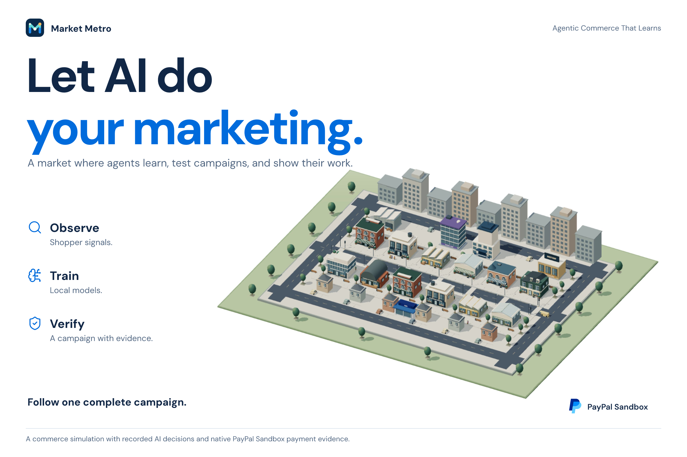
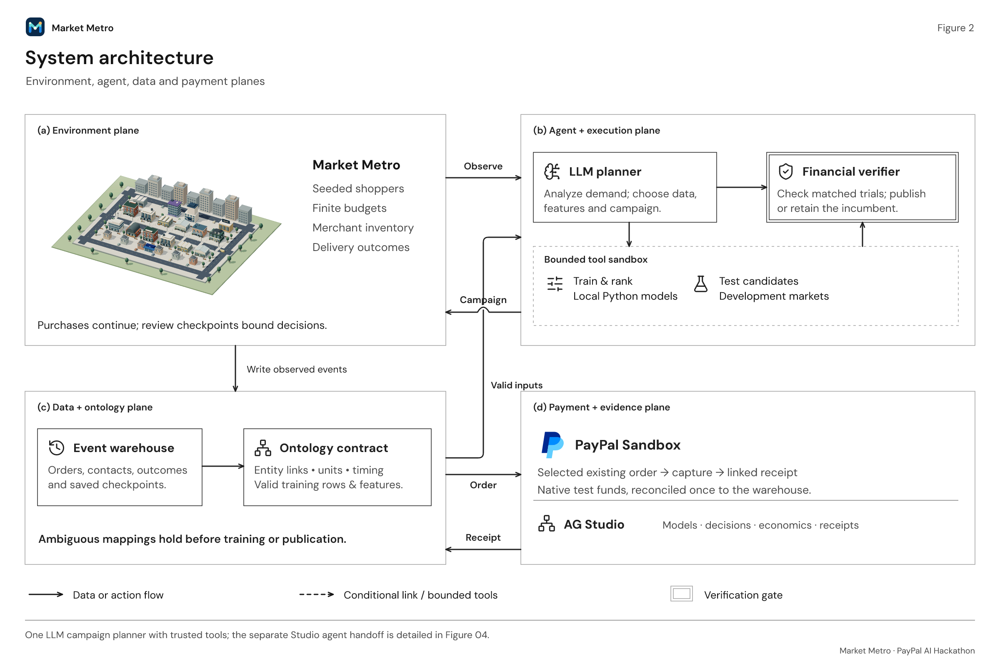
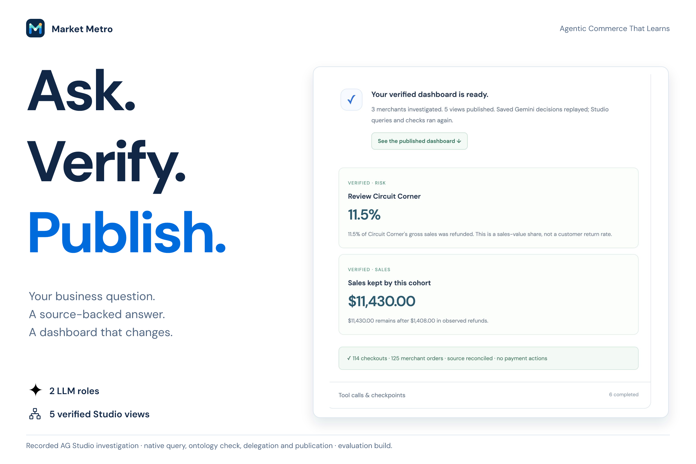
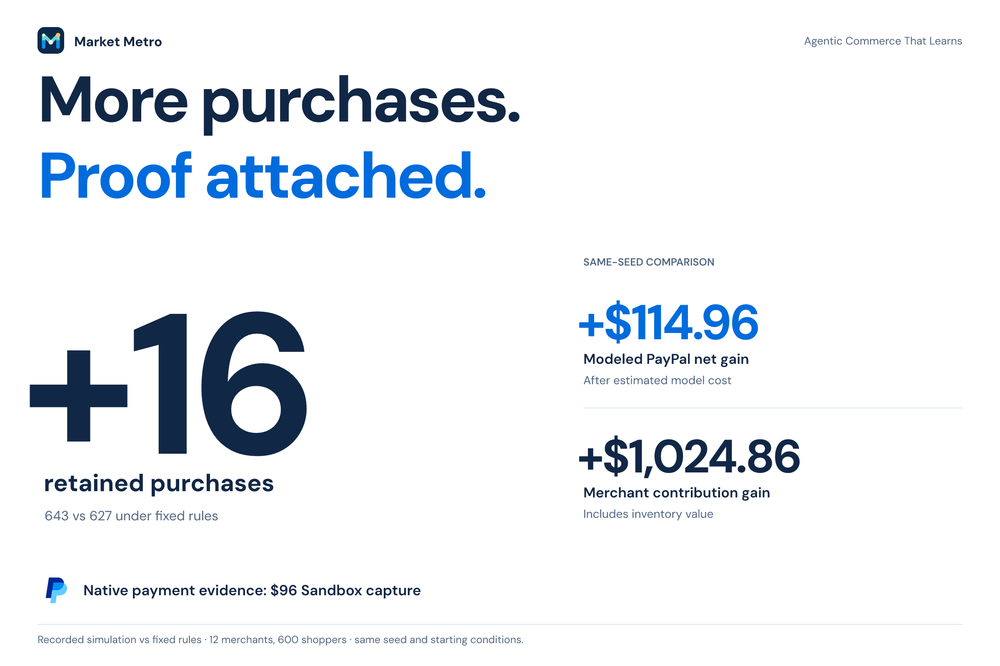

<p align="center"></p>

<h1 align="center">Market Metro</h1>

<p align="center"><strong>Agentic Commerce That Learns</strong></p>

<p align="center">A commerce lab where AI learns from shopper behavior, tests campaigns, and connects decisions to verifiable PayPal payments.</p>

<p align="center">
  <a href="https://market-metro-fifm2aalgq-uc.a.run.app/landing.html"><strong>Live site</strong></a> ·
  <a href="https://market-metro-fifm2aalgq-uc.a.run.app/judge.html"><strong>Judge walkthrough</strong></a> ·
  <a href="https://market-metro-fifm2aalgq-uc.a.run.app/agent-studio.html"><strong>Agent Studio</strong></a> ·
  <a href="docs/judging.md">Testing guide</a>
</p>

<p align="center">
  <a href="https://github.com/VinceVence/market-metro/actions/workflows/submission.yml"></a>
  <a href="LICENSE"></a>
  
</p>

[](https://market-metro-fifm2aalgq-uc.a.run.app/landing.html)

## Try it

**No account, API key, credit card, or PayPal login is needed for the hosted walkthrough.**

| Start here | What to inspect |
| --- | --- |
| [Judge walkthrough](https://market-metro-fifm2aalgq-uc.a.run.app/judge.html) | **Market → Agent decisions → Impact**. Begin at day 1, inspect the review, follow a shopper's purchase, and open the matching receipt. |
| [Agent Studio](https://market-metro-fifm2aalgq-uc.a.run.app/agent-studio.html) | Replay a verified investigation or try a fresh Gemini question while the shared allowance is available. |
| [Intelligence](https://market-metro-fifm2aalgq-uc.a.run.app/analytics.html?run=judge-demo) | Model training, decisions, financial comparisons, LLM usage and lifecycle records in AG Studio. |
| [Ontology explorer](https://market-metro-fifm2aalgq-uc.a.run.app/analytics.html?run=judge-demo&view=ontology) | Trace shoppers, checkout parents, merchant orders, training cases and payment evidence. |
| [PayPal evidence](https://market-metro-fifm2aalgq-uc.a.run.app/analytics.html?run=judge-demo&view=payments) | Verify the existing $96 Sandbox purchase, fees, proceeds and capture ID. |
| [Free new-seed simulation](https://market-metro-fifm2aalgq-uc.a.run.app/studio.html?view=market&judge=1&setup=1&execution=saved) | Run a new 12-merchant, 600-shopper economy using the saved model and campaign, with no new provider calls. |

The guided walkthrough replays recorded AI decisions and existing Sandbox evidence. Fresh campaign planning and payment creation are configured local modes; the separate hosted Agent Studio investigation has a durable shared model allowance. [Full testing instructions](docs/judging.md).

## From customer behavior to a checked campaign

Market Metro makes the entire decision process inspectable:

1. **Observe.** Seeded shoppers generate searches, purchases, deliveries and refunds in a finite economy.
2. **Connect.** The ontology defines identities, checkout grain, money units and eligible training data. Ambiguous mappings hold the workflow.
3. **Learn.** The LLM chooses an investigation, training data, features and model experiments. Local Python tools fit and validate the models.
4. **Test.** The planner proposes campaigns; trusted tools compare exact candidates in separate development markets.
5. **Verify.** Deterministic financial checks select an eligible tested policy or retain the incumbent.
6. **Trace.** Purchases, outcomes, model artifacts and PayPal receipts remain linked to their warehouse records and checkpoints.

There are two distinct agent workflows. **The campaign demo uses one planner plus a financial verifier.** **Agent Studio uses a commerce planner and insight editor**, connected through native queries, delegation, ontology verification and checked dashboard publication. Its analysis does not create additional campaign gains.

[](submission-media/gallery/upload/02-system-architecture.png)

## A measured example

The saved judge campaign uses **12 merchants, 600 shoppers and seed 92111706**, with the same starting conditions for both policies.

| Settled outcome | Fixed rules | Planner + verifier | Difference |
| --- | ---: | ---: | ---: |
| Modeled PayPal net, after estimated AI cost | $3,309.83 | $3,424.79 | **+$114.96** |
| Merchant contribution | $38,928.95 | $39,953.81 | **+$1,024.86** |
| Retained purchases | 627 | 643 | **+16** |
| Payment volume | $90,683 | $93,028 | **+$2,345** |

These are controlled simulation results from one featured run. Merchant contribution includes inventory value. The recorded model-usage estimate is **$0.032325**; modeled PayPal net is not actual PayPal profit. [Saved evidence](demo/data/judge-reactivation.json) · [Method and limits](docs/submission-candidate.md) · [Separate six-seed study](docs/commerce-expanded/model-check/reactivation-fresh/README.md).

## PayPal closes the loop

The selected shopper returned after 16 days and bought a $96 Mobile Side Table. The existing order is linked to native **PayPal Sandbox capture `2M324038C71499318`**, which reconciles **$96.00 gross = $3.56 fee + $92.44 test-merchant proceeds**. Mirroring the order never adds another simulated sale.

The project integrates **Orders/Checkout v2** and **Vault v3** for consented test-wallet purchases. A separate recorded lifecycle trial also verified **Payments refunds**, **Invoicing**, **Catalog Products/Subscriptions offers**, and **Orders shipment tracking**. Unpaid invoices, unapproved subscriptions, and unavailable Payouts/Transaction Search paths keep their actual statuses. All payment actions use Sandbox test funds. [Integration guide and service states](docs/paypal-services.md).

## An agent workspace built with AG Studio

Gemini chooses a merchant cohort, AG Studio's native query tool retrieves it, the ontology verifies the rows, and an insight editor chooses supported views. The custom harness uses **`createAiHarness`**, **`execute_query`**, **`delegate_to`** and **`complete_task`**, with a checked publication tool.

The saved investigation reconciles **125 merchant orders into 114 unique checkouts** and publishes **five verified views**. Native grids and charts expose the underlying records; custom widgets show payment proof and certified counts. Judges can arrange the layout, inspect the framework conversation, and open the tool checkpoints. [Implementation and recorded verification](docs/ag-studio/agent-workspace.md).

<table>
  <tr>
    <td width="50%"><a href="submission-media/gallery/upload/00-05-ask-verify-publish.png"></a></td>
    <td width="50%"><a href="submission-media/gallery/upload/00-06-more-purchases-proof-attached.png"></a></td>
  </tr>
</table>

[View all 15 project images and captions](submission-media/gallery/README.md) · [Download the gallery](submission-media/gallery/market-metro-gallery.zip).

## Run locally

Requires **Node.js 22.16 or newer**. The saved demo needs no credentials or Python setup.

```sh
git clone https://github.com/VinceVence/market-metro.git
cd market-metro
npm ci --ignore-scripts
npm start
```

Open [the local walkthrough](http://127.0.0.1:4173/judge.html) or [landing page](http://127.0.0.1:4173/landing.html).

For local numerical simulation and model fitting:

```sh
uv venv .local/marketing-venv --python 3.12 --cache-dir .local/uv-cache
uv pip install --python .local/marketing-venv/bin/python --cache-dir .local/uv-cache -r scripts/marketing/requirements.txt
npm run test:judge-simulation
```

`npm test` runs the submission checks without model or payment calls. Fresh provider modes require private configuration: [PayPal Sandbox setup](docs/paypal-sandbox.md) · [Gemini setup and spending controls](docs/campaign-workflow/autonomous-gemini.md#spending-and-configuration). Never commit `.env`, wallet tokens, ADC or private keys.

## Built with

| Layer | Technology |
| --- | --- |
| AI planning and investigation | Gemini 3.1 Flash-Lite and Gemini 3.1 Pro Preview through Vertex AI |
| Local learning | Python, NumPy and scikit-learn |
| Agent and data controls | Project-owned ontology, typed tools, checkpoints and deterministic verifiers |
| Commerce evidence | PayPal Sandbox REST APIs |
| Intelligence workspace | AG Studio, AG Grid and AG Charts |
| Market and warehouse | Three.js, Node.js and SQLite |
| Hosting | Google Cloud Run |

The current catalog and customer behavior are authored simulation fixtures. NVIDIA Auto Ontology informed the design; it is not a runtime dependency. The active candidate makes no Channel3 calls.

## Explore the repository

- [Developer guide and experiment index](docs/development.md): optional live modes, larger markets, benchmarks and project layout.
- [Ontology implementation](docs/ontology/README.md): feed validation, checkout lineage and training eligibility.
- [Typed execution contracts](docs/commerce-expanded/harness-v2/typed-execution.md): proposal validation and publication boundaries.
- [Cloud Run deployment](docs/cloud-run.md): setup, runtime identity, public-mode restrictions and service limits.
- [Submission materials](docs/submission-draft.md): project story and technical explanation.
- [Video source and preview](video/README.md): editable Remotion project.

Original code is [MIT licensed](LICENSE). Dependencies and assets retain their own licenses; see [third-party notices](THIRD_PARTY_NOTICES.md). AG Studio evaluation notices remain visible.
