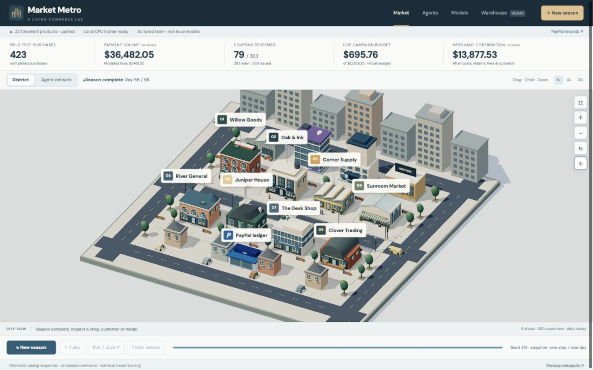

# Market Metro: the learning market

A local 3D commerce tycoon with an orbitable camera, hover inspection and DM Sans throughout the interface. A seeded population browses cached Channel3 products, receives merchant coupons, buys, returns and becomes inactive. A six-role **scripted** marketing workflow defines a business brief, validates observed data, trains real CPU models, launches controlled offers, and measures results. No LLM, paid cloud or catalog search is invoked during a season. Optional native PayPal Sandbox samples use a saved test wallet: up to three selected field-test orders per season, with fictitious funds and no repeated checkout.



The [current four-plane architecture](docs/market-system-architecture.md) shows the emulator, Channel3, PayPal and agent boundaries, including the saved-wallet bridge between selected learning-season purchases and native PayPal captures.

## Run

Requirements: Node.js 22.16+ and Python 3.12 for the local trainer.

```sh
npm ci
uv venv .local/marketing-venv --python 3.12 --cache-dir .local/uv-cache
uv pip install --python .local/marketing-venv/bin/python --cache-dir .local/uv-cache -r scripts/marketing/requirements.txt
npm run dev
```

Without uv, create the same environment with Python 3.12's venv module and install the requirements using its pip. Setup downloads open-source packages; it does not configure cloud services. A fresh clone uses authored sample products and starts without any saved buyer, receipts or simulation database. No provider account is needed to run the economy and local models.

Open http://127.0.0.1:4173/. The server binds to loopback only. `npm test` runs all regression checks; `npm run test:marketing` includes real local training. Real training checks explicitly skip when the Python environment is absent.

### Optional provider setup

1. Copy `.env.example` to `.env` if `.env` does not already exist.
2. For PayPal, set `PAYPAL_CLIENT_ID` and `PAYPAL_CLIENT_SECRET` from a **sandbox** REST app in the [Developer Dashboard](https://developer.paypal.com/dashboard/). Keep `PAYPAL_ENVIRONMENT=SANDBOX`, restart the server, and open `/sandbox-buyer.html` for the one-time test-buyer consent described below.
3. For Channel3, set `CHANNEL3_API_KEY` and set `CHANNEL3_FREE_CREDITS_CONFIRMED=true` only when using your sponsor/free-credit allocation. Open `/metropolis.html` and explicitly select **Sync Channel3**, then create a new learning season to use the cached products. No automatic catalog search runs during a season.

Your credentials, wallet consent and generated database remain under ignored local paths. The repository includes source and validation reports, not a reusable copy of the developer's accounts.

## Walkthrough

1. **New season:** choose the objective, population, seed, virtual budget, shock and workflow.
2. **Days 1–28:** observe history and randomized exploratory offers. History spending is separate from the live budget.
3. **Day 29:** fit logistic regression and a small decision tree, reserving the latest seven days for temporal validation.
4. **Field test:** a persistent 25% customer holdout receives no live coupons. Eligible treatment customers receive model-selected offers or a disclosed rule fallback.
5. **Day 36:** the configured market conditions change. The adaptive coordinator waits for completed outcomes before its scenario-driven review.
6. **After days 42 and 56:** report 14-day inactivity in the baseline-active randomized cohort, signed lift and an approximate 95% interval.
7. **Model bench → Compare four policies locally:** replay no offers, fixed rules, scheduled ML and adaptive coordination under matched inputs.
8. **PayPal records:** inspect verified native receipts, select existing emulator orders to mirror, or open the order-to-capture warehouse view.
9. **Warehouse:** inspect or export tables, views, fitted artifacts and coupon-to-payment lineage.

Pause, advance a day, run seven days, or finish a season. Drag to pan the 3D map, right-drag to orbit, and scroll to zoom. Distinct heritage stores, showrooms, supply sheds, offices and street furniture form the commerce district. Screen-space shop names retain readable DM Sans text while the camera moves; nearby labels are repositioned to avoid collisions. Hover over people or stores for current details; click to open a details dock that reflows the map instead of covering it. The inspector also offers keyboard-accessible selection. With the canvas focused, arrow keys pan, R rotates and Home resets. A stable sample of up to 32 customers follows sidewalk routes; refreshed data does not reset in-progress movement. Customers stop at their recorded destination and people who return home disappear inside. One simulation step is one day; visual motion replays that day and creates no additional transactions.

## Agent workplaces in the district

Switch **District → Agent network** to locate the team. Lines show workflow dependencies, not live messages. Click a workplace to open its responsibilities and recorded decisions; click a role to focus the camera on its building.

| Workplace | Role | Implemented responsibility |
| --- | --- | --- |
| Operations HQ | Business lead | Records the chosen objective and budget; flags the configured market change. |
| Data Exchange | Data engineer | Builds completed-day observed features and enforces the data cutoff. |
| Model Lab | Data scientist | Fits logistic regression and a tree on the local CPU; produces offer-response scores. |
| Model Lab, evaluation desk | Experiment analyst | Checks temporal validation and randomized holdout outcomes, with uncertainty. |
| Operations HQ, control room | Coordinator | Requests reviews, promotes or rejects candidates, and keeps the existing policy on failure. |
| Campaign Studio | Campaign manager | Issues eligible coupons under budget, contact, stock and margin constraints. |
| PayPal ledger | Payment connection | Captures selected orders using a saved sandbox wallet and joins real provider IDs, fees and verification timestamps to those emulator orders. |

The feedback path is **city events → observed warehouse → models → review → offers → purchases → payment ledger → warehouse**. All six team roles are scripted today. Their local model training is real, but there is no LLM planner and the diagram does not establish autonomous-agent superiority.

## Data and capability boundaries

- **Real catalog:** 22 Channel3 products imported on October 21, 2026, preserving IDs, prices and source URLs. New seasons reuse the cached snapshot. Without a cache, explicitly labeled authored products are used.
- **Real local ML:** scikit-learn fits each season's observed rows. Saved JSON artifacts contain actual coefficients/scales or tree thresholds/probabilities. JavaScript predictions must match Python predictions before use.
- **Scripted coordination:** task choices and messages follow code and measured conditions. There is no LLM planner and no demonstrated LLM-agent advantage.
- **Simulated economy:** customers, merchants, inventory, coupons, payments, delivery, returns and market changes are fictional.
- **PayPal:** selected orders now use a saved sandbox PayPal wallet. Native captures, fees, net amounts and IDs are read back from PayPal and stored in `paypal_receipts`; `v_paypal_order_lineage` joins them to orders, merchants, products and coupons. The earlier standalone $100 receipt remains separate. The blocked legacy card path is not used by this wallet flow.

Customer scores are our fitted predictions, not Channel3 customer data or proprietary Channel3 scores.

For a fresh Channel3 import on another machine, follow the existing .env setup in README-market-metro-v1.md, open /metropolis.html and choose Sync Channel3. This is an explicit provider request using the configured credits. Then create a new learning season to use the cached result. The learning-market UI never syncs automatically.

## Native sandbox payment samples

The reusable sandbox buyer is already configured on this machine. **New season** defaults to three native samples when the saved buyer is ready; zero or one can also be selected. Automatic samples begin after the 28-day learning history and never exceed the selected count. Matched-policy comparisons always run without provider calls.

For another machine, open `/sandbox-buyer.html` and approve a generated Personal sandbox account once. The server verifies approval through Payment Method Tokens v3 and stores the resulting wallet token in the ignored, owner-readable `.local/paypal-vault-setup.json`. Use the sandbox account credentials from the Developer Dashboard. Do not enter real card details. A sandbox app's Client ID and Client Secret are server credentials, not the buyer login.

**PayPal records** also lets you choose existing field-test orders. The server reads the authoritative order amounts, permits at most three orders and $1,000 of test funds per season, writes stable request IDs before calling PayPal, and verifies the returned order reference, emulator order ID, invoice, USD amount, capture and fee/net reconciliation. A retry reuses the same request identity. Uncertain requests older than the conservative five-hour retry window require reconciliation rather than a fresh charge attempt.

One consenting sandbox buyer represents the selected synthetic customers; all fictional stores settle to the connected sandbox merchant. This is not a multi-merchant onboarding implementation. Native receipts do not add revenue to the simulated ledger. Native timestamps remain separate from simulation dates. Simulated buyer refunds do not issue provider refunds. Live PayPal hosts and live mode are unsupported.

The saved consent was verified across a server restart and two seasons: three main-season captures ($192.59 total) and one automatic second-season capture ($31.99), without another checkout. See [native integration validation](docs/paypal-wallet-integration-validation.json).

## Experiment contract

Private customer traits include preferences, coupon response, loyalty, spending capacity and affinity. Training sees only observed pre-offer history, price, stock, payday and market conditions. Hidden traits are excluded from model inputs, public frames and exports.

External random draws are keyed by seed, customer, day and event kind. Policy changes do not change unrelated randomness. Comparison policies share identical history. Live inventory is partitioned between treatment and holdout so treatment demand cannot exhaust holdout stock.

The model predicts **a purchase during the next simulated day given the offer**. This differs from the evaluation's 14-day inactivity outcome. Current/future days are excluded from fitting. A candidate must improve validation log loss by at least 0.001 against both the fitted offer-rate baseline and any current champion. The selected candidate is then refit using already-observed rows. Rejection or failure preserves the current policy.

A scenario change is a disclosed scripted review trigger. After the first review, a follow-up runs once changed-condition days exist in both fitting and validation windows. Weekly checks can also trigger adaptive training if recent prediction loss exceeds the champion's validation loss by 20%. Scheduled ML retrains every seven live days. These are workflow rules, not learned orchestration.

Coupons are single-customer, single-product, single-day and single-use. Live contacts have a seven-day gap. Maximum discounts are reserved before issuing. Redeemed discounts plus assumed 2-cent outreach cannot exceed the virtual budget. A 20% post-fee/fulfillment order-margin floor applies. The profit objective additionally requires positive estimated incremental contribution.

Costs are assumed at 42–58% of catalog price, delivery at $3.50, and transaction fees at 3.49% + $0.49 (**not quoted PayPal rates**). Returned goods are not resold and COGS remains charged. Discounts already reduce payment volume; contribution deducts COGS, delivery, fees, refunds and outreach without subtracting discounts twice.

Retention uses the baseline-active randomized cohort, including eligible treatment customers who receive no coupon. Reported reduction is aggregate, signed and uncertain. Repeated windows reuse customers; do not add them as distinct saved people. Small samples and intervals spanning zero do not establish benefit. Results describe the authored simulator, not production ROI or PayPal profit.

## Warehouse

`.local/market-metro.sqlite` contains **24 public base tables and 11 SQL views**. Private `run_state` is excluded from exports.

New tables: `business_goals`, `campaign_assignments`, `coupons`, `coupon_redemptions`, `customer_days`, `model_runs`, `model_scores`, `team_decisions`, `retention_results` and `policy_comparisons`.

Views include `v_coupon_journey`, `v_learning_daily`, `v_model_history`, `v_retention_experiments` and `v_paypal_order_lineage`. Customer-day records pair a pre-action feature snapshot with the subsequently observed label. Model records preserve cutoffs, dataset hashes, candidate losses and fitted artifacts.

SQLite exports include one selected run and working views. JSON/CSV preserve full IDs, provenance and integer cents. Credentials, private state and payment request keys are omitted. Comparison run IDs are references to separate runs; a selected-run export retains comparison summaries without embedding all compared datasets. Campaign attribution alone is not causal lift.

## Code

- `demo/garden/world.mjs`: locally served Three.js 0.180 scene, people, camera controls, readable place labels and the workflow overlay.
- `demo/garden/city-art.mjs`: original, distinct retail and infrastructure architecture; street furniture and contextual city blocks.
- `demo/garden/agent-roles.mjs`: implemented role responsibilities and their map locations.
- `demo/garden/tycoon-motion.mjs`: tested sidewalk routing, continuous motion and pedestrian spacing.
- `demo/garden/app.mjs` and `style.css`: brief, town, team, models, comparisons and warehouse.
- `scripts/paypal-funding.mjs`: one-time sandbox wallet consent, private durable vault token and subsequent merchant-initiated payment source.
- `scripts/market-service.mjs`: bounded order selection, saved-wallet captures, idempotency and native receipt reconciliation.
- `scripts/marketing/economy.mjs`: seeded customer behavior, coupons, inventory and outcomes.
- `scripts/marketing/contract.mjs`: public feature contract, schema and portable inference.
- `scripts/marketing/train.py` and `trainer.mjs`: local fitting, validation, worker limits and parity checks.
- `scripts/marketing/orchestrator.mjs`: scripted roles, training decisions and fallback.
- `tests/city-art.test.mjs`: valid geometry and addressable workplaces for 8- and 12-merchant districts.
- `tests/tycoon-motion.test.mjs`: route clearance, stable refreshes and a crowded two-way replay.
- `tests/marketing-learning.test.mjs`: replay, seed changes, real training, accounting, isolation and failure behavior.

The previous metropolis remains at /metropolis.html and the reserve lab at /supply-yard.html. Historical setup is preserved in [README-market-metro-v1.md](README-market-metro-v1.md) and [README-supply-yard.md](README-supply-yard.md). The current demo needs no cloud infrastructure.

## License

Original project code is [MIT licensed](LICENSE). Fonts, dependencies, trademarks and provider data retain their respective terms; see [third-party notices](THIRD_PARTY_NOTICES.md).
