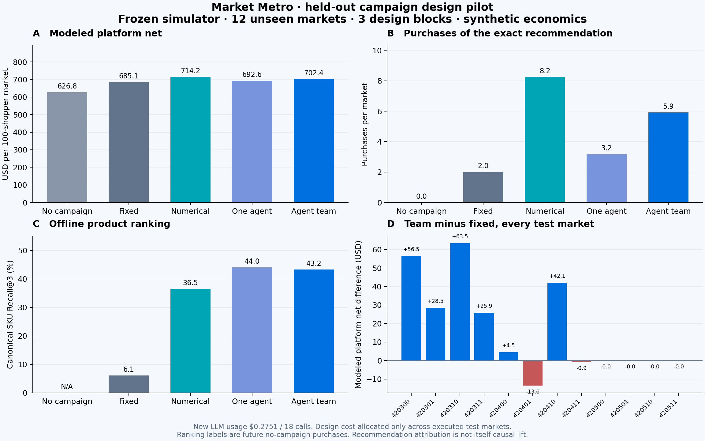

# Campaign construction: multi-agent performance

The research-backed system is implemented. The predeclared advancement gate **did not pass**. This is a 12-market synthetic pilot covering six scenarios and three separately constructed policies per architecture.

The existing workspace now includes **Performance**, individual decision checkpoints and a replay of the first held-out seed. The new design is an experimental replay; the **New live run** default remains unchanged because the advancement gate failed.

## What actually changed

Two independently prompted specialists construct typed ranking, audience, timing and coupon configurations. A trusted local simulator measures four proposals. A coordinator reads those results and constructs one refinement. A deterministic validation checkpoint selects a candidate meeting the validation merchant guard or the existing fixed fallback. EASE and count features are fitted locally; no per-shopper LLM calls and no generated SQL.

The single-agent control receives the same Pro model, three calls, five candidate evaluations and allowed features. Its later calls see its previous trials. Numerical search evaluates five diverse configurations in the same action space. The fixed weekly policy is preserved. No simulator parameter changed.

## Held-out results

| Approach | Platform net / market | Merchant contribution / market | Orders / market | Exact recommendation purchases / market | SKU Recall@3 | Construction cost |
|---|---:|---:|---:|---:|---:|---:|
| No campaign | $626.82 | $8479.76 | 370.8 | 0.0 | N/A | $0.000000 |
| Fixed weekly campaign | $685.15 | $9650.76 | 395.9 | 2.0 | 6.1% | $0.000000 |
| Numerical search | $714.19 | $9835.70 | 440.9 | 8.3 | 36.5% | $0.000000 |
| One generalist | $692.61 | $9527.30 | 419.2 | 3.2 | 44.0% | $0.136852 |
| Specialist team | $702.36 | $9621.34 | 432.9 | 5.9 | 43.2% | $0.138262 |

- Team versus No campaign: +$75.54 modeled platform net and +$1141.58 merchant contribution per market; 12/12 positive platform comparisons.
- Team versus Fixed weekly campaign: +$17.21 modeled platform net and −$29.42 merchant contribution per market; 6/12 positive platform comparisons.
- Team versus Numerical search: −$11.84 modeled platform net and −$214.36 merchant contribution per market; 3/12 positive platform comparisons.
- Team versus One generalist: +$9.75 modeled platform net and +$94.04 merchant contribution per market; 9/12 positive platform comparisons.

Total new provider usage: **$0.275114 across 18 calls**. Every role used Gemini3.1 Pro with MEDIUM reasoning. Invalid candidate configurations: 0.

## Cost and uncertainty

Construction is paid once per policy design. The primary net result allocates that observed cost across the four test markets where the policy was actually executed. The JSON also reports a conservative full construction charge on every individual market. It does not amortize over hypothetical future traffic. Local CPU times are recorded; local hardware electricity and developer labor are not monetized.

- Team versus No campaign, exploratory 95% interval using three design-block means: [+$47.26, +$103.81].
- Team versus Fixed weekly campaign, exploratory 95% interval using three design-block means: [−$40.42, +$74.84].
- Team versus Numerical search, exploratory 95% interval using three design-block means: [−$49.65, +$25.98].
- Team versus One generalist, exploratory 95% interval using three design-block means: [−$46.34, +$65.83].

Twelve market seeds do not equal twelve independently designed policies. Intervals are wide with only three design blocks. Observed gains are not proof of production transfer or universal multi-agent superiority.

## Role contribution and latency

Average design wall time: numerical search 2.5s, one agent 40.0s, specialist team 48.1s. The team used 28727 input tokens and 6734 output/thinking tokens. All 18 provider calls completed; all 30 LLM proposals passed typed validation. This is execution reliability, not a guarantee of decision quality.

The coordinator refinement was selected in 0/3 design sessions. The two learned team policies came from the recommendation specialist; the third session kept the fixed fallback. The economist and coordinator participated, but this pilot does not establish their incremental economic value. The single-agent versus team mean difference also has an interval spanning zero. Do not present this as proof that three agents are necessary.

## Measurement boundaries

- Recommendation purchase requires the exact offered merchant/product and `behavior_recommendation` order channel. Merely buying after a contact does not qualify.
- Coupon purchases use the recorded coupon channel and redemption data. Coupons issued are not sales.
- Offline ranking uses a day 30 snapshot and future no-campaign purchases in days 31–37. Canonical SKU deduplication is identical across policy, count-affinity and popularity rankers. Ranking and causal intervention profit are separate metrics.
- Economic outcomes include retained fees, modeled processing costs, subsidy, outreach, delayed returns and AI usage. Merchant contribution includes COGS and delivery. Fees and costs are authored assumptions, not PayPal financial disclosures.
- The initial 30 days and exogenous random draws are shared within each paired market. Private tastes, wallets, need and future returns are excluded from agent input. Models refit every 14 days using completed observations only.
- Development tools reveal simulation outcomes only for development seeds. Validation chooses a policy without exposing validation scores to the LLM. All selections are frozen before opening test seeds.
- Saved candidate checkpoints are research-time decisions. Replaying them is not a fresh LLM run, and executing thousands of shopper actions is not thousands of LLM decisions.

## Research basis

The implementation combines targeted measured refinement from [MLE-STAR](https://research.google/blog/mle-star-a-state-of-the-art-machine-learning-engineering-agents/), independent recommendation perspectives from [Multi-Agent Collaborative Filtering](https://arxiv.org/abs/2511.18413), and cheap [EASE](https://arxiv.org/abs/1905.03375) fitting. Cost-matched comparisons follow [AI Agents That Matter](https://arxiv.org/abs/2407.01502). These papers motivate the architecture; they do not establish its commerce profitability.

Full Hyperresearch report: [research report](../../research/notes/final_report_commerce-agent-performance-e46beb.md).

## Reproduce

`node --test tests/commerce-design-v2.test.mjs` runs local accounting, leakage and schema checks. Protocol and source hashes are in `trial-1/protocol.json`. `benchmark.mjs design` skips completed checkpoints, refuses failed/uncertain retries, and enforces both per-design and experiment limits. `benchmark.mjs test` refuses to overwrite test outcomes. Historical pilots remain unchanged.

Local verification: `node scripts/commerce-design-v2/verify.mjs` checks source hashes, disjoint seeds, checkpoint timestamps, provider ledger costs and warehouse replay parity. [Completion audit](completion-audit.json) and [UI checks](ui-check.json) record their actual scope.
