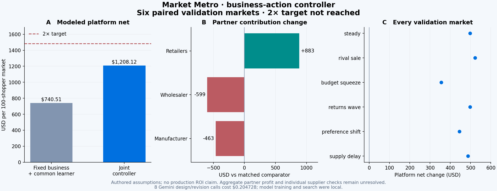

# Business-action controller: current evidence

**Goal active.2× not achieved.** The strongest feasible candidate reached **1.638×** on six new validation markets. These markets selected the controller; they are not a final test.

| Metric | Comparator | Controller | Difference |
|---|---:|---:|---:|
| Modeled platform net after all design cost | $768.37 | $1258.39 | +$490.01 |
| Retailer contribution | $10213.53 | $11381.50 | +$1167.97 |
| Wholesaler contribution | $3374.90 | $2933.53 | −$441.38 |
| Manufacturer contribution | $3166.30 | $2853.03 | −$313.27 |
| Aggregate partner contribution | $16754.73 | $17168.05 | +$413.32 |
| Terminal partner cash | $32369.52 | $32779.59 | +$410.07 |
| Retained shopper volume | $28547.90 | $29636.79 | +$1088.89 |

Purchases: 441.3 → 439.8 per market. Purchases of the exact recommended product: 4.50 → 6.17.

The comparator uses fixed commercial settings with the same learned campaign tools. A discovery-policy fallback includes a fitted local model; it must not be labelled a purely scripted rule baseline.

## What changed

Three fresh Gemini specialist calls proposed demand, commercial and lifecycle components. Three matched generalist calls were also evaluated. All initial fully composed plans failed the financial gate. Component preservation, local response-model training, numerical joint search and a liquidity checkpoint produced this controller. It sets merchant prices to [10,0,0]%, routes both supplier stages through the modeled PayPal rail, and reduces inventory cover to7 days on day70. Replenishment invitations require observed interest and explicit simulated consent. Local regressors estimate incremental value over the incumbent action; they do not read private shopper traits or future outcomes.

## Why this is not a2× win

Most platform uplift comes from paid supplier invoices. Retail payment contribution changes by +$20.11 while network payment contribution changes by +$470.04. Wholesaler and manufacturer contribution decrease even though aggregate partner contribution and cash pass the registered checks. These losses must not be hidden behind the aggregate. No final target test was opened.

## Cost and limits

Six model calls cost $0.14 (0.140734 precisely); all later work used local CPU. The recorded lifetime estimate is $3.36 with 0 unsettled entries. These are token-price estimates, not a billing invoice.

- All customer behavior, fees, costs, bank delays, inventory and subscription consent are authored simulation assumptions.
- No new PayPal API or Channel3 calls in this benchmark. Orders and supplier invoices are simulated; earlier Sandbox receipts remain separate.
- The current catalogue is independently authored; no Channel3 product data is used.
- The six Gemini calls proposed business components. Local models and numerical search built the subsequent controller; these are not fresh autonomous LLM decisions for every shopper.
- The100-day campaign has a known endpoint. Inventory cover drops to7 days on day70; this needs separate testing before claiming year-round performance.
- Aggregate gates do not establish that every counterparty benefits. Wholesaler and manufacturer losses are shown explicitly.
- No2x claim, no production PayPal profit claim, no claim that additional agent roles have been causally validated.

