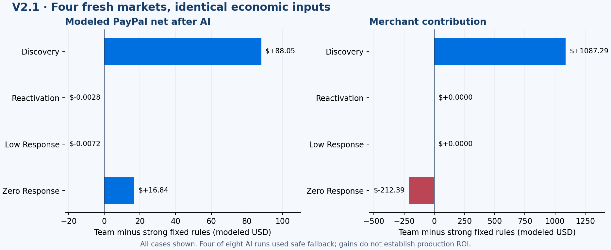

# V2.1: fresh decisions on four unseen markets

**Mean modeled PayPal net rose $26.22 (0.71%) versus strong fixed rules after AI cost.** Merchant contribution rose $218.73 and retained purchases rose 3.5 per market. This is progress, not a decisive generalization result: one market supplied all additional purchases, and four of eight AI workflows fell back after errors.

| Mean per 600 shoppers | Fixed | One planner | Three-role team |
|---|---:|---:|---:|
| PayPal contribution after AI | $3,693.98 | $3,693.96 | $3,720.20 |
| Merchant contribution | $43,953.30 | $43,953.30 | $44,172.02 |
| Retained purchases | 679.0 | 679.0 | 682.5 |
| Retained payment volume | $98,215.50 | $98,215.50 | $98,670.75 |

## What happened

- **Discovery:** the analyst investigated the payment funnel, selected intent-context features and identified general inquiries as an opportunity. The scientist trained and compared local models. The manager tested an intent-assistance campaign, then raised its contact ceiling from 36 to 60/day. Code selected the better tested revision. On the fresh market: +14 retained purchases, +$88.05 PayPal net, +$1,087.29 merchant contribution. The single planner retained fixed rules.
- **Reactivation:** a duplicate revision ended the single planner's reviews; a provider HTTP 502 stopped the team. Both safely kept fixed rules, with their incurred AI costs counted.
- **Low response:** the single planner's campaigns failed the development gate. A provider HTTP 502 stopped the team. Both retained fixed rules.
- **Zero response:** the single planner hit a provider HTTP 502. The team changed its campaign/supply policy: +$16.84 PayPal net but **−$212.39 merchant contribution and no extra purchases**. This is not a joint commerce win. Passing two development markets did not protect this different market.

All 12 financial runs completed and settled liabilities. Four AI review workflows failed; these are different measures. There were 63 fresh provider calls, 20 actual local model fits and two publications. Model usage cost was **$0.128868**; the shared project ledger reached **$5.244555**. These are token-price estimates, not a cloud billing invoice. Earlier aborted diagnostics remain archived and are included in project spend.

## Evidence and boundaries

[Protocol](protocol.json) froze cases, tools, costs and source hashes before evaluation. [All results and checkpoints](results.json) include losses and provider failures. Each arm used identical initial states, needs, consent, income and shocks; both AI approaches received the same model/tools/call allowance. The original and expanded economies were verified unchanged. No confirmation outcome was sent back to the agents. Development trials used separate 12-merchant/600-shopper worlds.

[First-market accounting](first-market-proof.json) reconciles its +$88.05 to retail fees, supplier fees, processing, outreach, fee refunds and model cost. Closing cash increased and inventory decreased in that market. Across all four markets, mean inventory increased 2.34%; merchant contribution includes inventory accounting.

[Recorded replay](replay.json) rebuilds all 126 frames and reproduces the original financial totals with zero new model calls. The [subsequent $34 native Sandbox receipt](native-receipt.json) links a real test capture to one existing merchant order. It is not added to simulated revenue and never repeats during playback.

Role labels alone do not establish multi-agent necessity. This pilot compares complete workflows with fresh choices; it does not isolate each role's causal contribution. Four markets and one purchase-improving case do not establish repeatable production ROI.

## Next work under the active goal

Add bounded handling for transient model-service failures and unchanged proposals, carry prior experiment results and the exact incumbent into later reviews, and make the manager confront observed response/merchant tradeoffs. Preserve these results. Any changed architecture needs new registered cases before promotion.
