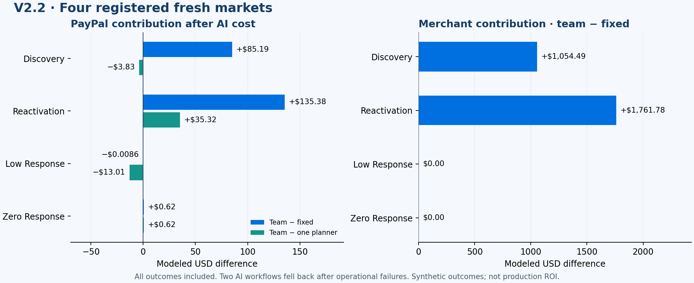

# V2.2: stronger measured commerce, two operational failures

The three-role team increased mean modeled PayPal contribution by **$55.30 (1.47%)** versus strong fixed rules after AI cost. Merchant contribution increased **$704.07**, retained purchases **9**, and retained payment volume **$1,372.75** per 600-shopper market. All four cases, including failures, remain in the result.

| Mean per market | Fixed | One planner | Three-role team |
|---|---:|---:|---:|
| PayPal net after AI | $3,772.73 | $3,823.25 | $3,828.03 |
| Merchant contribution | $44,980.98 | $45,571.27 | $45,685.05 |
| Retained purchases | 703.50 | 713.25 | 712.50 |
| Retained payment volume | $100,755.25 | $102,029.75 | $102,128.00 |
| Closing partner cash | $155,339.03 | $156,272.55 | $156,388.43 |
| Closing inventory | $6,270.95 | $6,194.71 | $6,183.78 |

The team earned $4.77 more modeled PayPal net and $113.78 more merchant contribution than one planner, but produced 0.75 fewer purchases. This small four-case difference does not establish general multi-agent superiority. V2.1 used different confirmation seeds; comparing the two cohort averages is not a paired architecture-effect estimate.

## What the agents did

The analyst selected an investigation, feature recipe and window. The scientist chose and trained local model candidates, then selected an artifact using measured validation. The manager proposed and revised campaigns using financial trials. Code also tested the same initial campaign with incumbent supply preserved, and retained the best eligible measured candidate.

In the discovery run, the team chose a response-hurdle model and intent assistance. Its initial combined campaign/supply proposal gained $16.33 PayPal contribution per development market. Keeping the same campaign with incumbent supply gained $40.29. Pro's larger-contact revision gained $36.06, so the deterministic publisher kept the better supply-preserved version. On the fresh discovery market this delivered **16 additional retained purchases, +$85.19 PayPal net and +$1,054.49 merchant contribution**.

On the fresh reactivation market, the team added **20 retained purchases, +$135.38 PayPal net and +$1,761.78 merchant contribution**. The zero-response case added no purchases or merchant contribution; its $0.62 net gain was outreach savings after AI cost. Do not present that case as purchase growth.

The action mix shifted toward general needs inquiries. Mean contacts decreased from 2,006.75 to 1,970; SKU recommendations decreased from 2,006.75 to 1,148.5. Recommendation-matched purchases also decreased. The supported gain is total retained commerce and net contribution, not an increase in every recommendation metric.

## Reliability and cost

Six of eight AI workflows completed; two safely retained fixed rules:

- The low-response team lost its local trial process before receiving a result. The failure timing matched the four-minute limit, but the original log did not retain structured exit metadata. Re-executing the identical development input completed in 64.508 seconds with no model calls. This points to an execution/recovery issue; it does not demonstrate a bad campaign choice.
- The zero-response single planner could not obtain a Google token. No model call was made. A subsequent team run authenticated successfully. Initialization needs a bounded retry for transient read failures.

There were **77 provider calls, 26 actual local fits and six publications**. No model HTTP retry was required in this live cohort; that recovery path was checked using controlled failures. Model usage cost was **$0.500226**, bringing the shared ledger to **$5.744781**, with no unsettled entries. These are token-price estimates, not a cloud billing invoice. Local CPU time is measured but not assigned a dollar cost.

## Recorded demo and payment evidence

[Open the recorded V2.2 market](http://127.0.0.1:4173/studio.html?session=AUTONOMY-e25772eb0a67670d). [Replay verification](replay.json) confirms all 126 frames and the original financial totals, with zero new model calls.

On displayed day 33, returning shopper BUYER-0083 responded to a general needs inquiry and funded a **$96 basket**; it arrived on displayed day 34. Fixed rules did not capture that request. This is an illustrative post-hoc example; all displaced purchases and losses remain in aggregate outcomes. [Financial bridge and customer trace](first-market-proof.json).

The $96 order was then mirrored to PayPal Sandbox using the saved buyer: capture **9S3344048D797830K**, fee **$3.56**, merchant proceeds **$92.44**, fictitious funds only. [Native receipt](native-receipt.json). The receipt is joined to its existing warehouse order and never counted as another simulated sale. Playback does not repeat the payment.

## Reproduction and scope

[Protocol](protocol.json), [full outcomes and checkpoints](results.json), [model reports](model-reports.json), and [trajectory hashes](trace-manifest.json) preserve the evidence. Fixed, single and team use identical initial states, needs, consent, income and shocks on each registered seed. Both AI approaches receive the same model routing and limits. The original and expanded economic kernels remain unchanged.

Training and development trials are separate from confirmation. Development adds an existing no-response scenario, not a new economic rule. Customer behavior and prices are authored assumptions; Sandbox receipts establish integration, not production PayPal profit. Operational recovery remains open under the active goal; the two failures have not been replaced or hidden.
