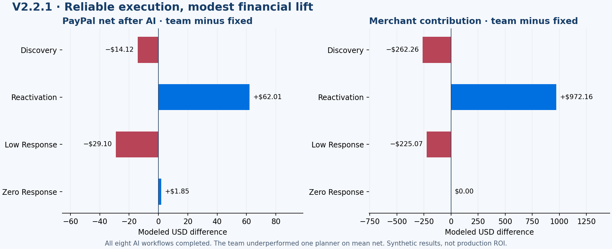

# V2.2.1: reliable execution, weak incremental lift

All eight fresh AI workflows completed on the four registered seeds. The team improved mean modeled PayPal net by **$5.16** and total merchant contribution by **$121.21** versus fixed rules, but **underperformed one planner** by $14.72 PayPal net and $56.26 merchant contribution. This does not establish a financial advantage from the team architecture. The goal remains active.

| Mean per 600 shoppers | Fixed | One planner | Three-role team |
|---|---:|---:|---:|
| PayPal net after AI | $3,870.97 | $3,890.85 | $3,876.13 |
| Merchant contribution | $46,083.21 | $46,260.68 | $46,204.42 |
| Retained purchases | 716.75 | 720.50 | 719.75 |
| Retained volume | $102,628.25 | $102,851.50 | $102,710.25 |

The discovery case increased purchases but reduced net and merchant contribution. Reactivation improved both. The team's low-response case lost money, while the single planner made a small gain. No-response gains were cost savings, not purchase growth. Every case is included in [results.json](results.json).

The comparison cost **$0.655548** in metered-token estimates; cumulative project usage reached **$6.400329**, below the $8 ledger cap. No native payments were made in this benchmark. [Protocol](protocol.json), [model reports](model-reports.json), and [trajectory hashes](trace-manifest.json) preserve the evidence. No live recovery was required in this cohort; controlled recovery checks and the actual historical-input replay are separate evidence in [recovery-replay.json](evidence/recovery-replay.json).

## Next hypothesis: match the inquiry model to its data

A general needs inquiry has no product SKU, so the shared feature vector uses placeholder product age/stock values. Product recommendation quality therefore does not establish inquiry-value quality. Two free, numerical development probes compared the current classifier, the locked-v1 inquiry reward estimator, and a response-calibrated value model. [All development inputs, source and results](../inquiry-value-development.json).

The old v1 estimator was weaker than the current classifier in this probe and is not promoted. The response-calibrated value prototype models reply probability separately from later payment/merchant value. Only past replies adjust response estimates; only mature outcomes update value. Regularization/pseudo-count strength 8 and a 28-day response window are explicit modeling assumptions.

| Development policy | Mean PayPal gain vs fixed | Merchant gain | Retained-purchase gain |
|---|---:|---:|---:|
| Current classifier, recent inquiries | $40.29 | $246.50 | 5.00 |
| Current classifier, broad inquiries | $60.32 | $861.31 | 14.67 |
| Calibrated value, recent inquiries | $42.99 | $400.55 | 5.00 |
| Calibrated value, broad inquiries | $55.20 | $672.27 | 11.33 |

Broad classifier outreach lost PayPal contribution in the low-response and zero-response development cases. Calibrated broad inquiry had nonnegative payment and merchant differences in all three development cases. This motivates a bounded production implementation and fresh confirmation; it is not an agent-selected result or proof of unseen improvement. No economic parameters were changed and neither probe made model/API calls.
