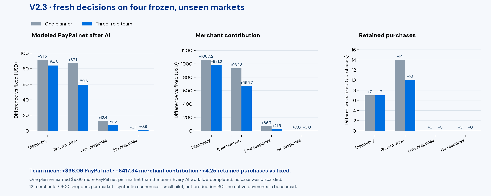

# V2.3: reliable autonomous commerce with positive net, not a team-performance win

The three-role team improved modeled PayPal net after AI cost in **all four registered unseen markets**. Aggregate merchant contribution increased in three and was unchanged in the no-response case. All eight fresh AI workflows completed, with **96 provider calls, 32 real local fits, 11 publish decisions and zero unpaid liabilities**. The original and expanded economic sources stayed unchanged.

Across the four markets, the team added **$152.37 PayPal net, $1,669.35 merchant contribution and 17 retained purchases** versus strong fixed rules. The mean PayPal improvement was **1.01%**, not 2×. One planner did better overall: the team averaged **$9.66 less PayPal net, $97.47 less merchant contribution and one fewer retained purchase**. This demonstrates a working profitable workflow in this pilot; it does not demonstrate that three LLM roles outperform one planner.

| Mean per 600-shopper market | Strong fixed | One planner | Three-role team |
|---|---:|---:|---:|
| Modeled PayPal net after AI | $3,785.59 | $3,833.35 | $3,823.69 |
| Merchant contribution | $45,622.32 | $46,137.13 | $46,039.66 |
| Retained purchases | 711.25 | 716.50 | 715.50 |
| Retained payment volume | $101,008.50 | $102,021.50 | $101,788.25 |
| Closing partner cash | $155,952.39 | $156,625.11 | $156,471.48 |
| Closing merchant inventory | $6,057.52 | $6,185.78 | $6,178.36 |
| Model cost per paid run | — | $0.053222 | $0.051953 |

Partner cash includes merchants and upstream suppliers. Merchant contribution includes inventory accounting and is not all realized cash. The primary platformUSD field and the table above deduct AI cost; legacy normalized simulator fields in raw rows describe the pre-AI economic run.

## What changed

General needs inquiries have no SKU, so using placeholder product features was a poor fit. V2.3 fits inquiry response and payment/merchant value separately, adapts response estimates from prior replies and waits for mature outcomes before updating retained value. SKU recommendations retain the scientist's local classifier. Both AI approaches receive this same numerical improvement.

The LLM chooses the analysis, feature recipe, model experiments, campaign and optional revision. A deterministic publisher validates the exact proposal and selects the best eligible measured candidate. Known development stress cases must all protect PayPal, merchants and purchases; those checks do not guarantee future gains. [Contracts and execution](../typed-execution.md).

## One concrete handoff

The discovery-team analyst chose the payment funnel and identified an inquiry conversion gap. The scientist trained boosted/intent-context and response-hurdle/existing models, then selected the boosted artifact. Its whole-market validation AUC was 0.679 versus 0.605 for the coarse reference. Its inquiry-only classifier AUC was below 0.5: that is a limitation, not evidence of strong inquiry prediction. Inquiries use the separately fitted value head.

The manager proposed intent assistance with adaptive forecasting and requested product preferences. Its development gain was $2.93 PayPal contribution. The same campaign with incumbent supply preserved gained $27.34 and passed the guards. The manager finished the review; code published the measured alternative. The observed contribution of the trial/selection tool is clear. This is not a causal ablation of each LLM role.

On the fresh discovery market, the resulting policy added **$84.30 PayPal net, $981.16 merchant contribution and 7 purchases**. Its net bridge is +$67.23 retail fees, +$53.60 supplier fees, −$41.88 processing, +$3.70 outreach savings, +$1.70 fewer fee refunds, minus $0.048424 AI cost. Most gain came from commerce, not contact-cost savings. [Reconciled ledger and shopper trace](first-market-proof.json).

Shopper **BUYER-0507** received an office-bundle recommendation on displayed day 32, funded a **$64** order and received delivery on day 34. Fixed rules did not capture that request. This is a post-hoc illustration; all losses and displaced purchases remain in aggregate totals.

[Replay the recorded campaign](http://127.0.0.1:4173/studio.html?session=AUTONOMY-85115305aa04828f). All 126 day frames and warehouse rows reproduce the recorded financial totals, with no new model calls or native payments during playback. [Replay verification](replay.json).

The selected $64 order was later mirrored through the saved Sandbox buyer: capture **7KU53634N57929458**, native fee **$2.48**, proceeds **$61.52**. [Native receipt](native-receipt.json). These are fictitious funds, recorded separately from modeled fees and simulation revenue. Playback never repeats the payment.

## Evidence and limits

- [Protocol](protocol.json): seeds 77016001–77016004, registered before outcomes; shared tools, model schedule, budgets and exogenous input hashes.
- [Results](results.json): every arm and market, all agent rationales and numerical checks. The team beats fixed in net, but not one planner. No-response gains are cost control, not extra demand.
- [Model reports](model-reports.json): all 32 real fits. Classifier AUC does not validate the inquiry value head or establish causal campaign lift.
- [Trace manifest](trace-manifest.json): all eight compressed trajectories and hashes. Original economy snapshots and prior negative results remain intact.
- [Value-model parity](evidence/value-model-parity.json): production scoring matched the free development prototype exactly across three development worlds. This is implementation evidence, not additional held-out cases.

The comparison cost **$0.420699** in metered-token estimates; cumulative recorded model use is **$6.821028** against the unchanged **$8** ledger cap. All reservations settled. Local CPU time is separate. No native payments were made by the benchmark; any selected demo receipt is a later Sandbox mirror, never added to simulation revenue.

Four authored market scenarios constitute a small pilot. Fresh seeds are unseen within the frozen simulator, not real-world validation or a population-wide significance test. Extra role prompts were not financially superior here. The defensible submission is the autonomous, auditable experiment-to-payment workflow with measured simulation gains, not a claim of optimality or production PayPal profit.
