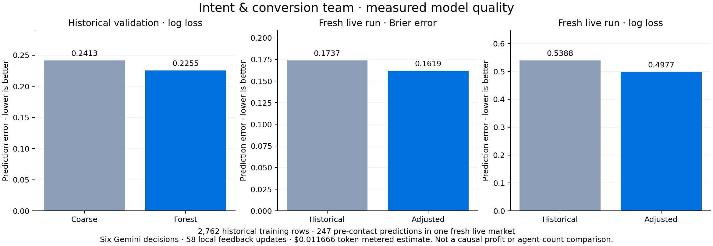

# Verified intent and conversion team

The user defined completion as **“Focus on autonomous workflow and model quality; report profit separately.”** This supersedes the earlier profit-multiplier and every-merchant-improvement completion gates. Their recorded failures remain intact and are not relabeled as successes.

## What works

| Requirement | Inspected evidence |
|---|---|
| Three real application-agent roles | Market analyst, ML scientist and commerce manager; six recorded Gemini 3.1 Flash-Lite responses and reconciled provider usage |
| Real local learning | One forest trained on 2,762 historical observations; validation log loss 0.2255 vs 0.2413 coarse |
| Automatic execution | Two validated campaign publications; no human decisions after starting the run |
| Feedback adaptation | 58 local updates using observed current-market funding responses |
| Continuous commerce | 20 and 24 purchases occurred while the two reviews were running |
| Measured model quality | Brier error 0.1737 → 0.1619 on the same 247 issued recommendations; log loss 0.5388 → 0.4977 |
| Checkpoints and traceability | Saved role inputs/outputs, model artifacts, daily feedback events and linked shopper/payment records; checkpoint writes are serialized and atomically renamed |
| Inspectable demo | Day-1 replay, agent evidence modal, trained-model warehouse row, model-quality summary and separate financial table verified in the browser |
| Cost controls | Run estimate $0.011666; lifetime recorded estimate $3.622899 under the existing $8 application / $50 user ceilings and $0.25 run cap |
| Frozen environment | Original economic hashes and paired fixed reference preserved; negative studies retained |

Six focused local checks passed. The saved fresh run proves actual provider activity; the local tests use explicit test doubles. Replaying the demo made no new model calls. No development subagents or APAC project operations were used for this implementation and verification.

## Watch the demo

1. Open [the verified run](http://127.0.0.1:4173/studio.html?session=AUTONOMY-fbaa1815978e9f39&view=performance).
2. Click **Replay** to start in the market on day 1. Saved playback makes no AI calls.
3. Open **Agent team** or an individual decision to inspect what it knew, chose and passed to the next role.
4. Inspect **Warehouse → Trained models**, campaign contacts and payment records.
5. Return to **Performance** for model quality and the separate financial results.

The analyst chooses an evidence-backed focus. The scientist chooses the model family, training window, intent scope and feedback adjustment. The manager chooses campaign and fulfillment controls. Local tools fit/score models and execute validated actions; numerical tools and the simulator are not extra LLM agents.

## PayPal's role

Authorized funding, captures, deliveries and refunds provide commerce outcomes for the team's next review. The existing saved-wallet Sandbox integration can mirror a selected retained merchant order. This demonstration kept the sampler off: **zero native payment calls in this run**. The warehouse separately contains 11 previously verified completed Sandbox receipts. These are not added to the current simulated sales.

## Financial outcome, reported separately

The fresh live team had $2.21 more modeled platform contribution after AI cost and $10.76 less retailer contribution than fixed rules. It retained 150 purchases versus 148. Neither 2× profit nor universal merchant improvement is claimed. Earlier negative experiments and the later numerical value/allocation prototypes remain available in their original folders. None was silently promoted or credited to the live agent run.

The fresh-run comparison establishes improved prediction error on the same issued contacts in one market. It does not establish population-wide superiority, causal profit lift or that three agents outperform a matched single planner. Provider costs are token-metered estimates; local CPU/energy and billing-invoice reconciliation are excluded.

## Evidence

- [Completion audit](audit.json)
- [Fresh live-run accounting audit](../adaptation-live-1/results.json)
- [Actual decision checkpoints](../adaptation-live-1/checkpoints.json)
- [Prediction records](../adaptation-live-1/prediction-audit.json)
- [Registered run protocol and source snapshots](../adaptation-live-1/protocol.json)
- [Data/task-fit audit](../data-fit-audit.md)
- [Earlier financial comparison](../validation-1/REPORT.md)
- [Hyperresearch architecture basis](../../../../research/notes/final_report_commerce-agent-performance-e46beb.md)
- [Hyperresearch constraints and experiment design](../../../../research/notes/final_report_commerce-net-headroom-0335d1.md)

Goal tracker: closed as complete under the explicit user clarification. Cumulative recorded goal time was approximately 21 hours 20 minutes across the earlier research and builds; this is not the duration of the final UI check. The earlier financial targets remain unachieved.
