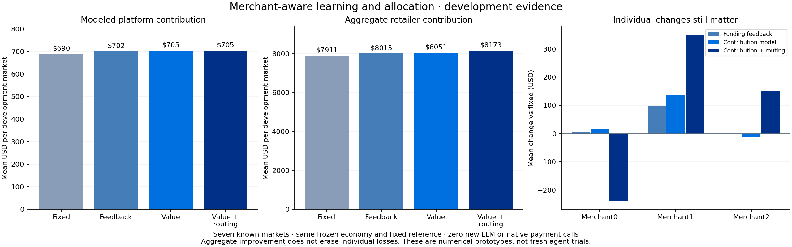

# Merchant-value development study

All three variants use the same seven previously used development markets. No unseen seed was opened, no application LLM decision was made and no native PayPal call occurred. These are local numerical model/controller experiments, not a new agent-performance result.

## Why the live campaign lost retailer contribution

An exact fixed-policy replay reproduced the live comparator. The team generated two more orders, $10 more captured revenue, $8 more refunds, $7 more delivery expense, $4.30 more consumed product cost, $1.03 more net payment fees and $0.43 more inventory holding cost. Together these explain the $10.76 retailer decline. Split-basket count was unchanged. The principal gap was the value of the added/replaced order mix, not an unexplained payment fee.

The underlying accounting is in [results.json](results.json). This is an explanatory replay of a spent seed; it is not a fresh validation run.

## A more appropriate prediction target

The response forest remains the same. An additional local value forest estimates payment contribution plus retailer order contribution, conditional on a retained purchase. Failure values include observed refund/product losses and outreach costs. The sum counts payment fees once: they enter platform contribution and leave retailer contribution. Inventory holding, supplier outcomes and displaced future purchases remain outside the per-contact label and are still assessed in full-world evaluation.

The training data contains 7,010 observed contacts and 457 retained purchases. Whole-development-market validation selected the forest; shared-value RMSE was 2194.04 cents versus 2229.49 for the coarse predictor. The JS export matched 128 Python predictions within 0.0000001 cents. This is predictive model-selection evidence, not proof of profit or causal uplift.

## Every variant

Strong fixed reference: platform $690.36, retailers $7,910.75, partner cash $27,074.77, inventory $3,146.28 per market.

| Variant | Platform net | Retailer contribution | Closing partner cash | Closing inventory | Merchant0 /1 /2 change vs fixed |
|---|---:|---:|---:|---:|---|
| Funding feedback | $702.15 | $8,014.95 | $27,201.29 | $3,188.35 | $5.60 / $99.84 / $-1.23 |
| Contribution model | $705.25 | $8,051.27 | $27,260.51 | $3,177.78 | $14.89 / $137.04 / $-11.40 |
| Contribution + routing | $704.85 | $8,172.79 | $27,280.90 | $3,270.75 | $-238.72 / $349.65 / $151.13 |

All variants preserve aggregate retailer contribution, supplier contribution and cash on these development means, stay within the inventory allowance, and end with no unpaid liabilities. **Every variant still fails at least one individual merchant guard.** Exact recommended-item purchases also remain below the fixed reference. No variant is promoted as a proven winner.

## What the allocation experiment guarantees—and what it does not

The secondary numerical tool starts from the reference allocator's chosen baskets on the **current observed state**. It may only substitute merchants for identical catalogue items and quantities, with unchanged buyer gross, payment fee and processing expense. It requires at least the reference aggregate immediate merchant order contribution. It then maximizes the least merchant's cumulative order contribution relative to its observed warmup contribution. A failed check falls back to the reference allocation.

Across the seven markets it changed 56 of 249 eligible allocation decisions, with zero fallback failures. The immediate contribution checks passed. **That did not preserve each merchant over the full horizon:** merchant0 ended down $238.72 per market. Stock, cash and subsequent allocations evolve after each decision; a local protection is not a terminal economic guarantee. The application team has not been given this routing tool as a default.

## Status and artifacts

The working live intent/conversion team and its measured prediction improvement remain intact. Financial completion is still unproven. The user subsequently chose autonomous workflow and model quality as the demo completion criteria, with profit reported separately. These financial measurements and failed individual guards remain unchanged.

- [Contribution-model training](../shared-value-training-1/model-report.json)
- [Export parity](../shared-value-training-1/js-parity.json)
- [Contribution-only full results](../shared-contribution-probe-1/results.json)
- [Routing full results](../merchant-routing-probe-1/results.json)
- [Current live team](../adaptation-live-1/README.md)

