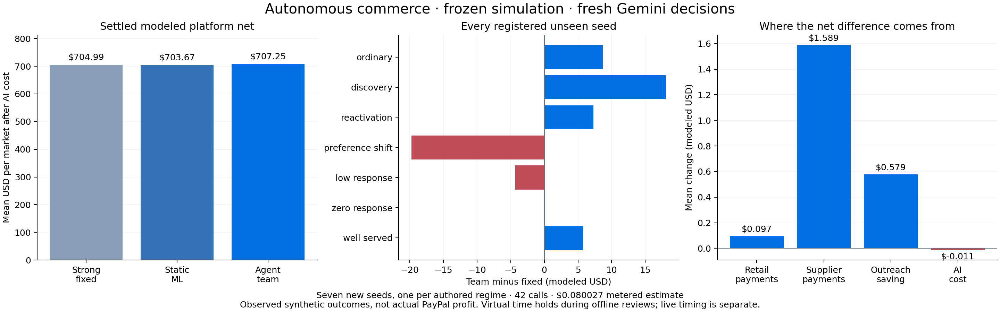

# Autonomous commerce: seven new markets

The fresh team completed 42 Gemini decisions, 10 real local fits and 14 campaign publications. Mean modeled platform net after AI cost was **$707.25 vs $704.99 fixed (0.32%)**. It improved 4/7 registered markets. This is measured synthetic commerce, not PayPal production profit.

The user's completion target is autonomous operation plus measured improvement. **2× is a stretch target.** All financial guards, including individual merchant tradeoffs, remain reported.

| Approach | Platform after AI | Retailers | Retained purchases | Payment volume | Exact recommendation purchases |
|---|---:|---:|---:|---:|---:|
| Strong fixed | $704.99 | $8048.91 | 128.00 | $18585.00 | 21.71 |
| Static learned routing | $703.67 | $7983.95 | 128.86 | $18485.86 | 15.71 |
| Fresh autonomous team | $707.25 | $8038.24 | 129.57 | $18573.00 | 16.57 |

Means per market; days31–100 plus a26-day settlement tail after shared warmup. The same initial funds, opportunity stream, consent and income hashes matched in every arm.

## What changed

The market analyst examines observed search, browse, contact and settled-payment evidence. The scientist chooses a model and routing recipe, trains locally, validates its artifact and can retain or retrain it at the next review. The commerce manager chooses the audience, allowed contact types, capacity, value threshold, stock coverage and settlement route. Trusted code validates the bounded action contract and executes it without human intervention.

The new inquiry expert estimates response value from actual public intent age and mature observed outcomes. It avoids treating all inquiries as signal-free cold contacts. The ambiguous-intent recipe keeps product recommendations for explicit searches and allows inquiries for browsing. A random forest scores recommendations; local numerical tools handle complete baskets and fulfillment. These are learned estimators and deterministic execution tools, not extra LLM agents.

Team minus static learned routing is +$3.58 per market. This control prevents crediting all numerical-model improvements to multiple LLM roles. A matched single-planner ablation was not run, so additional roles are not independently proven necessary. Generated rationales sometimes overstate optimality or compare funded responses with retained purchases across different cohorts; they are preserved as model outputs, not accepted statistical claims.

## PayPal's role and accounting

The trusted payment plane turns a customer request into an authorization, capture and settled delivery or refund. Supplier settlement affects when inventory can arrive. Those payment outcomes become the next scientist's labels. Existing Sandbox integration can mirror one selected retained merchant order using saved test consent; this benchmark deliberately made **zero native calls**. Modeled receipts are never presented as native PayPal receipts.

| Component per market | Fixed | Team |
|---|---:|---:|
| Retail fees after fee refunds and processing | $448.13 | $448.23 |
| Supplier payment fees after processing | $272.27 | $273.86 |
| Outreach expense | $15.41 | $14.84 |
| AI expense | $0 | $0.011432 |

Platform transfer sums reconcile to the settled balance change. No additional shopper money, unpaid liabilities or hidden evaluator data were introduced. In this test, most of the small platform gain comes from supplier payments and outreach savings; retained retail volume fell. This is not evidence of a strong retail-demand lift.

## All registered cases

| Regime | Seed | Fixed | Team after AI | Difference | Retailer difference |
|---|---:|---:|---:|---:|---:|
| ordinary | 987500 | $579.68 | $588.36 | +$8.68 | +$131.48 |
| discovery | 987501 | $778.03 | $796.12 | +$18.09 | +$18.24 |
| reactivation | 987502 | $549.46 | $556.75 | +$7.29 | +$51.72 |
| preference_shift | 987503 | $827.10 | $807.36 | −$19.74 | −$269.93 |
| low_response | 987504 | $629.18 | $624.85 | −$4.33 | −$73.68 |
| zero_response | 987505 | $706.08 | $706.07 | −$0.01 | +$0.00 |
| well_served | 987506 | $865.43 | $871.23 | +$5.80 | +$67.45 |

Individual merchant mean changes: MERCHANT-0 +$7.15; MERCHANT-1 +$12.00; MERCHANT-2 −$29.83.

Guards: positivePlatform PASS; aggregateRetailer FAIL; eachRetailer FAIL; suppliers PASS; cash FAIL; inventory PASS; noLiabilities PASS; autonomy PASS.

## Cost, timing and limits

Fresh inference: **$0.080027**, a token-metered estimate from the actual provider usage ledger, not a reconciled cloud invoice. Lifetime recorded cost: $3.611233. Additional cap$0.25, application lifetime cap$8 and existing isolated-project control were preserved. No APAC operations or development subagents. Local CPU training has no cloud charge; CPU/energy cost is not priced in this total.

Offline policy-quality comparison: virtual time holds at both agent review boundaries. Provider and local training latency are measured. Live background execution is a separate check. Total provider latency: 139.7 seconds. The existing live workflow runs the same roles in the background while fixed fallback serves shoppers.

- Seven new seeds, one per existing authored regime; not a population or production-profit claim.
- Static ML routing isolates numerical-tool benefit; no claim that three roles beat a matched single planner.
- Historical development evidence is available to the team; no future evaluation outcomes are exposed.
- All registered results, including losses and failed calls, are retained. No model calls are retried.

The source hashes and seeds were registered before execution. Every result is retained. These seeds are now spent for any future policy tuning. Earlier negative runs remain unchanged.

See [protocol](protocol.json), [results](results.json), [full rows](rows.json) and the per-case team checkpoints. The [interactive workspace](http://127.0.0.1:4173/studio.html?session=AUTONOMY-272a791d4860b5ca&view=performance&evaluation=autonomy-validation) includes the recorded decisions and evidence.
