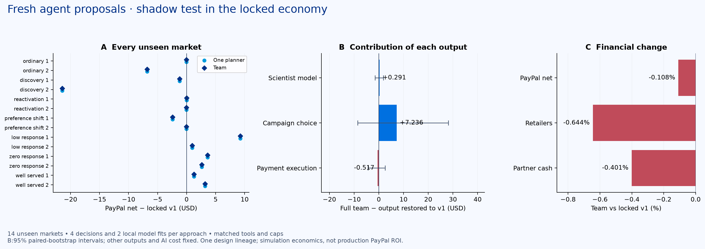

# Fresh specialist team versus locked baseline v1

**The candidate did not pass all aggregate financial checks. Baseline v1 remains locked.** This is a shadow test of fresh model-proposed candidates; neither planner approved these candidates for deployment.

This is one fresh design per approach, tested on14 unseen seeds in the unchanged economy. Each approach had 4 Gemini3.1 Pro decisions, two actual local model fits, 2 seven-market campaign trials, the same starting evidence and a $0.30 per-round model cap. The single planner had all the specialist tools and all their evidence.

The same predeclared deterministic nomination rule chose each architecture’s highest-development-net proposal for research evaluation. This is separate from the LLM reviewers’ publication decisions: both retained v1 after development safeguards failed. The shadow evaluator makes no model or payment calls and never deploys a rejected policy.

## Outcome

| Approach | Net after AI / market | Retailers | Retained purchases | Partner cash | Inventory |
|---|---:|---:|---:|---:|---:|
| Original strong fixed | $718.92 | $8300.43 | 132.21 | $27755.95 | $2942.52 |
| Locked baseline v1 | $735.86 | $8632.41 | 136.50 | $28297.35 | $2889.83 |
| One planner · same tools | $735.06 | $8576.78 | 135.71 | $28183.78 | $2947.47 |
| Specialist team | $735.06 | $8576.78 | 135.71 | $28183.78 | $2947.47 |

Team minus baseline v1: **−$0.80** net per market;95% paired-market bootstrap interval [−$4.65, +$2.18]. 6 wins, 0 ties, 8 losses. The two seed-panel mean deltas are +$1.49 and −$3.08. Team retailer contribution changes −$55.63 and partner cash −$113.57.

The team and single planner produced exactly the same measured commercial outcomes in all14 markets. Their net difference is only $0.00055071 per market from token-price variation; it is not a strategy gain. Semantically identical tested proposals: **false**. Differences in JSON key order, artifact IDs or tiny token-price differences are not strategy improvements. No broad multi-agent superiority claim follows from one design per approach.

## What each agent did

1. **Demand scientist:** analyzed historical inquiry/response/purchase data; chose two cohort/model recipes; actual local training fitted empirical-Bayes priors and selected shrinkage8/32/128 through leave-one-source-market-out validation.
2. **Campaign strategist:** selected trained artifacts, whether they replace inquiry ranking or audit it, audience, payment-versus-joint value ranking and a bounded recovery probe.
3. **PayPal operations reviewer:** proposed trusted fulfillment tools, read actual paired development trials, and retained v1 when financial safeguards failed. An additional repair checkpoint tested a single component restoration in an earlier attempt. Shadow nomination is an evaluator action, not an LLM publication decision.

The application LLMs made these choices. Local models, allocation solvers, consent checks, funding/capture/refund operations and accounting remain deterministic tools. No LLM invents shopper funds or executes arbitrary SQL/code.

## Contribution of each output

| Output restored to v1 | Full team's net advantage | Retailer advantage | Extra purchases |
|---|---:|---:|---:|
| Scientist model | +$0.29 | −$30.13 | -0.43 |
| Campaign strategy | +$7.24 | +$161.51 | 1.71 |
| Payment execution | −$0.52 | −$20.15 | -0.21 |

Each ablation holds the other outputs and full team design cost fixed. These are conditional contributions with possible interactions, not isolated credits for an LLM persona. Restoring the campaign output also restores its model-use choice: the fitted model then replaces inquiry estimates instead of auditing v1. A positive audit contribution may therefore show protection against a harmful model substitution; it is not independently proof of improvement over v1. A zero or negative contribution is retained. No remaining agents were retrained after removing an output.

## Model and timing boundaries

The original dataset contains7010 contacts across seven source markets;3890 are inquiries. The data-matching revision additionally derives3805 observed contacts (2720 inquiries) from seven completed locked-v1 markets. Those source markets are disjoint from the seven development markets and every new confirmation seed. The scientist can select historical, logged-v1 or combined data. Actual data choices: single combined; team combined. Source markets stay separate in model validation. No seed, regime, customer ID, hidden need, household wallet or future outcome is a predictor.

The response-hurdle model learns response probability from previous contacts and retention/value from matured responders. Pending responders are excluded from settled labels. The audit option preserves v1 ranking and vetoes an inquiry only when even a two-posterior-standard-deviation optimistic response estimate has nonpositive expected payment value and no cohort responders remain unresolved. This is an uncertainty buffer, **not a calibrated95% guarantee**. A permitted recovery probe is at most one inquiry every seven days when all regular candidates are rejected and v1 or the model still predicts positive value. Consent, funds and campaign budgets remain unchanged.

## Earlier failed attempt and costs

The first attempt directly replaced inquiry scores. Its development results lost merchant value, so the single planner retained v1. The team finished its trials but its final provider review returned HTTP429. The failure and all checkpoints remain in [attempt1](../baseline-v1-challenger-1/). **No confirmation markets were opened in that attempt.**

The next revision added model auditing and a single bounded20-second retry for429, followed by a single-output repair checkpoint. Both retained baseline v1 after failed merchant/cash safeguards; their unseen comparisons therefore showed the same commercial behavior plus additional design cost. These failures remain in attempts2 and3. The data-matching revision uses logged baseline traffic without changing the economy. All approaches receive the same available sources and tool choices. Policies and artifact hashes were frozen before each new confirmation cohort opened; prior unsuccessful experiments are never relabeled as unseen wins.

Final design-round usage: single $0.099268, team $0.095520. Including all preceding attempts: single $0.260700, team $0.252990. All these costs are included in net, amortized over the same14 markets. The subsequent shadow comparison adds no model charges. Local numerical computation is not assigned a fictitious cloud price; there were no native payment calls. Recorded project Vertex spend is $4.531074 with 0 unsettled ledger entries, beneath the user's $50 ceiling and existing tighter application caps.

## Verification and artifacts

- Frozen baseline snapshot and all12 economic source hashes verified; paired initial world, opportunity, consent and income hashes match.
- No unpaid liabilities: true. Merchant/cash/inventory checks: {"positiveNetVsV1":false,"retailerVsV1":false,"partnerCashVsV1":false,"originalInventoryLimit":true}.
- Eight focused tests cover label maturity, pending responders, known nonresponses, actual fitting, audit behavior, canonical policy comparison, consent/budget constraints, repair publication guards and the baseline lock. No APAC changes or development subagents.
- [Protocol](protocol.json), [frozen plans](frozen-designs.json), [team checkpoints](team/checkpoints.json), [single-planner checkpoints](single/checkpoints.json), [all rows](rows.json), [results](results.json), [semantic policy audit](semantic-comparison.json).
- Customer response and economic values are authored assumptions. Modeled payment contribution is not production PayPal profit. This research view does not replace the live app controller or the locked baseline.

