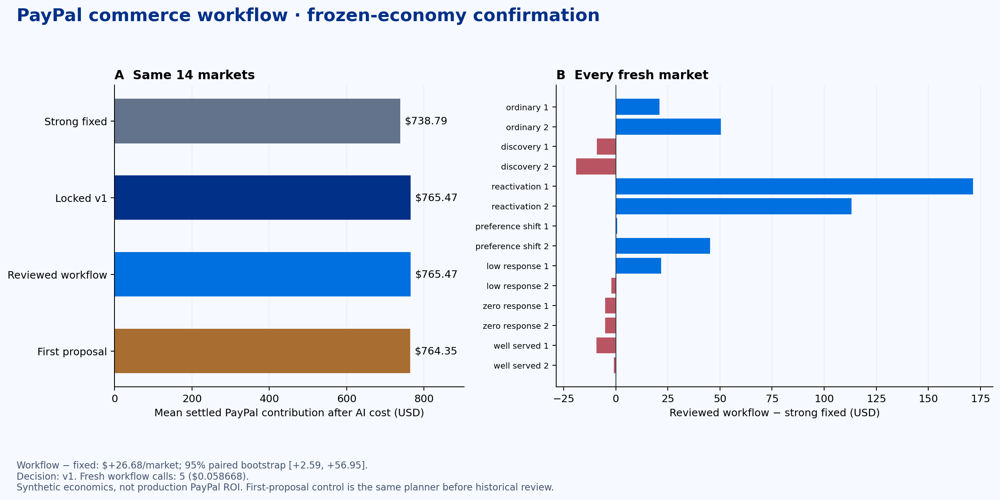

# Finalized economic workflow — November 3, 2026

**Retain baseline v1. Its fresh confirmation improves average modeled PayPal net over strong fixed rules; the new economic overlay did not improve v1.**

| Approach | PayPal net after allocated AI | Retailer contribution | Retained purchases | Partner cash |
|---|---:|---:|---:|---:|
| Strong fixed | $738.79 | $8,420.03 | 131.43 | $27,875.85 |
| Locked v1 | $765.47 | $8,822.32 | 137.43 | $28,453.91 |
| Reviewed workflow | $765.47 | $8,822.32 | 137.43 | $28,453.91 |
| First proposal, no historical review gate | $764.35 | $8,808.27 | 137.43 | $28,431.22 |

Means across 14 newly registered 100-shopper markets: seven equally weighted regimes, two seeds each, 30 shared warmup days, 70 operating days and 26 clearing days. The policy, evaluator and economic hashes were registered before confirmation. No changes or extra decisions were made after confirmation began.

The reviewed workflow retained v1 and improved net **$26.68 / market (+3.61%)** over fixed. The 95% paired-market bootstrap interval is [$2.59, $56.95]. Both panels improved: $27.39 and $25.97. Seven markets improved and seven lost money relative to fixed; there is no every-market win claim.

Retailer contribution increased $402.30, partner cash $578.06, and retained purchases 6 per market. Closing inventory is 2.00% above fixed, within the original 10% limit. No unpaid liabilities remained.

## What actually happened autonomously

Five fresh Gemini 3.1 Pro preview calls completed without a human choosing tool arguments:

1. **Inspect:** read demand, inventory, liquidity, supply and payment indicators at day60, using history through day59. Discovered-request growth was 1.257×, 56.25% of merchant/product listings had no available units, but the current funded basket was fillable. Available merchant cash was $14,324.30.
2. **Train:** requested the adaptive local demand fit. Past-only validation selected **recent14**, using 25 observations in its fit window from 126 available funded observations. This is a real local rolling Poisson-rate fit; it is not a cloud training job or causal uplift model.
3. **Propose:** keep v1 outreach and fast PayPal supplier settlement; temporarily use forecast stock cover of physical lead plus3 days. Activate only when listing stockouts exceed50% and discovered-request growth exceeds1×, both with14-day evidence. Expire after7 days.
4. **Test:** the exact artifact ran against v1 on seven separate completed historical markets. Average platform contribution fell $0.7371; retailer contribution rose $0.9043 and partner cash rose $5.7929. The platform-net gate failed. The candidate actually activated on15 days across this panel.
5. **Decide:** kept v1. Trusted code then evaluated that frozen choice and the unrevised proposal on all14 fresh seeds. There were no further model calls or outcome-driven revisions.

The unreviewed proposal averaged $764.35 versus the retained workflow's $765.47. The review therefore preserved $1.12 in mean net, but its interval [-0.13, +3.20] crosses zero. **This is not convincing new financial lift from the harness.** It is also not a multiple-agents-versus-one-planner comparison.

## What needs improvement

The planner's final rationale incorrectly said no historical trials remained. It had used one of two and chose to stop. The checkpoint counters, not that sentence, are authoritative. Its model-fit rationale also referred to a legacy28 baseline even though the locked inventory program uses rate14. Both original statements are preserved in the trace. A better baseline-policy inspection and explicit before/after stock-target preview would reduce these misunderstandings; they were not silently corrected or tested after seeing confirmation outcomes.

The new overlay remains unpromoted. V1's advantage is its previously selected broad positive-value needs inquiries plus funded-basket execution; this experiment does not re-establish which individual role is necessary. The earlier matched single/team study remains available, including its negative result. No claim of multi-agent superiority follows from this report.

## PayPal's financial role

Average workflow contribution reconciles exactly with the simulated platform ledger:

| Component | USD / market |
|---|---:|
| Retail payment fees | 798.1350 |
| Supplier settlement fees | 478.3729 |
| Processing expenses | -447.0643 |
| Returned payment fees | -35.5793 |
| Outreach expense | -28.3893 |
| Allocated AI cost | -0.005990 |
| **Net after allocated AI** | **765.469010** |

Payment principal and merchant sales are not PayPal revenue. Capturing funded baskets, supplier settlement timing, delivery/refund outcomes and payment costs connect commercial decisions to this ledger. The promotion gate checks retailer value, cash, retained volume, inventory and liabilities as well as platform net, preventing supplier-fee growth alone from qualifying.

These are authored simulator fees and customer behavior, not PayPal internal data or production profit. Existing native Sandbox integrations remain separate; this evaluation made **zero native payment calls** and did not change the live app's existing controller.

## Cost and reproducibility

Current fresh design: **$0.058668** in token-metered API estimates. Earlier economic-workflow attempts: $0.128574; this workflow family totals **$0.187242**. Recorded project model ledger: **$4.718316**, below the $50 user ceiling and unchanged tighter application limits. No APAC changes or development subagents.

The current table allocates original v1 design plus this workflow's design over14 markets. If applied to just one market, the full new review would cost $0.058668. Charging all economic-workflow attempts yields an additional $0.013374 / market versus v1. No extra profit over v1 is hidden by amortization. These estimates are not cloud billing invoices; local computation is not assigned a fictitious cloud price.

- [Protocol and source hashes](protocol.json)
- [Frozen fresh decision](frozen-decision.json)
- [Actual model/tool checkpoints](checkpoints.json)
- [Every result row](rows.json), [aggregate results](results.json), [example platform ledgers](example-ledger.json)
- Exact evaluator sources are preserved in `source/`.

`npm run baseline:verify` checks all12 frozen economic files,45 baseline artifacts and70 published traces. `node --test tests/economic-harness.test.mjs tests/economic-final.test.mjs tests/commerce-baseline.test.mjs` verifies accounting, evidence windows, forbidden fields, checkpoint recovery and gate enforcement. Reopening **Economic workflow** replays saved evidence without calls. `npm run dev -- --no-recover` starts the app without automatically resuming old paid jobs.

## Every fresh market

| Case | Regime | Workflow − fixed net | Retailer change | Extra retained purchases |
|---|---|---:|---:|---:|
| F0 | ordinary | +21.07 | +498.72 | +6 |
| F1 | ordinary | +50.49 | +796.36 | +9 |
| F2 | discovery | -8.98 | +28.38 | +3 |
| F3 | discovery | -19.05 | +104.89 | +6 |
| F4 | reactivation | +171.48 | +1750.45 | +23 |
| F5 | reactivation | +113.05 | +1224.84 | +24 |
| F6 | preference_shift | +0.75 | +234.14 | +0 |
| F7 | preference_shift | +45.28 | +586.85 | +7 |
| F8 | low_response | +21.73 | +207.11 | +2 |
| F9 | low_response | -2.04 | +130.30 | +1 |
| F10 | zero_response | -5.14 | -0.03 | +0 |
| F11 | zero_response | -5.15 | +0.01 | +0 |
| F12 | well_served | -9.20 | -63.98 | +0 |
| F13 | well_served | -0.84 | +134.12 | +3 |

