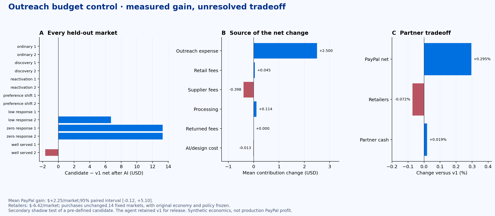

# Actual net evaluation: response-aware outreach budget

**The candidate increased average modeled PayPal net by$2.25/market, but is not a demonstrated robust upgrade over v1.** The95% paired-market interval is [-0.12, +5.10], and retailer contribution declined$6.42/market. The agent's release decision remains v1. No live controller was replaced.

| Per100-shopper market | Strong fixed | Locked v1 | Budget-control candidate |
|---|---:|---:|---:|
| PayPal net after allocated AI/design | $745.09 | $762.47 | $764.72 |
| Retailer contribution | $8,616.78 | $8,942.23 | $8,935.81 |
| Partner cash | $27,501.60 | $28,009.10 | $28,014.34 |
| Retained purchases | 134.07 | 138.86 | 138.86 |
| Outreach cost | $15.54 | $26.71 | $24.21 |

The gain is **cost avoidance, not sales lift**. Both seven-market panels have positive mean net changes (+1.89, +2.61), but the pooled interval still includes zero. Three markets improved; one had a commercial decline; the remaining markets had unchanged commerce and their allocated design expense. All14 completed settlement with no unpaid liabilities. The portfolio net change is$31.48 after all costs allocated here. Different cohorts have different levels; compare each policy on these same seeds, not against the earlier$765.47 cohort average.

## What changed

The exact v1 model, product selection, fulfillment and economic transitions remain intact. The extension uses an already fitted empirical-Bayes response-hurdle prior to review general inquiries:

1. Read only prior-day contacts and their observed replies. Never access hidden needs, shopper funds, future outcomes or private regime labels.
2. Update the inquiry-response probability from the learned prior and current observed inquiries. Estimate the net value conditional on a reply from fully settled historical training data.
3. Use an optimistic response estimate (posterior mean plus two standard deviations) to calculate inquiry value after the contact cost.
4. Reduce routine general inquiries only when **no marketing reply has yet been observed** and even that optimistic value is nonpositive.
5. Keep every product recommendation v1 selected. Allow one recovery inquiry per existing7-day contact-gap interval. Any observed reply reopens routine outreach. Consent, contact caps and funding guards remain.

The uncertainty buffer is a model heuristic, not a calibrated95% guarantee. This can pause too early in a temporarily quiet market; the negative case and partner loss are preserved.

One actual checkpoint was day38 in caseN9: 73 prior general inquiries, 0 replies, optimistic inquiry net-0.0044USD. The controller suppressed9 proposed inquiries and retained1 product recommendations that day. Suppressed proposal counts are not the paired contact-count difference: policy trajectories and feedback can diverge. Actual cost savings come from the reconciled ledgers.

## Where the money comes from

| Candidate minus v1 | USD / market |
|---|---:|
| Outreach expense avoided | +2.500000 |
| Retail payment fees | +0.045000 |
| Supplier settlement fees | -0.397857 |
| Processing expense | +0.114286 |
| Returned payment fees | +0.000000 |
| Additional allocated AI/design cost | -0.012682 |
| **Net change** | **+2.248746** |

These are simulator fees, costs and response assumptions. Neither merchant sales nor payment principal is counted as PayPal profit. This study made no native Sandbox payments and does not estimate production PayPal ROI.

## Role of the LLM and the shadow evaluation

A fresh Gemini review saw completed development evidence and **retained v1** because the proposed budget policy slightly reduced merchant value. That decision is unchanged in [the original review](../response-budget-confirmation-1/decision.json).

The current secondary shadow test separately evaluates the same candidate that was already defined, source-hashed and offered to that reviewer **before the parent markets opened**. No candidate logic or model was tuned after those markets opened. Exact fixed/v1 controls are reused with matching initial-world, opportunity, consent and income identities. This is not an LLM-approved deployment, a replacement confirmation claim for the selected-v1 arm, or proof that multiple agents outperform one planner. The daily response/value calculation is local statistical software; the LLM reviews the operating policy and tradeoffs.

The earlier product-choice extension also completed14 fresh markets. It gained on development data but finished−$0.0216 per market after costs on confirmation. Its uncertainty interval was [−$3.73,+$3.38]. That failed result remains in [net-lift-confirmation-1](../net-lift-confirmation-1/results.json); the budget controller does not include that product substitution.

## Cost, artifacts and verification

Two new Gemini reviews this task cost$0.027066. The comparison includes$0.177554 total relevant EDA/design work, including the previous analytical attempts and failed product-choice nomination, divided equally across14 markets. Project recorded model usage is$4.895870, below$50 and unchanged tighter app caps. These are token-metered estimates rather than cloud invoices. Local compute adds no paid service calls; no APAC or subagents were used.

- [Shadow protocol](protocol.json), [all rows and budget checkpoints](rows.json), [aggregate results](results.json)
- [Original nomination and seed registration](../response-budget-confirmation-1/protocol.json)
- [Development result](../response-budget-1/results.json)
- [Earlier product-choice development](../net-lift-1/results.json) and [failed confirmation](../net-lift-confirmation-1/results.json)

`npm run baseline:verify` validates the unchanged12 economic files,45 archived artifacts and70 published traces. Focused tests verify inquiry preservation, contact limits, model artifact integrity, exclusion of future replies, reopening after a response, recovery probes, unchanged initial economies and settlement. The UI's **Measured net** view replays saved results without new model or payment calls.

## Every market

| Case | Regime | Net after costs − v1 | Retailers − v1 | Partner cash − v1 | Purchases − v1 |
|---|---|---:|---:|---:|---:|
| N0 | ordinary | -0.0127 | +0.00 | +0.00 | +0 |
| N1 | ordinary | -0.0127 | +0.00 | +0.00 | +0 |
| N2 | discovery | -0.0127 | +0.00 | +0.00 | +0 |
| N3 | discovery | -0.0127 | +0.00 | +0.00 | +0 |
| N4 | reactivation | -0.0127 | +0.00 | +0.00 | +0 |
| N5 | reactivation | -0.0127 | +0.00 | +0.00 | +0 |
| N6 | preference_shift | -0.0127 | +0.00 | +0.00 | +0 |
| N7 | preference_shift | -0.0127 | +0.00 | +0.00 | +0 |
| N8 | low_response | -0.0127 | +0.00 | +0.00 | +0 |
| N9 | low_response | +6.6973 | -4.35 | -7.13 | +0 |
| N10 | zero_response | +13.2873 | +0.00 | +0.00 | +0 |
| N11 | zero_response | +13.2873 | +0.00 | +0.00 | +0 |
| N12 | well_served | -0.0127 | +0.00 | +0.00 | +0 |
| N13 | well_served | -1.6627 | -85.49 | +80.56 | +0 |

