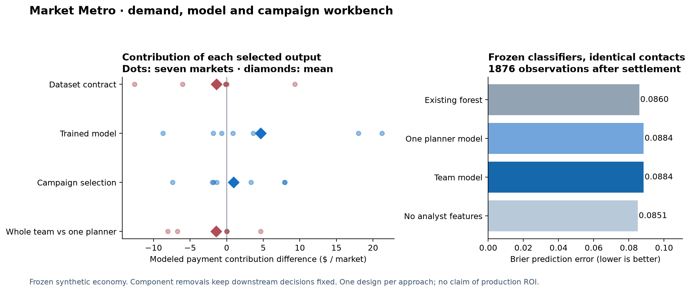

# Demand, model and campaign agent workbench

The architecture now performs actual analysis, feature preparation, local model fitting and campaign experiments. The model scientist and campaign selection made positive contributions in the registered component tests. The analyst's added features reduced profit and prediction quality on the new markets. **The full specialist team did not beat the equally equipped single planner.**

Run `WORKBENCH-0826c0ac1c666e89`, completed November 2, 2026. Open **Performance → Demand, models and campaigns · role contributions** in Market Metro. This is an executed research-team workflow and its saved results. It does not silently replace the existing live-run controller.

## Architecture and actual decisions

| Agent | What it decided | Executed tool / artifact |
|---|---|---|
| Demand analyst | Investigate the recent payment funnel; keep 100 days of training history; add pre-contact shopper interest context. | A grouped demand query, then a dataset contract that added two interest-age flags to the original 16 predictors. |
| Model scientist | Compare a direct purchase forest with a response-to-purchase model; select the latter from whole-market validation. | Two actual CPU training jobs, portable model artifacts, validation reports and prediction-parity checks. |
| Campaign lead | Compare product recommendations with a model choosing between a recommendation and a needs inquiry; select the latter, ranking joint payment and retailer contribution. | Two full historical campaign trials, then a publication bound to the exact tested model and trial hashes. |

The single planner received the same tools, evidence, six-call allowance, two training jobs and two campaign-trial opportunities. It chose the same dataset and model, but ranked its discovery campaign by payment contribution rather than joint contribution. No agent was given a hidden response rule, current-world seed, private wallet or future outcome.

The demand evidence included 41 retained purchases with no immediate funding authorization. All had responded to outreach; some requests became funded later. The two-stage model therefore predicts **response × retained purchase given response**, not immediate funding × purchase. General inquiries originally had product-age99 because no SKU was named; the warehouse still had a pre-contact shopper interest bucket. Adding that context was an executable feature decision, not a text-only recommendation.

The analysts' feature choice looked plausible, but did not generalize better here. That negative result is preserved.

```mermaid
flowchart LR
    H[Completed simulation history] --> A[Demand analyst chooses investigation]
    A --> Q[Trusted aggregate query]
    Q --> D[Analyst commits dataset contract]
    D --> S[Scientist chooses two training jobs]
    S --> T[Local fitting and whole-market validation]
    T --> M[Scientist selects model artifact]
    M --> C[Campaign lead proposes two strategies]
    C --> E[Historical commerce trials]
    E --> P[Select and checkpoint tested campaign]
    P --> F[Freeze model and campaign]
    F --> U[Seven unseen economies]
    U --> R[Funded orders, captures, delivery and refunds]
    R --> V[Financial and classifier evaluation]
```

Each role has two real Gemini decisions. Trusted tools perform the arithmetic, fitting and payment checks. No generated SQL, arbitrary code execution, threshold-writing DSL, developer subagents, or native payment calls are used in this workbench.

## Unseen-market comparison

These are means over seven new seeds, 992310–992316, one per existing authored regime. Each market has 100 shoppers, 100 market days and 26 settlement days. Fixed rules, customer behavior, prices, funds, fees and all 12 frozen economy files remained unchanged. Actual design-call cost is deducted once, allocated across seven markets.

| Approach | Modeled PayPal net after AI | Retailer contribution | Retained purchases | Exact recommended item bought |
|---|---:|---:|---:|---:|
| Strong fixed | $753.22 | $8,801.41 | 134.57 | 21.00 |
| Existing model workflow | $757.62 | $8,825.68 | 135.00 | 17.57 |
| Single planner | $760.12 | $8,866.13 | 136.00 | 19.00 |
| Specialist team | $758.68 | $8,844.37 | 135.71 | 17.29 |

Team versus fixed: +$5.46 modeled payment contribution, +$42.96 retailer contribution and +1.14 retained purchases per market. Team versus one planner: **−$1.45 payment contribution, −$21.76 retailer contribution and −0.29 retained purchases**. Across seven markets the team won once, tied four times and lost twice to one planner. Exact recommended-product purchases did not increase; the selected workflow also uses needs inquiries.

For a concrete example, the reactivation market (seed992312) went from 99 retained purchases under fixed to102 with the team. Modeled payment contribution increased from $551.03 to $582.11 before allocated design cost; retailer contribution increased from $6,118.37 to $6,437.94. That illustrates a working improvement, but is not a replacement for the full seven-market result.

## What each output contributed

For each replay, remove only the named output and keep the other selected decisions unchanged. Positive means the complete team's output helped; negative means removal helped. These effects are **not additive** and are not a fresh replan by the remaining agents.

| Output tested | Team's payment contribution gain | Team's retailer gain | Extra retained purchases |
|---|---:|---:|---:|
| Analyst's added input features / dataset contract | **−$1.37** | −$33.07 | −0.14 |
| Scientist's trained artifact versus the strong existing model | **+$4.64** | +$55.07 | +0.86 |
| Campaign selection versus the existing campaign with the same new model | **+$0.96** | +$19.11 | +0.43 |

The scientist counterfactual preserves the existing inquiry estimator and funding calibration; it does not handicap the old model. The analyst counterfactual retrains the same selected model family using the original 16 features and full100-day history. The campaign counterfactual preserves the selected model and uses the existing intent-assistance/joint-value campaign.

These tests locate value in particular artifacts. They do not establish that separate LLM contexts are necessary: one planner produced the same model and a slightly better campaign choice.

## Prediction quality and limits

On **1,876 identical logged contacts** from the incumbent-policy confirmation runs, with features recorded before contact and outcomes evaluated after settlement:

| Frozen classifier | Brier error ↓ | Log loss ↓ |
|---|---:|---:|
| Existing forest | 0.08597 | 0.29570 |
| Team / single planner's selected model | 0.08844 | 0.30918 |
| Same two-stage model without analyst's extra features | **0.08509** | **0.29105** |

The chosen model's historical validation was better, but its classifier error on these unseen contacts was worse. Financial contribution and classifier error are separate outcomes. This is a diagnostic of feature/generalization risk, not proof that more models or more agents automatically help. The classifier audit excludes the full online calibration/inquiry stack; the economic comparisons include it.

One design per approach and seven markets screen an architecture. No model or campaign was changed after confirmation opened. These are now spent evaluation seeds. Removing a role's output holds the downstream choices fixed; it does not test how the remaining team would autonomously adapt. Local runtime and token usage are operational evidence; no production ROI is established.

## PayPal and spend

PayPal's modeled role is authorization of existing buyer funds, capture of complete baskets, supplier settlement and payment/refund reconciliation. Those records define the training labels and measured payment contribution. The campaign cannot manufacture funds or force purchases. Fees, processing costs, refunds and contact expenses reduce modeled net. Sandbox receipts remain separate integration evidence; this study did not create new receipts or double-count earlier ones.

Twelve fresh Gemini 3.1 Flash-Lite calls cost **$0.023950 estimated from recorded tokens**: single planner $0.012228; team $0.011722. Four model fits were requested by the two approaches; one additional local fit supported the analyst ablation. The local integration test also trained a temporary model, excluded from application job counts. No paid retry or post-confirmation tuning ran. Total recorded Gemini usage is now **$3.664175**, with no unsettled entries; this is a token-price estimate, not a billing invoice. APAC was untouched.

## Evidence and implementation

- `protocol.json`: declared seeds, equal budgets, outcome definitions and frozen source hashes.
- `single/checkpoints.json`, `team/checkpoints.json`: every real model call, demand query, training result, campaign trial and publication.
- `single/fit-*`, `team/fit-*`: actual datasets, job specifications, fitted artifacts and validation/parity results.
- `frozen-designs.json`: final artifacts recorded before confirmation opened.
- `confirmation-rows.json`, `results.json`: all paired outcomes and role contributions.
- `reference-prediction-data.json`: common held-out classifier observations.
- `source/`: snapshots of the executed implementation.

The reusable orchestrator is `scripts/commerce-growth/autonomy/team-workbench.mjs`; typed tools are in `team-workbench-tools.mjs`; `train-workbench.py` performs local fitting. The UI presents the actual checkpoints and all losses. It does not automatically promote this team to the live controller.

Eight focused checks passed, including real two-stage local training, whole-market grouping, exported prediction parity, feature contracts, delayed-funding labels and compatibility with the existing autonomy controller. A new study requires a fresh output directory and the explicit `--run-authorized` flag; replay and export make no model calls.
