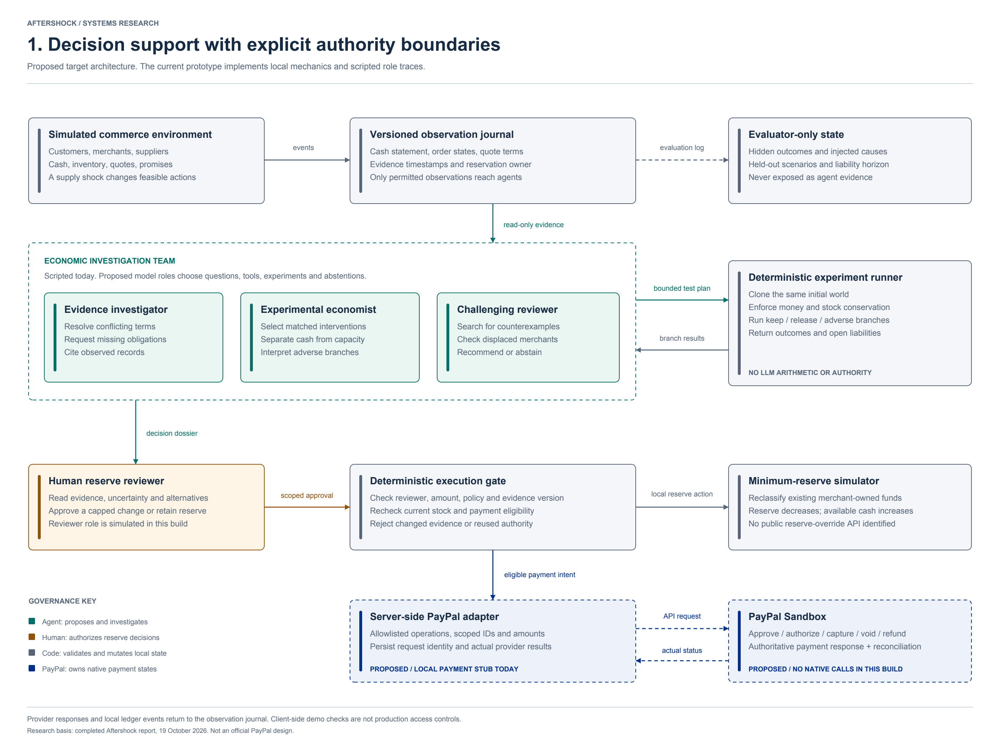
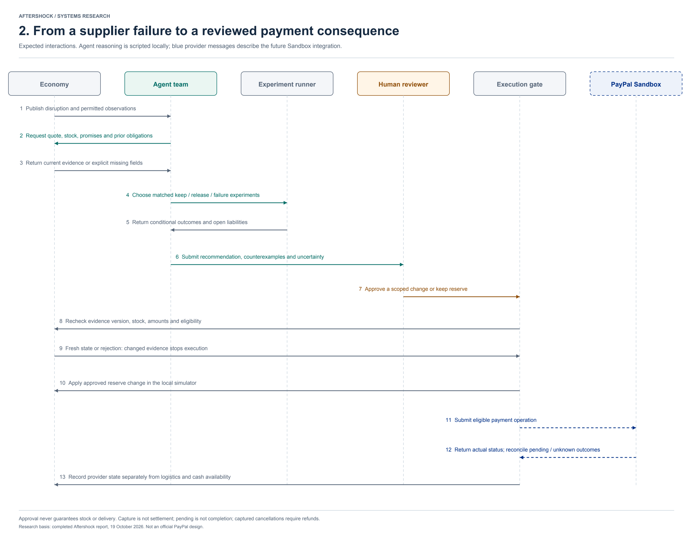
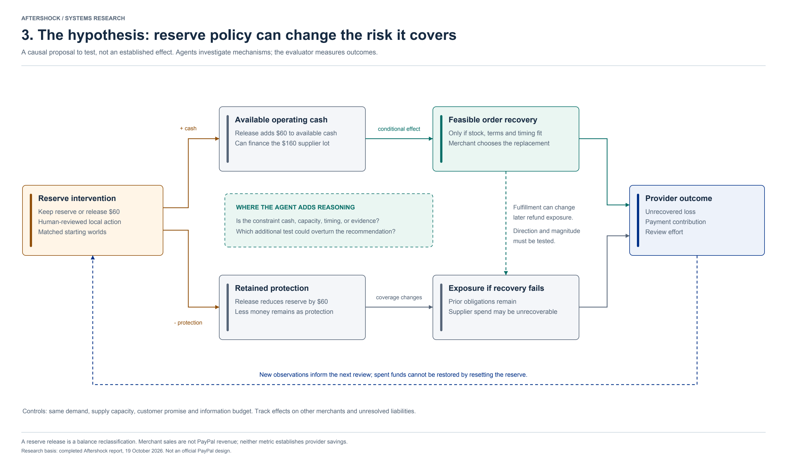
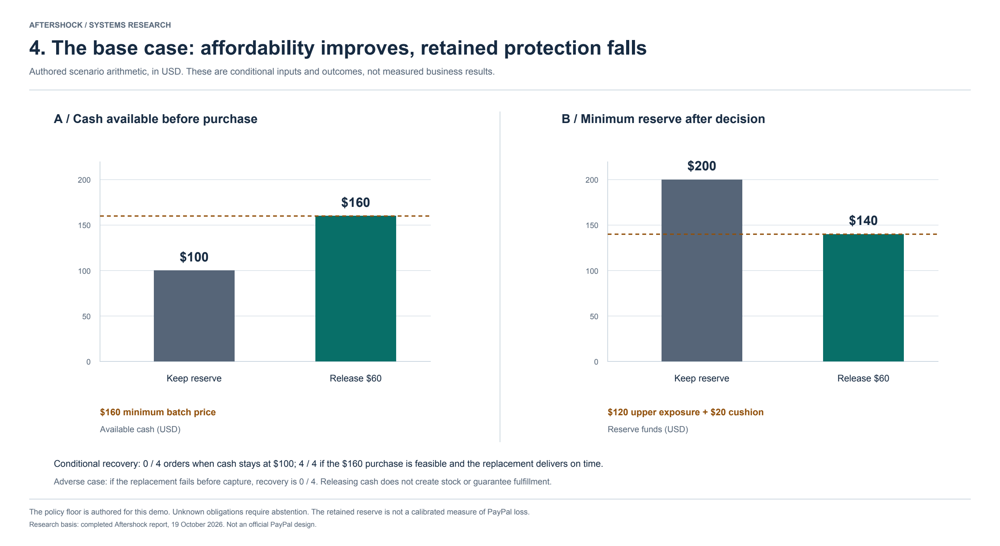

# Aftershock research figures

These are the original architecture figures. The current [Harbor Town game and financial model](../harbor-town.md) adds a captured-payment recovery case; the live PayPal-outcomes comparison and screenshots in `docs/screenshots/` show the updated financial story. Figure 4 below remains the earlier $320 authorization-case illustration.

These figures describe the proposed architecture and expected interactions. Quantitative values are authored scenario inputs and deterministic arithmetic; they are not measured economic effects. No installed skill named “research style” was found, so the figures use a consistent vector research-diagram style produced with ReportLab.

Colors identify responsibilities: teal for agent reasoning, gray for deterministic state and code, amber for human authority, and blue for payment-provider integration. Labels carry the same meaning without relying on color. Dashed components in the architecture mark planned model/provider integration.

## 1. Architecture and authority

The investigation team reads allowed evidence and proposes bounded experiments. Code computes outcomes; a human reviews the reserve decision; execution rechecks the case. Reserve changes are local simulations. The proposed PayPal adapter operates only on native payment states and receipts.

[SVG](01-system-architecture.svg) · [PDF](01-system-architecture.pdf) · [PNG](01-system-architecture.png)

## 2. Expected interactions

The sequence shows evidence acquisition, counterfactual comparison, reviewer approval, fresh-state validation, and payment status reconciliation. Current role traces and provider responses are scripted local fixtures.

[SVG](02-decision-sequence.svg) · [PDF](02-decision-sequence.pdf) · [PNG](02-decision-sequence.png)

## 3. Economic feedback hypothesis

A reserve release can increase purchase capacity while reducing retained protection. Recovery depends on actual stock and feasible terms. The overall provider effect remains an empirical question; the agent investigates which mechanism binds and which counterexample could reverse the recommendation.

[SVG](03-economic-feedback.svg) · [PDF](03-economic-feedback.pdf) · [PNG](03-economic-feedback.png)

## 4. Authored scenario tradeoff

The $60 release moves available funds from $100 to $160 and reserved funds from $200 to $140. The latter exactly meets the authored $120 upper prior-exposure assumption plus a $20 cushion. This example illustrates a decision boundary; it is not PayPal policy or proof of reduced losses.

[SVG](04-scenario-tradeoff.svg) · [PDF](04-scenario-tradeoff.pdf) · [PNG](04-scenario-tradeoff.png)

## Reproduction

Run `python3 scripts/render_figures.py` from the repository root with `reportlab` and `pypdfium2` available. The editable figure source is [render_figures.py](../../scripts/render_figures.py). PNG exports are rendered at 2x; SVG and PDF remain vector formats.
