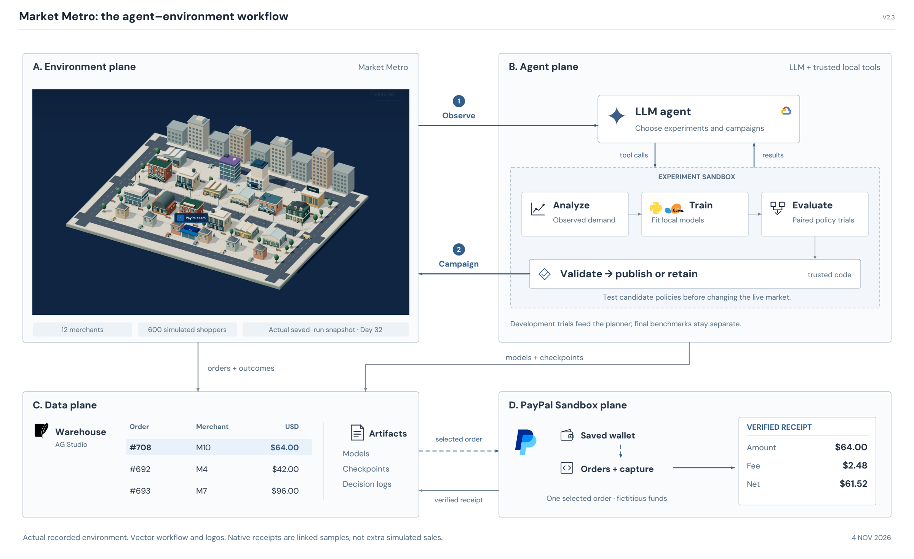

# Market Metro: agent and environment workflow

[Choose among three research-paper mockups](mockups/README.md): journal serif, ML methods, or typed protocol. The options add technical detail and use the generic label **LLM agent**.

The actual market scene and the agent workflow sit side by side. Data and PayPal occupy the lower row; a local experiment sandbox sits inside the agent plane.

[Editable SVG](system-architecture.svg) · [PNG preview](system-architecture.png) · [PDF](../../../output/pdf/market-metro-planner-v23.pdf)

| Plane | What the viewer follows |
|---|---|
| Environment | An unedited screenshot of the actual Market Metro canvas, replayed at Day 32 |
| Agent | The LLM agent requests analysis, local training and trial evaluation; code validates publication |
| Data | Generated order rows, model artifacts, checkpoints and decision logs |
| PayPal Sandbox | A selected existing order becomes a verified native receipt linked back to the warehouse |

The numbered observe/campaign arrows are the main feedback loop. Local development trial results return to the planner; final held-out benchmark scores do not. The nested experiment sandbox is a bounded numerical test workflow, not a claim of OS-level isolation. The planner consumes projected state and JSON evidence; the diagram does not imply unrestricted LLM SQL writes or payment authority.

## Actual environment and payment evidence

[Capture provenance](assets/environment-snapshot.json) records the saved session URL, displayed day, viewport and screenshot hash. The capture used only GET requests in an isolated browser and blocked API writes. It starts no new simulation, LLM job or payment. The city image is the application's rendered canvas, not generated artwork. The captured session is the recorded team-mode V2.3 replay; planner and team modes share the illustrated harness.

[Diagram evidence](assets/diagram-evidence.json) contains three real rows from the local synthetic warehouse and the archived native receipt fields. Highlighted order #708 / merchant M10 is the $64 merchant leg mirrored to PayPal Sandbox. Its fee is $2.48 and proceeds are $61.52. These are fictitious test funds; the native receipt is not extra simulator revenue. [Study and receipt evidence](../../commerce-expanded/harness-v2/v23-20261104/README.md).

The warehouse stores simulation events and native receipt lineage separately. The authored catalog/economy remain frozen; Channel3 is not active. Checkpoints support audit/replay, without claiming automatic recovery of uncertain provider calls.

## Export and reproduce

The SVG and PDF embed the authentic raster scene screenshot. Labels, logos, arrows, tables and workflow components remain vector-based. The [export validation](validation.json) records the expected image and embedded fonts; the final page was visually inspected.

[Drawing source](../../../scripts/render_planner_architecture.py) uses the committed screenshot and evidence files. With Python 3.12 and artifact-only packages reportlab, svglib==1.5.1 and pypdfium2, run `python3 scripts/render_planner_architecture.py` from the project root. This environment used the bundled runtime plus `PYTHONPATH=.local/diagram-deps`. Application dependencies were not changed. The [manifest](manifest.json) records the source hashes and captured scene identity.

## Asset credits

PayPal's mark comes from paypalobjects.com. Gemini comes from Simple Icons. Google Cloud, Python, scikit-learn and SQLite come from Devicon. [URLs and hashes](assets/sources.json), [Devicon MIT notice](assets/devicon-LICENSE.txt), and [Simple Icons CC0 text](assets/simple-icons-LICENSE.txt) accompany the assets. Trademarks remain with their owners. The environment is a screenshot of the project's own renderer; technical symbols are original vector artwork.
