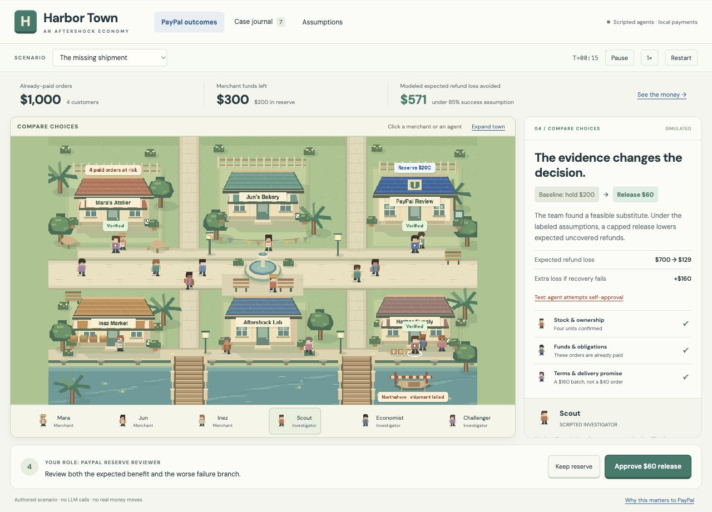
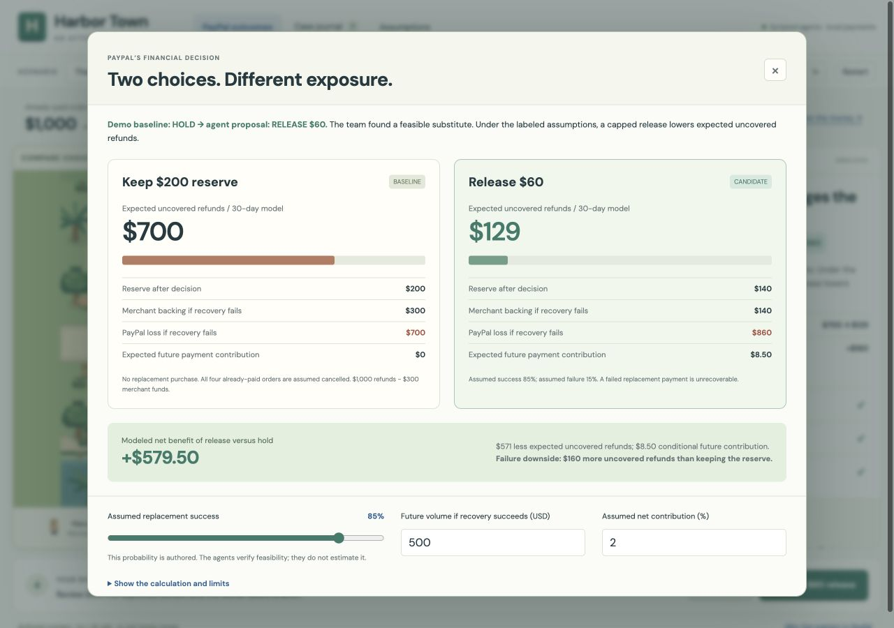

# Harbor Town: Aftershock as a playable economy

**Previous visual version.** The active demo is now [Supply Yard](supply-yard.md): the same simple layout and financial case with new warehouse, office and supply artwork. The village artwork shown below is historical.

The current homepage is **Harbor Town**, a pixel-art economy adapted from the user's original Mint Town. Aftershock is its investigation and reserve-decision system. This version deliberately uses scripted roles; no LLM, native PayPal request, or paid service is called.

The intended user is a PayPal merchant-reserve reviewer. The question is whether releasing a small amount of a seller's existing reserve can reduce the provider's eventual exposure to refunds on already-paid orders. This is an authored experiment, not an assertion that PayPal currently follows the demo policy.



## The concrete case

Mara sells four custom gift kits for $250 each. The **$1,000 has already been captured and settled**. Before the shock, $700 was spent and is assumed unrecoverable. The merchant has $100 available and $200 held in reserve. The original supplier fails.

The demo baseline keeps the reserve because no replacement has been verified. The three scripted investigators physically visit the relevant town locations:

The scenario assumes no other replacement supplier, merchant credit or financing within the deadline. Refund processing costs, support costs, reputation effects and financing costs are excluded; the displayed loss is the uncovered customer-refund amount.

- **Scout → Harbor Supply:** verifies four unreserved units in the current stock register.
- **Economist → PayPal Review:** checks that the customer payments were captured, the refund obligation is $1,000, and only $300 remains recoverable. These payments cannot use a void-authorization path.
- **Challenger → Mara's Atelier:** checks that the advertised $40 is per unit, the batch is four units costing $160 upfront, and delivery in two days fits the original four-day promise.

When all checks pass, the candidate is a **$60 reserve release**, bringing available funds to $160. Buying the replacement leaves $140 reserved and $0 available. The recommendation changes from the authored HOLD baseline to RELEASE only if the independent scenario assumptions and policy constraints also support it. The agents do not estimate the success probability.

## PayPal exposure and benefit

The 30-day example assumes full customer refund eligibility, PayPal covering any unrecoverable merchant shortfall, no other merchant assets or subsequent recovery, and no additional returns when the replacement succeeds. These assumptions do not describe universal PayPal policy.

| Quantity | Keep reserve | Release $60 and buy replacement |
| --- | ---: | ---: |
| Merchant funds backing refunds before action | $300 | $300 |
| Supplier spend | $0 | $160 |
| Reserve immediately after decision, before any refund | $200 | $140 |
| Recoverable merchant funds if the route fails | $300 | $140 |
| Customer refunds if delivery fails | $1,000 | $1,000 |
| PayPal's uncovered loss in the failure branch | **$700** | **$860** |
| Authored chance of successful replacement | 0% | 85% |
| Expected uncovered refunds | **$700** | **$129** |
| Expected new payment contribution | $0 | $8.50 |
| Contribution less expected uncovered refunds | −$700 | −$120.50 |

The release option produces **$571 less expected uncovered refunds** and **$579.50 modeled net benefit** under these inputs. The failure branch is **$160 worse**. Both results must be shown together.



Calculations:

```text
Keep:        $1,000 refund obligation − $300 recoverable merchant funds = $700
Release:     $300 merchant funds − $160 supplier purchase = $140 backing
Failure:   $1,000 refund obligation − $140 backing = $860
Expected:    15% failure × $860 + 85% success × $0 = $129
Avoided:     $700 − $129 = $571 expected loss avoided
New margin:  85% × $500 future volume × 2% assumed net contribution = $8.50
Net delta:   $571 + $8.50 = $579.50
```

The original cohort's transaction fees are sunk and **excluded**. The $500 is separate hypothetical new volume after successful recovery, and 2% is an authored net contribution assumption, **not a PayPal fee or margin disclosure**. Future contribution is never booked into the local cash ledger. The $60 release is merchant-owned money, not PayPal spending.

At a 10% success assumption, expected uncovered refunds rise to $774; modeled future contribution falls to $1; net benefit becomes **−$73**. The recommendation switches to HOLD. The UI exposes the probability, future-volume and contribution assumptions.

The authored policy additionally requires verified evidence, lower expected uncovered refunds, a maximum $60 release, and a maximum $900 failure loss. Increasing speculative future sales cannot override the expected-refund constraint. All these thresholds are demonstration choices, not PayPal policy.

## Visual and interaction design

The town contains three merchant sprites, four paid customers, five background pedestrians, three investigators, a supplier, a courier and a reviewer. Merchants have recognizable shops and apron sprites. Investigators have distinct badges and walk to their evidence sources. The supplier dock visibly closes after the shock; stock appears as crates; releases, procurement and refunds produce labeled money flows.

Click the characters or use the accessible character buttons. The inspector shows their role and current evidence. Pause freezes world movement and investigation; 2× changes simulation speed. Restart creates a clean case. Secondary detail is in the PayPal outcomes, case journal and assumptions dialogs so the town remains the dominant view.

The user plays the reviewer. After approval, choose delivery success, replacement failure, or pending refund. These are deliberately selected branches, not probabilistic samples or real provider responses. Pending refunds move no cash until reconciliation. The ledger distinguishes the selected branch from the earlier expected-value comparison and freezes the comparison at execution.

Other scenarios cover unavailable stock, Jun's competing reservation, an expired quote, a missing liability file, and a fragile recovery. A stock-race button changes inventory after approval; execution must reject the old decision before any funds move and permit a fresh investigation.

## Implementation and Mint Town reuse

Game Studio's architecture, UI, sprite and playtest skills informed this version. The existing Canvas 2D renderer was the smallest appropriate continuation of Mint Town; adding a new engine would not improve this bounded prototype. The simulation is outside the renderer, and the text-heavy HUD and accessible controls remain DOM-based.

Original sources inspected and adapted, without modifying the Mint Town checkout:

- `APAC Google Hackathon/web/dist/town-art.js`: town scenery and walkable street graph.
- `APAC Google Hackathon/web/dist/resident-sprites.js`: original pixel characters, directional walk frames and a shared foot anchor.
- `APAC Google Hackathon/web/dist/town.js`: movement, selection, pause and reduced-motion patterns.
- DM Sans font files and their accompanying OFL license.

The renderer creates cached 4-direction × 4-frame sprite atlases from the existing character drawing code. No newly generated image or external artwork is required. Harbor Town has its own names, shops, palette accents and state. B and C are visible counterparties, not full autonomous companies yet; background walking does not silently generate money.

| File | Responsibility |
| --- | --- |
| `demo/game/economy.mjs` | Serialisable world, agent jobs, evidence, comparisons, approval, money and refund invariants |
| `demo/game/streets.mjs` | Deterministic routing around buildings and the fountain |
| `demo/game/town-art.mjs` | Adapted Harbor Town scenery |
| `demo/game/resident-sprites.mjs` | Reused pixel character source |
| `demo/game/town-view.mjs` | Sprite atlases, selection, water, inventory, money and crate effects |
| `demo/game/app.mjs` | Commands, inspector, financial comparison, assumptions and journal |
| `demo/game/town.css` | Responsive game HUD and dialogs |

The original authorization-based decision lab is retained at `/lab.html` as an earlier experiment. Its $320 order example is separate from Harbor Town's already-captured $1,000 cohort.

## Limits and next integration boundary

This is a deterministic research game with explicitly authored probabilities, policies and outcomes. The script demonstrates the desired investigation and changed decision, not an LLM performance advantage. Success can be reversed by adverse evidence and assumptions.

Reserve authority remains simulated. Future PayPal Sandbox work must use owned approved orders and actual capture/refund/status responses; the local aggregate refund receipt is not a native batch-refund API. Full refunds would be scoped to the separate captured payments. Future model roles should use the same observation and action boundaries without receiving hidden outcomes or authority to approve themselves.

Actual provider benefit would require representative evidence, validated probabilities, full recovery accounting and operational evaluation. These modeled values are not forecasts or measured savings.
