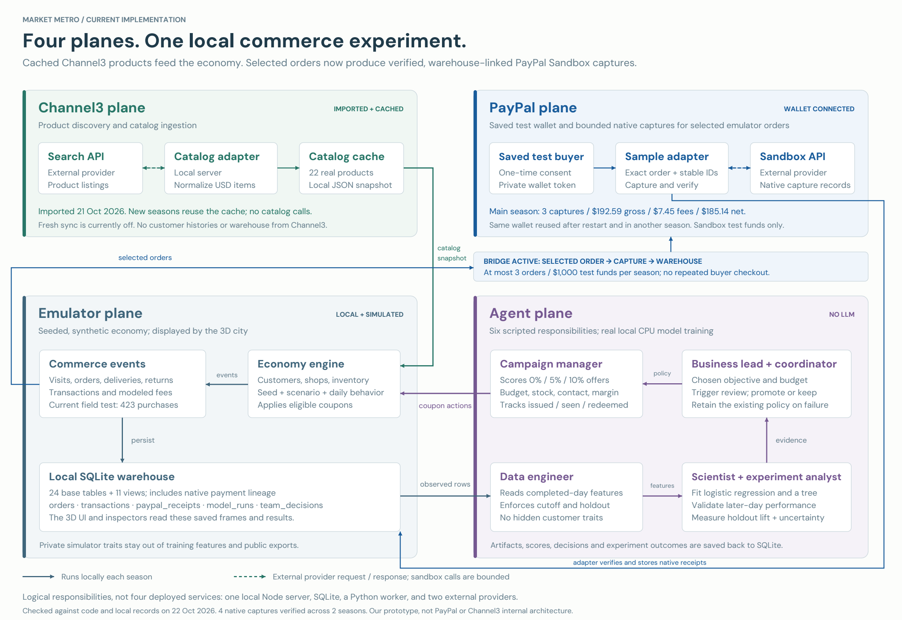

# Market Metro: four-plane architecture

Updated on **22 October 2026** after real PayPal Sandbox captures and receipt readback. Four native captures were verified across two emulator seasons, using the same saved test buyer. No live-money payment, new catalog search or cloud model call was made.

[Scalable SVG](figures/market-system-planes.svg) · [Drawing source](../scripts/render_market_architecture.py)

## Integration status

| Plane | What is implemented and evidenced | Current boundary |
| --- | --- | --- |
| Channel3 | Search adapter, product normalization and a saved cache of 22 API products imported on 21 October. The active season uses `CHANNEL3_API` product snapshots. | Each season reads the cache. No catalog searches happen during simulation. The current service reports fresh-import credentials and free-credit calls as disabled. Channel3 supplies product listings, not customer histories, inventory reality or a warehouse. |
| Emulator | Seeded customer behavior, fictional merchants, inventory, coupon exposure/redemption, orders, deliveries, returns and a simulated payment ledger. A local SQLite database has 24 public base tables and 11 views. | All customer behavior and financial outcomes are synthetic. The 3D city displays the recorded state; rendering does not create extra transactions. |
| Agent | Six scripted role responsibilities, local scikit-learn training, temporal validation, model promotion/rejection, coupon constraints and randomized holdout evaluation. Three model reviews exist in the displayed season; version 3 is active. | Real fitted ML, scripted coordination, no LLM planner. The roles are local code and a Python worker, not independently deployed agents or services inside either provider. |
| PayPal | Payment Method Tokens v3 saves one approved sandbox wallet. The Orders API captures selected emulator orders with that token, then verifies native receipts. Three main-season captures total $192.59 gross, $7.45 provider fees and $185.14 net. A second season automatically captured $31.99 using the same wallet. | At most three orders and $1,000 of sandbox funds per season. One test buyer and one test merchant represent the fictional population. Native receipts are sidecar evidence, not additional simulated revenue. The older standalone $100 receipt and blocked legacy card path remain separate. |

**The selected-order bridge is now working.** The marketing economy reads cached Channel3 products, and selected purchases are captured in PayPal Sandbox using a saved wallet. Every native capture links to the originating emulator order, product and coupon in the warehouse. The rest of the economy stays simulated.

## The active feedback loop

1. The catalog adapter previously searched Channel3 and saved normalized product IDs, titles, prices and source URLs locally.
2. Starting a season copies that snapshot into fictional merchant inventory. The current season has 24 merchant-product rows derived from the 22 cached source products; source products can be reused across fictional stores.
3. The seeded emulator generates visits, offers, purchases, deliveries and returns. Its ledger uses modeled fees; those are not observed provider fees.
4. The warehouse stores observed customer-day features, event dates, merchant/customer/product identifiers and financial lineage.
5. The data engineer prepares only completed-day observed features. Private simulator preferences and future outcomes stay out of training.
6. The data scientist fits logistic regression and a depth-limited tree locally. The experiment analyst checks later-day performance and holdout outcomes. The coordinator promotes a qualifying model or keeps the existing policy.
7. The campaign manager issues simulated coupons under budget, stock, margin and contact constraints. Customers respond according to seeded behavior, creating the next observations.

The model artifacts, predictions, decisions and experiment results are saved back to the same local warehouse. The business lead records the operator's chosen objective and budget and flags the configured market change.

## The integrated PayPal path

One-time setup:

`Generated sandbox buyer → PayPal approval → server verifies approved setup token → Payment Method Tokens v3 exchange → private saved wallet token`

Repeated sample payments:

`Selected emulator order → reserve one of three sample slots → persist idempotency keys → Orders API with saved wallet → verify native order and capture → paypal_receipts → v_paypal_order_lineage`

The server reads the order amount from SQLite; a browser cannot choose an arbitrary amount. Native requests include the simulator order in `custom_id`, a unique receipt reference and invoice, the exact USD total after the coupon, and `MERCHANT / SUBSEQUENT / UNSCHEDULED_PREPAID` stored-credential indicators. This uses the supported wallet-token flow, not the previously rejected direct-card route.

The provider result is read back and checked for order identity, emulator reference, invoice, amount, currency, capture ID and fee/net reconciliation. An uncertain request retries only with the same persisted request ID within the conservative five-hour window. A completed provider order without a verifiable capture cannot become a successful receipt.

The private token is stored in the ignored `.local/paypal-vault-setup.json` with owner-only permissions. It is tied to the sandbox app profile, never returned to the browser or exported in the warehouse, and persists across server restarts. Initial consent was explicitly approved by the user. Subsequent captures require no repeated buyer login or checkout while that consent remains valid.

## Sampling and accounting boundaries

- **Existing orders:** PayPal records lets the operator select up to three eligible orders and inspect their native receipts.
- **New seasons:** with a saved buyer, the brief defaults to up to three automatic samples. Sampling starts after the 28-day learning period; zero or one can also be selected.
- **Comparisons:** matched-policy replay never calls PayPal.
- **Account mapping:** one sandbox buyer and merchant represent the fictional population; this is not production multi-merchant onboarding.
- **Source separation:** `transactions` remains the simulated ledger; `paypal_receipts` contains actual sandbox responses. Their gross amounts must not be summed as additional sales.
- **Dates:** simulation event time and provider capture/verification time are separate columns.
- **Refunds:** simulated refunds do not issue native PayPal refunds.
- **Live payments:** live hosts, live mode and arbitrary user-supplied card details are unsupported.

The main season still has 423 field-test purchases and $36,482.05 modeled volume. Exactly three of those orders now have native captures totaling $192.59. See [validation evidence](paypal-wallet-integration-validation.json). No simulated coupon is issued to a real Channel3 retailer.

## Implementation evidence

- [Catalog adapter and cached-product status](../scripts/market-catalog.mjs): `normalizeChannel3`, `status`, `products`, explicit `sync`.
- [Market service and sample execution](../scripts/market-service.mjs): explicit order selection, automatic field-test samples, amount/count caps, saved-wallet payloads, persisted request identities and native receipt verification. Comparisons remain offline.
- [Reusable sandbox funding](../scripts/paypal-funding.mjs): setup state, provider-confirmed approval, token exchange, app ownership and the private saved-wallet token.
- [PayPal adapter](../scripts/paypal-sandbox.mjs): sandbox host, server-side OAuth, order/capture validation and saved receipt handling.
- [Local API routes](../scripts/serve.mjs): market status/run/table endpoints and local PayPal receipt listing are read-only; native payment actions use separate guarded POST routes.
- [Seeded economy](../scripts/marketing/economy.mjs): customer state, coupons, events and synthetic ledger outcomes.
- [Scripted coordinator](../scripts/marketing/orchestrator.mjs): review triggers, candidate fitting and promotion/rejection records.
- [Local trainer](../scripts/marketing/trainer.mjs): completed-day SQL features and a local Python subprocess with no provider credentials in its environment.
- [Schema and feature contract](../scripts/marketing/contract.mjs): observed feature allowlist, model and decision tables, coupon-to-payment views.

The four planes describe responsibilities. The implementation is one local Node server, local SQLite/JSON storage, a local Python training subprocess, a browser renderer and two external API providers. This is our prototype's architecture, not PayPal's or Channel3's internal architecture.
