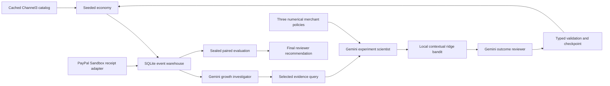

# Policy Lab implementation

**Emulator plane:** three whole-market branches use the same starting state and keyed exogenous draws. Their shopping paths diverge under different actions. The joint experiment budget is virtual. Merchant stock, costs, customer behavior and return timing are assumptions.

**Channel3 plane:** cached real catalog IDs, titles, prices and source URLs populate simulated merchant listings. No claim of real warehouse, inventory or customer access.

**Agent plane:** role order is fixed orchestration; investigation cut, strategy, audience, targets, training/reuse, exploration and review verdict are actual LLM decisions. Local code fits the learner and owns money/eligibility constraints. Three merchant actors use independent per-merchant numerical rules. This is not self-play or multi-agent RL.

**PayPal plane:** the existing saved-wallet adapter can mirror a selected emulator order using sandbox funds. It validates order/capture references and amounts, and uses persistent request identities. The successful first trial's receipt remains linked to its own order. The corrected trial uses it only as a labeled reference. Actual provider fees and simulated economics stay separate.

**Checkpoint plane:** requests precede calls; valid outputs precede effect publication. Failed output and provider costs are retained. One bounded correction can repair a typed decision. Unknown provider outcomes are not blindly retried. Training and policy publication are separate; state and publication checkpoint commit together. Late analysis cannot publish after the observation validity window.

**Evaluation plane:** controls stay out of training and review packets during trading. Their results are unsealed only after the complete tail. Saved publication times and fitted coefficients support an exact, zero-call replay. One seed establishes reproducibility and integration, not general economic improvement.

The full prototype remains one local Node process with SQLite. It reuses the existing Vertex client, spend ledger, PayPal adapter and Three.js district. There are no additional frameworks or cloud services.
