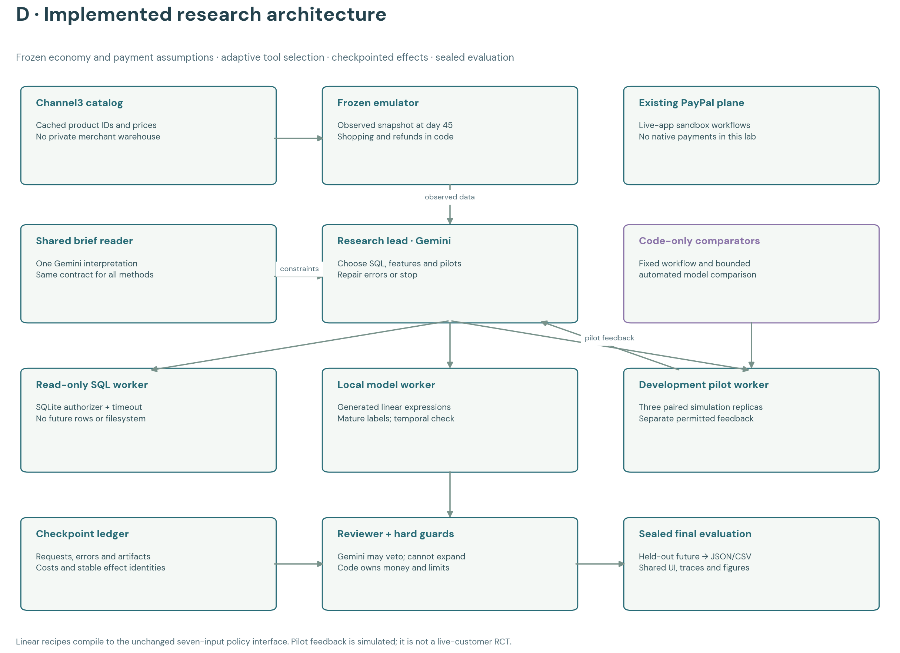
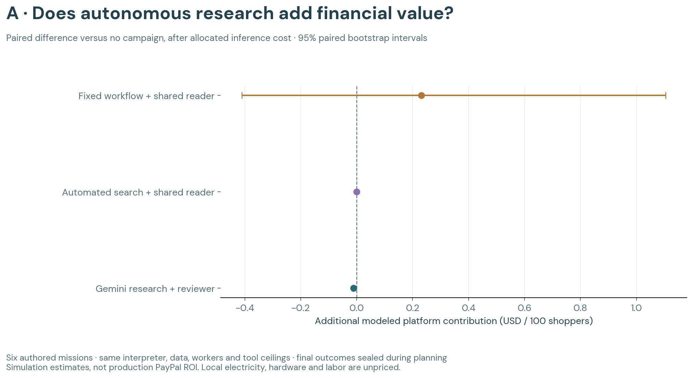

# Research workflow v3

The new workspace is implemented and six fresh Gemini missions have completed. Gemini writes SQL, chooses a bounded feature recipe, fits a local model, tests a campaign in a development pilot, and submits a decision for independent review. Every request, failure, tool result and decision is checkpointed. The existing simulation UI now replays these actual records without making paid calls.

**The workflow works; financial superiority is not established.** All six research missions chose to observe after negative pilot means. The automated comparator also observed. Successful execution is not proof that the agent's SQL or explanation is correct; a separate manual audit found semantic errors that the runtime guards did not catch.

[Open the research workspace](http://127.0.0.1:4173/?run=GARDEN-LAB-df43cd08499c0c0a&policyLab=GARDEN-LAB-df43cd08499c0c0a&policyView=benchmarks) · [Full results](result.json) · [Comparison CSV](cases.csv) · [Verification](verification.json) · [Semantic audit](semantic-audit.json)

## What each component does

| Component | Actual authority |
|---|---|
| Shared Gemini reader | Interprets the authored business brief once. All three methods receive the same validated constraints. |
| Gemini research lead | Chooses the next tool; writes SQL; chooses mean or ridge models, linear feature expressions and training windows; specifies a campaign and chooses a pilot or final decision. |
| SQL worker | Executes bounded read-only SQLite queries against the observed snapshot. No future outcomes, filesystem access, network or writes. |
| Model worker | Fits real local coefficients using mature outcomes and temporal validation. Generated linear recipes compile into the frozen actor's existing seven-input interface. |
| Pilot worker | Tests the proposed policy against no campaign on three separate development simulation seeds, through the return tail. Gives paired monetary feedback. |
| Independent Gemini reviewer | Approves or vetoes the proposal using its recorded evidence. Cannot increase the budget, change the world or see final test outcomes. |
| Hard guards and ledger | Validate source references, currency amounts, authority and effect identities; record calls and cost; stop on unknown paid requests. |
| Final evaluator | Unseals the mission's future only after the decision and review. Computes platform, merchant and transaction outcomes. |

The live app retains its earlier planner. v3 is a separate research runner with an in-app replay, not a silently promoted live policy. The native PayPal integration remains in the live app; v3 has no payment tool.



## One concrete run: a rival's sale

Mission 2 asks for reactivation of previous buyers inactive for seven days at Oak & Ink and Corner Supply. The authored authority is at most 5% off, $50 of simulated joint funding, and 14 days.

1. Gemini inspects the schema and writes three SQL queries. A customer-only join repeats observations: this is preserved and visibly annotated, not counted as correct merchant attribution.
2. It chooses a ridge model using recency, purchases, prior offers, price, observed affinity and recent refunds. The model worker fits the original mature observation rows, independently of exploratory SQL results.
3. Gemini proposes a reactivation pilot. Three paired development replicas show a mean platform difference of **−$5.97**, with an exploratory interval of **−$8.98 to −$4.43**.
4. It commits **observe**. The independent reviewer also selects observe. No final campaign is deployed.
5. The evaluator then runs the unseen final future. Ordinary shopping continues. The final difference from no campaign is only the **−$0.013939** allocated model cost.

This demonstrates tool-directed research and a decision grounded in an experiment. It does not show that Gemini outperforms a fixed pilot-and-stop rule. The erroneous query also demonstrates why SQL execution success alone is an inadequate quality gate.

## Matched evaluation

Six authored missions cover steady demand, a rival sale, budget pressure, supply delay and returns. Each has 100 simulated shoppers and three merchants. Observed data stops at day 45; a single candidate campaign can begin then, and the evaluator runs through 100 shopping days plus a 14-day return tail. Post-history metrics include days 30–100; identical pre-campaign days cancel in the paired contrast. There is no automatic campaign renewal.

All methods receive identical numeric observed rows, catalog, shared brief interpretation, local fitter, development pilot API and tool ceilings. Method-local identifiers differ. The opportunity audit, prior simulator and rules, and v3 executable inputs are hashed in [protocol.json](protocol.json). Original v1/v2 code is unchanged.

| Method | Workflow |
|---|---|
| Fixed + shared reader | Two fixed queries, one full ridge fit, two recommendation pilots, choose the best positive pilot mean or observe. |
| Automated search + shared reader | The same queries, four bounded model/window candidates, two pilots for selected candidates, the same commitment criterion. |
| Gemini research + reviewer | Adaptive SQL, model recipe and pilot choices, error feedback and independent final review. |

Tool ceilings are six query attempts, four admitted model fits, two admitted pilots and 16 planning decisions. Models and pilots consume their quota when actually admitted; rejected parameters still consume a model request and planning step. SQL runs in a separate process with a two-second timeout and bounded output.

The pilot and test use separate seeds. Pilot feedback is deliberately available to every method; final test outcomes are sealed. Pilot intervals contain only three replicas and are exploratory. The six final mission/seed pairs are not a representative or statistically powered PayPal ROI study. A planner-only versus planner-plus-reviewer ablation has not been run.

## Measured results

The primary quantity is the difference in **modeled platform contribution after allocated inference cost**, versus no campaign on the same mission. The unchanged economy accounts for modeled processing, incentives and delayed returns. These are assumptions, not PayPal's proprietary margins or observed production profit. Transaction volume and merchant contribution are separate outputs.

| Method | Completed | Mean platform difference | 95% paired bootstrap interval |
|---|---:|---:|---:|
| Fixed workflow + shared reader | 6/6 | +$0.231545 | −$0.410121 to +$1.104880 |
| Automated search + shared reader | 6/6 | −$0.000121 | −$0.000123 to −$0.000120 |
| Gemini research + reviewer | 6/6 | −$0.011623 | −$0.013379 to −$0.009703 |

The research and automated-search methods chose no outreach in every mission. Their negative differences therefore equal model costs. The fixed method tested outreach in two missions, with one positive and one negative final platform outcome. No method establishes reliable economic improvement in this sample.



The research execution used **71 actual evaluation model requests**, **26 SQL attempts**, **six fitted models** and **six development pilots**. This is real Gemini tool selection, not a saved-plan replay during evaluation. Browser playback uses the resulting saved records.

### Reliability findings

There were **22 failed tool attempts**, all retained:

- Six references to a missing `observations.merchant_index` column.
- Seven unsupported `PRAGMA` requests after a SELECT-only contract and schema had been supplied.
- Nine submissions whose structured pilot dollar amount disagreed with the measured pilot mean.

All six research missions recovered and reached a final decision. Separately, manual inspection found five classes of semantic issues: customer-only join duplication, an action-to-product key mismatch, an incorrect inactivity filter, inconsistent maturity denominators, and a reviewer calling a market-level dollar amount "per shopper". See the exact affected records in [semantic-audit.json](semantic-audit.json). This manual audit is not an exhaustive correctness rate. The app displays these annotations next to the original text without changing it.

The independent fitter does not train on arbitrary SQL output; it uses the original validated observations. The pilot and final score are calculated by code. Those boundaries contain the numerical effects of the exploratory SQL mistakes. They do not make the agent's reasoning reliable or prove that review is useful.

### Cost and controls

| Scope | Provider-token estimate |
|---|---:|
| Six-mission evaluation | $0.069738 |
| Three retained development attempts | $0.033640 |
| Entire v3 suite | **$0.103378** |
| Cumulative model ledger after v3 | **$1.108568** |

These amounts use provider-reported usage and the existing price ledger; they are not a cloud billing invoice. Shared parsing is billed once but its full cost is allocated to each comparator to represent standalone operation. Local electricity, hardware and operator labor are unpriced.

The v3 suite had a $1 ceiling, below the existing $0.25 per-case and $8 lifetime model limits and the user's $50 whole-hackathon ceiling. No new PayPal transactions, Channel3 requests, APAC resources or coding subagents were used.

## Free opportunity audit

Before paid evaluation, the local audit tested 72 fixed policy configurations in 1,195 rollouts. The best general development policy made no outreach and had zero gain. It also had zero gain on 50 separate confirmation cases. Choosing a winner after seeing each development outcome gives an optimistic mean of +$0.926 (interval +$0.404 to +$1.832), but that hindsight choice is not deployable or a true optimum bound. Untested policies may behave differently.

The evidence suggests limited reliable headroom in this tested policy class. The simulator was not changed to favor an LLM. A later experiment must justify a new task, feature or action class independently of the final outcomes; weakening the comparator is not a valid improvement.

## Reproduce and inspect

For this historical study, run the commands below in a separate checkout of [revision `6544108`](https://github.com/VinceVence/market-metro/tree/6544108c67dcb458ddafb2a8dee1cb1e4adc5195). It contains the matching scripts and npm commands.

The research sandbox was tested on Node **25.2.1** with SQLite's authorizer API. The base app's older Node minimum does not imply support for this new research runner. Plotting uses the existing local research Python environment and matplotlib.

```sh
# Offline checks and artifact regeneration; no cloud or payment calls.
npm test
npm run research:verify
npm run research:plot

# Potentially paid: resumes the frozen protocol and existing checkpoints.
# Completed cases are reused. Never delete paid-request records to force a retry.
npm run research:run
```

`npm run research:opportunity` was used before freezing v3. Do not rerun it over the frozen audit artifacts: their hashes are part of the evaluation protocol. A new opportunity search belongs in a separate version or scratch checkout.

The three development attempts remain under `pilot/`, including the two failed attempts. Evaluation journals, request metadata and observed SQLite snapshots remain under `missions/`. [verification.json](verification.json) checks frozen hashes, numeric evidence parity, mature outcomes, costs and model provenance. `npm test` completed with **222 passing tests**. UI verification and screenshots are recorded separately in [ui-validation.json](ui-validation.json).

| File | Purpose |
|---|---|
| `scripts/research-lab/data.mjs` | Observed warehouse, constrained SQL, feature compiler, local fit and frozen rollouts |
| `scripts/research-lab/workspace.mjs` | Tool authority, checkpoints and development experiments |
| `scripts/research-lab/agent.mjs` | Guarded Gemini reader, adaptive lead and final reviewer |
| `scripts/research-lab/run.mjs` | Protocol, matched comparators and sealed evaluation |
| `scripts/research-lab/verify.mjs` | Offline integrity and cost audit |
| `demo/garden/research-lab-view.mjs` | Recorded office replay, models, pilot results and annotated failures |
| `scripts/plot-research-lab.py` | Research figures, browser index and comparison CSV |

The next justified improvement is a shared semantic data contract: explicit join keys and row grain, generated unit/denominator checks, and an independent query-result validation step available to all methods. It should be tested on a new frozen protocol. Larger models, more agents and more spending are not supported by these results yet.
