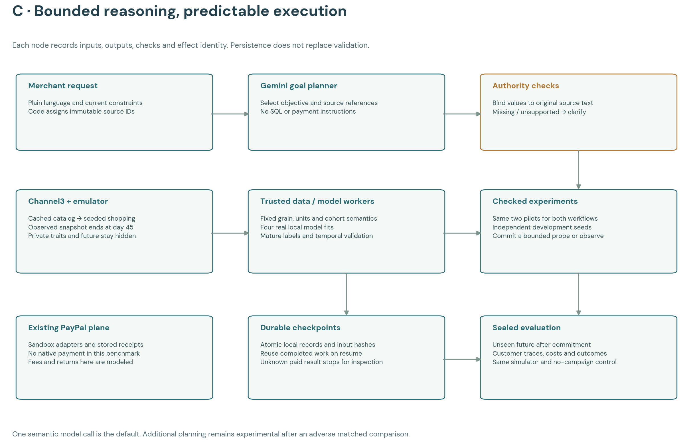
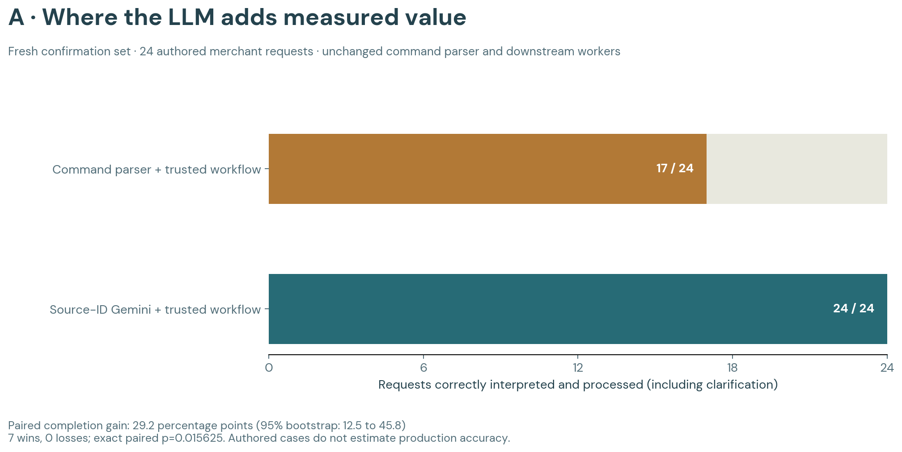
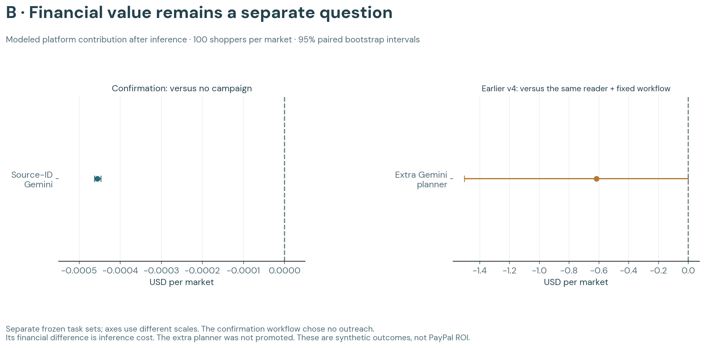

# Trusted commerce workflow: measured LLM value

The default uses **one Gemini interpretation followed by a predictable, checkpointed workflow**. The LLM selects a supported business goal and references to the merchant's request. Code binds those references to the original text, validates authority, runs trusted analyses, trains local models, tests candidates and commits a bounded simulation decision.

**Fresh confirmation: 24/24 exact workflow completions with Gemini versus 17/24 with the unchanged command parser.** Neither accepted an unsupported request. This supports the LLM's role in interpreting varied natural-language requests. It does not establish greater campaign profit or justify an additional free-form planning agent.

[Standalone demo](http://127.0.0.1:4173/trusted.html) · [Results](result.json) · [Frozen protocol](protocol.json) · [Verification](verification.json) · [Browser validation](ui-validation.json)

## Why this architecture

The [v3 audit](../v3/semantic-audit.json) found successful SQL queries with incorrect joins, inactivity filters and denominators. v4 replaced that interface with tested operations. An initial development run then exposed two semantic mistakes: Gemini invented a missing budget and narrowed a requested 30-day cohort to seven days. Those records remain under [v4 development](../v4/development/). A positive simulated outcome from an unauthorized interpretation was not credited as successful completion.

Source-bound validation repaired the development failures. On 24 frozen evaluation requests, v4 completed 22 versus the command parser's 17. Two copied evidence excerpts did not exactly match the request, although their structured terms were correct. v4.1 therefore makes the model select existing sentence IDs; code supplies the exact text. General authority and financial validators were retained, rather than relaxed.

This follows [Anthropic's guidance on workflows, routing and tool interfaces](https://www.anthropic.com/research/building-effective-agents) and [LangGraph's discrete steps and checkpoint boundaries](https://docs.langchain.com/oss/javascript/langgraph/thinking-in-langgraph). The implementation is a small local state machine, not a LangGraph dependency. These are established engineering patterns, not our novelty claim.

## What the LLM decides

The model recognizes the current objective, interprets paraphrases and corrections, and selects source statements that supply the constraints. It routes to four supported objectives: retained-sales growth, seven-day buyer reactivation, return-exposure diagnosis, or market explanation.

Code owns joins, row grain, inactivity definitions, monetary units, maturity filters, fitting, comparison, pilot scoring, budget checks and publication identities. The model cannot supply SQL, arbitrary code, reward formulas or payment recipients. Unsupported goals or missing authority require clarification. For users who can provide a structured form directly, this experiment does not show a need for an LLM.

| Stage | Implementation and saved evidence |
|---|---|
| Interpretation | Actual Gemini request; selected source IDs and proposed contract |
| Authority binding | Original amounts/windows, merchant scope, supported cohort and limits |
| Snapshot | Same frozen market and observed events before day 45 |
| Analysis | Tested merchant sales, mature returns, reactivation cohort and model readiness |
| Models | Four real local mean/ridge recipes with temporal validation |
| Pilots | Two checked candidates on separate three-replica development seed groups |
| Commitment | Valid positive-mean candidate with merchant checks, or observation; still an uncertain simulated probe |
| Evaluation | Unseen future after commitment; 100 shopping days plus a 14-day return tail |

Each node saves its input hash, output, status and effect identity. Completed fits and pilots are reused after recovery. Changed contracts, snapshots and live implementation versions are rejected. Unknown paid-model outcomes stop for reconciliation instead of silently issuing another request. The local service runs one workflow at a time.



## Confirmation

Code and 24 new authored requests were frozen before confirmation: six direct requests, six paraphrases, six revisions/negations and six ambiguous/unsupported requests. Expected specifications were evaluator-only; runtime validators never compared output with expected answers. Both methods received identical requests, safe observations, worker interfaces, four model recipes and two pilot slots. The treatment difference was language interpretation.

| Measure | Command parser + workflow | Gemini + same workflow |
|---|---:|---:|
| Exact end-to-end completion | 17/24 | **24/24** |
| Incorrect ready decisions | 0 | 0 |
| Unsupported requests accepted | 0/6 | 0/6 |
| Unnecessary clarification | 7 | 0 |
| Model inference estimate | $0 | **$0.010928 total** |

The paired completion difference is **+29.2 percentage points**; the 95% paired bootstrap interval is **+12.5 to +45.8 points**. There were seven wins, zero losses and 17 ties; the exact paired sign-test p-value is **0.015625**. These describe the authored set, not production accuracy. The interval does not eliminate selection bias or establish generality beyond these objectives.

Here, completion means the request was interpreted exactly and the prescribed evaluation/report/clarification workflow finished correctly. It does **not** mean a sales-growth target was achieved. The frozen result field `grade.goalCompleted` uses that operational definition; financial success is scored separately.

The verifier checked **80 actual local model fits**, **40 development pilots**, matched snapshots, source binding, mature outcomes and accounting consistency across both methods. Local compute, electricity, hardware and labor are unpriced.



## Extra planning was not promoted

The separate [v4 experiment](../v4/result.json) gave a fixed workflow and an additional Gemini planner the exact same LLM interpretation and evidence. Both completed 22/24 requests. Extra planning changed mean modeled platform contribution by **−$0.617805 per 100-shopper market**, with an exploratory interval of **−$1.504512 to −$0.000259**, after inference cost. It added no completions. That is evidence against promoting the extra planner in this setting.

The v4.1 default retains interpretation and uses code for subsequent model/pilot selection. All confirmation campaigns selected observation; ordinary shopping continued. Their financial difference from no campaign was only inference cost: **−$0.000455 per market on average**. Merchant contribution was unchanged. **No increase in PayPal profit was demonstrated.**



## Live app and integrations

**Try a mission** starts an actual autonomous server workflow without this chat. Each request has a stable job ID, checkpoints, a $0.25 per-case model cap and no native-payment capability. A URL with `trustedJob=<id>` restores saved state without creating another request. Interrupted jobs can resume when their code version matches and their paid request state is known.

Two custom runs completed, one via the API and one through the browser form. Each used one Gemini call, four fits and two pilots, then selected observation. Costs were **$0.000462** and **$0.000463**. The browser run recorded **1,196 simulated purchases** with no outreach. See [live runs](live-runs.json) and [browser validation](ui-validation.json).

The existing Channel3 catalog cache and PayPal Sandbox integrations remain. Channel3 supplies reference products; shoppers and transactions are simulated. This experiment uses modeled fees, returns and incentive costs. It issued **no new PayPal payment**, made no Channel3 search call and changed no APAC resource. Existing native receipts establish integration behavior, not policy ROI.

## Cost and checks

| Work | Token-based estimate |
|---|---:|
| First development attempt, failures included | $0.006345 |
| Grounded development rerun | $0.006111 |
| Frozen v4 evaluation | $0.017400 |
| Fresh confirmation | $0.010928 |
| Two live app runs | $0.000925 |
| **Entire trusted-workflow work** | **$0.041709** |
| **Cumulative ledger after live runs** | **$1.150277** |

These are provider-token estimates, not billing invoices. The existing $8 lifetime and $0.25 per-case guards remain below the authorized $50 ceiling; this suite also has a $1.50 guard. No coding subagents were used.

The full offline suite passed **231 tests**. Targeted service tests were rerun after recovery changes. Desktop 1280×900 and mobile 390×844 were checked, including source references, models, replay, the paid form, error logs and previous benchmarks. Recovery tests interrupt fitting, pilots and commitment, then verify completed artifacts and effect identities are not repeated.

## Reproduce

Research tools were tested on Node 25.2.1. Recorded playback needs neither model credentials nor a saved private economy. Fresh Gemini missions require the configured isolated Vertex project and spend ledger.

```sh
npm run dev
# Open http://127.0.0.1:4173/trusted.html
npm test
npm run trusted:verify
npm run trusted:plot
```

`npm run trusted:benchmark` resumes frozen confirmation and can make paid calls for unfinished cases. Completed requests are reused. Preserve journals; do not delete them to force a retry. New changes require a new protocol and fresh cases.

| Code | Responsibility |
|---|---|
| `scripts/trusted-workflow/contract.mjs` | Authority, source checks and command baseline |
| `scripts/trusted-workflow/source-router.mjs` | Existing-source-ID Gemini interface |
| `scripts/trusted-workflow/tools.mjs` | Analyses, local fits, pilots and durable nodes |
| `scripts/trusted-workflow/service.mjs` | Autonomous jobs and resumption |
| `scripts/trusted-workflow/confirm.mjs` | Matched confirmation and outcome accounting |
| `scripts/trusted-workflow/verify.mjs` | Source, cost and outcome verification |
| `demo/garden/trusted-workflow-view.mjs` | Office replay, figures and live form |

The supported conclusion is an inexpensive natural-language interface to a governed data-science workflow. Broader requests, independently authored tasks, structured-form comparisons and real business outcomes remain necessary before claiming production benefit or a winning hackathon result.
