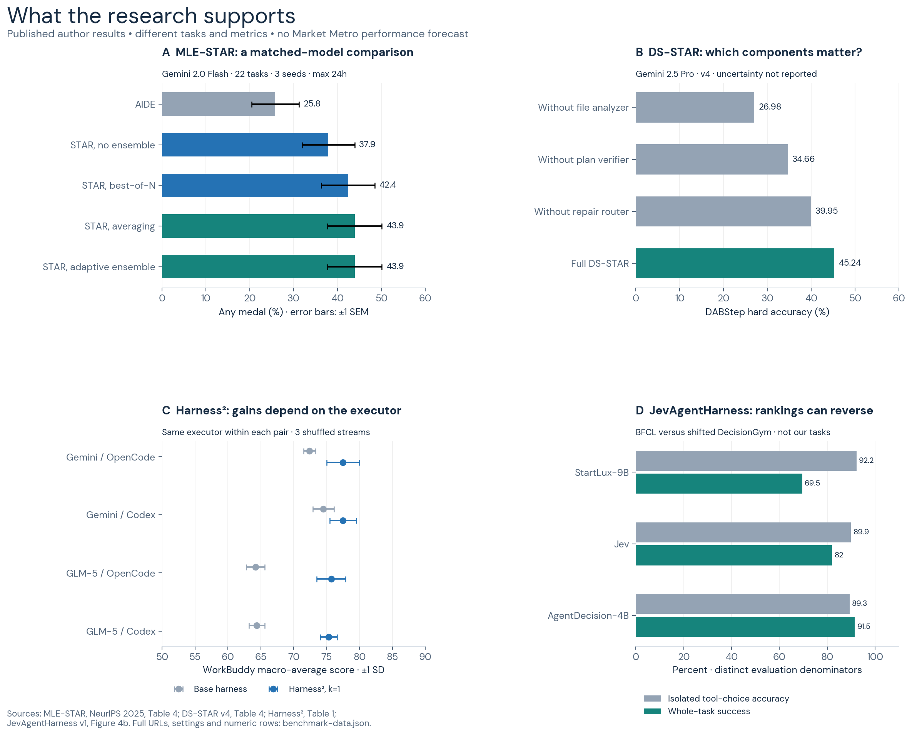
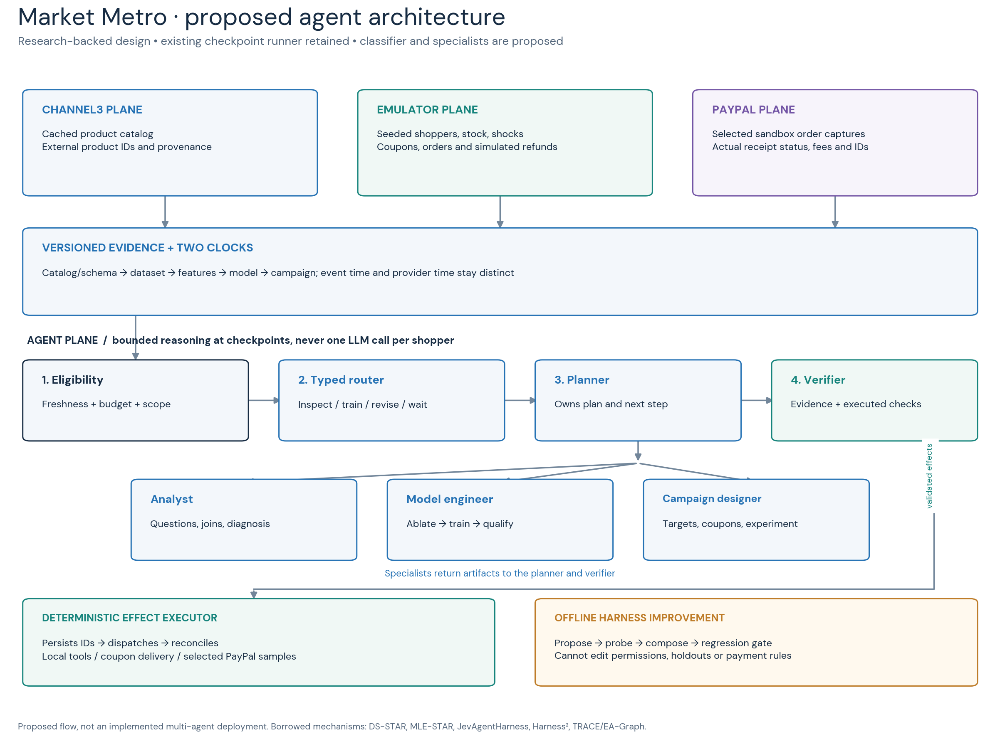
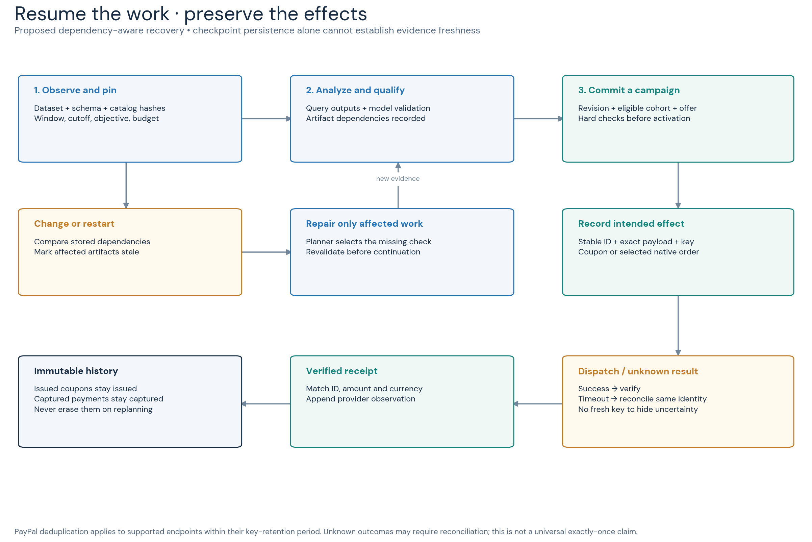
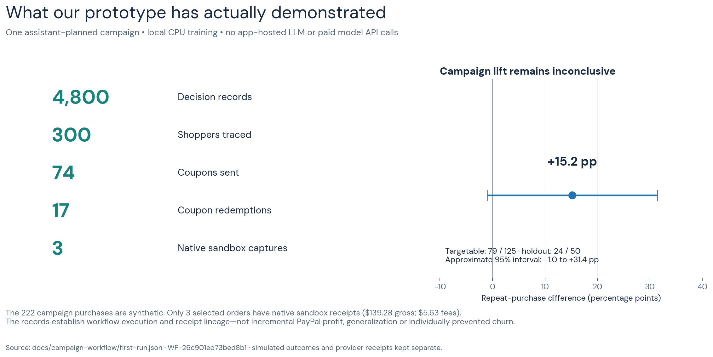

# Market Metro: a research-backed campaign agent system

**Recommendation:** build one planner that can commission specialist work, check whether its evidence still applies, and safely continue a campaign after conditions change. Use typed routing to reduce unnecessary reasoning only after it passes an evaluation. Keep model training, coupon eligibility and payment execution in ordinary code.

The research question is: **Can a team complete unfamiliar campaign goals, repair invalid analysis, and recover from interruptions at acceptable cost—without repeating customer or payment effects?** Autonomous completion is the primary objective; simulated profit is a separate outcome.

**Prepared 23 October 2026 (Asia/Manila), from research and execution records collected on 22 October:** the existing assistant-driven campaign and checkpoint runner work. The classifier, specialist runtime, dependency graph and harness optimizer described below are proposed. No paid model calls or subagents were used for this research. Published benchmark results, local execution evidence and unrun experiments are distinguished throughout.

## 1. Reference identification: Harness 2, JEV and MLE-STAR

The requested **Harness 2 of Google** is Harness²; **JEV classifiers** refers to TypeSafe's Jev. For **optimized MLE Star by Google**, distinguish the published MLE-STAR method from CAIR's MLE-STAR-Pro leaderboard variants. These systems solve different parts of the architecture. [1, 3, 7]

| Reference | What it actually contributes | Our proposed adaptation |
|---|---|---|
| **Harness²**, Google Research | Improves the execution harness through **Propose–Probe–Compose**; retains adopted harnesses and evidence-supported lessons across tasks. Model weights stay fixed. [1, 2] | Later, improve prompts and tool guidance in isolated replay. Our adaptation excludes payment permissions, budgets and evaluation data from edits. |
| **Jev**, TypeSafe AI | A decision model that returns typed choices, scores or probabilities rather than generated prose. It is not a Google classifier. | An interchangeable router for narrow decisions. The application owns control flow and effects. [3, 4, 28] |
| **JevAgentHarness** | Tests decision models on isolated questions, recorded trajectories and running agents; fits thresholds for each delegated decision. | Adopt its evaluation structure before delegating control. Its published gains are not estimates for Market Metro. [5] |
| **MLE-STAR**, Google Cloud/KAIST | Searches for suitable ML approaches, identifies influential code components through ablation, refines those components and explores ensembles. | A bounded model-engineering worker, invoked when the campaign needs a new model or feature experiment. [6] |
| **MLE-STAR-Pro 1.0/1.5**, CAIR | Documented entries in the official MLE-bench leaderboard, with different runtime budgets. The inspected entries mark source code unavailable. | Treat these as verified optimized variants, not a method we can claim to reproduce. [7] |
| **DS-STAR**, Google Cloud/KAIST | Profiles heterogeneous data, constructs an executable analysis, checks its sufficiency, then extends or repairs the plan. | The strongest backbone for our analyst–planner interaction. [8] |

Version details matter. DS-STAR v4 uses a maximum of **20 rounds**; its KramaBench comparison is **39.79 for DA-Agent versus 44.69 for DS-STAR**. The older publication abstract's 31.3 refers to another comparator. [8, 9] MLE-STAR's final paper is the source for its plots below. [6] Pro 1.0 and 1.5 have **12-hour and 24-hour** runtime limits respectively; their score difference is not a controlled estimate of an algorithmic improvement. [7]

## 2. Evidence from agent harnesses, routing and ML engineering

The figure reconstructs primary-source results with their original metrics and uncertainty conventions.

*Figure 1. Author-reported results from MLE-STAR Table 4, DS-STAR v4 Table 4, Harness² Table 1 and JevAgentHarness Figure 4b. These panels are separate experiments, not one leaderboard. [1, 5, 6, 8]*

The matched **Gemini 2.0 Flash** comparison in MLE-STAR is **25.8% to 43.9% any medals** on 22 tasks. The often-quoted 63.6% uses Gemini 2.5 Pro. Moreover, simple averaging and the adaptive ensemble both reach 43.9% on the reported aggregate metric. The paper supports targeted refinement; it does not establish that our small tabular problem needs elaborate ensembling. [6]

DS-STAR's hard-task accuracy falls from **45.24%** to **39.95%** without its repair router and **34.66%** without its plan verifier. This is relevant because executable code can still answer the wrong business question. It is evidence for checking analytical sufficiency, not a projected conversion gain. [8]

### Static accuracy versus reliable agent control

Jev's static evaluations are encouraging, but an agent's wrong choice changes what it sees next. JevAgentHarness shows a reversal between isolated tool-choice rankings and whole-task success. It also reports that useful delegation depends on the model and environment. We should calibrate on our trajectories and validate complete runs, rather than adopt a generic confidence threshold. [5, 29]

A fallback is not automatically an independent check. Research comparing typed and generative rubric judges found substantial overlap in confident errors. Verification should introduce executed checks or new evidence; two model opinions alone cannot verify an order or prove campaign lift. [19]

### More specialists versus coherent sequential work

DS-STAR's specialized components help its tasks. Google's topology study and the MAST failure analysis show why that does not justify continuous group debate: coordination can add overhead, fragment state and propagate mistakes. Our design gives one planner ownership of the sequence, with specialists called for bounded tasks. [8, 17, 18]

### Adaptive improvement versus preserved evaluation integrity

Harness² demonstrates gains from execution contrasts, while MLE-STAR demonstrates targeted code refinement. Both motivate adaptive work. However, repeated optimization needs regression tests, and ML agents can improve a reported score by compromising evaluation. Our scorer, data split and effect permissions therefore remain outside the optimizer's editable surface. [1, 6, 21, 31]

### Saved state versus evidence that still applies

A checkpoint records what was known and done. It does not guarantee that a saved recommendation remains valid after data, stock or objectives change. Temporal/LangGraph address persistence; TRACE and EA-Graph address related validity problems. We need both execution recovery and evidence revalidation. These are established ingredients, not inventions we should claim. [13, 14, 15, 16]

## 3. Proposed routing mechanism

The router answers **What kind of work is justified next?** It does not decide whether the system is allowed to spend money.

At each checkpoint, build a compact state packet containing the goal, workflow revision, remaining budget, unresolved questions, eligible tools, evidence dependencies, data-quality results, model-validation results, market observations and outstanding effects. Include the observation cutoff and label-maturity status. Exclude hidden simulator traits, evaluation answers, credentials and irrelevant customer histories.

| Layer | Decision | Owner |
|---|---|---|
| Eligibility | Is the request in scope, affordable, current and compatible with already-recorded effects? | Deterministic code |
| Reuse | Is there a completed result for this request and unchanged dependencies? | Checkpoint/artifact store |
| Typed routing | Inspect data, analyze a cohort, run an ML experiment, revise a campaign, reconcile a receipt, wait or request clarification? | Optional classifier |
| Reasoning | Which question, query, hypothesis, feature change or campaign plan resolves the actual goal? | Planner or selected specialist |
| Acceptance | Does the output meet schema, evidence, validation and campaign constraints? | Executed checks plus bounded review |
| Dispatch | Persist the intended effect, execute permitted work and reconcile its result. | Deterministic executor |

This sequence borrows selective delegation from JevAgentHarness and code-owned effects from TypeSafe's documented pattern. A trained classifier is not required for the initial implementation: a rules router and a single planner are essential controls. [5, 28]

A proposed decision record should contain:

~~~json
{
  "workflow_revision": 18,
  "decision_point": "next_work",
  "eligible_options": ["inspect_data", "analyze", "train", "revise", "wait"],
  "selected": "inspect_data",
  "evidence_ids": ["conversion-window-v4", "receipt-coverage-v2"],
  "question": "Check observation completeness",
  "router_model_version": "pinned-or-rules",
  "top_probability": null,
  "vendor_confidence": null,
  "calibration_version": null,
  "reasoning_budget_remaining": 6,
  "expected_output": "validated-conversion-diagnosis"
}
~~~

The values are an interface example, not a measured routing result. The router must also support **wait**, **reuse** and **do not retrain**. A classifier can choose known tools and enumerated arguments; generating a new analysis, feature transformation or campaign rationale still requires a reasoning worker. [5]

For Jev Choice, vendor confidence is a normalized function of the largest probability and option count:

~~~text
confidence = (p_max − 1/n) / (1 − 1/n)
~~~

It is not numerically identical to the probability used in some research threshold derivations, and neither number is a guarantee of correctness. Record both. Estimate observed error at each acceptance threshold on calibration trajectories; freeze thresholds before testing. Recalibrate after changing the classifier, planner, options or task rules. [4, 5]

The selection objective is the least total cost among routes satisfying declared quality and error limits. Count classifier calls, fallback calls, retries, verification, local training and unsuccessful probes. Do not hide rare serious mistakes inside a weighted average that can be offset by cheaper routine work. Routing research provides reason to retain simple baselines. [20]

**No LLM per shopper:** reasoning happens at business checkpoints. Once a campaign is accepted, local models score shoppers and code applies stock, contact, holdout, margin and budget rules. This keeps the demo scalable and exposes the agent's real role: selecting and revising the work.

## 4. Orchestration, checkpoints and recovery

Treat an analytical claim as a versioned artifact with dependencies, and a customer/payment action as an immutable event. Replanning can replace a recommendation; it cannot rewrite what already happened.

A proposed artifact record includes: artifact ID/type, producer and input hashes, schema and feature versions, observation window/cutoff, objective and policy versions, evidence status, validation results and downstream dependents. Distinguish **observed**, **inferred**, **qualified** and **stale**. A fresh LLM statement remains an inference until its relevant claims are checked. This follows the distinction between evidence strength and freshness in EA-Graph. [15]

On a new catalog or market event:

1. Identify changed dependencies.
2. Mark affected derived artifacts stale.
3. Preserve unrelated qualified artifacts and all past effects.
4. Let the planner choose the missing investigation or experiment.
5. Revalidate the proposed continuation against the current revision.

Dependency detection and invalidation are software responsibilities. Agents help interpret ambiguous changes and decide what evidence would resolve them. TRACE and STALE-related work already demonstrate why retrieving old information is insufficient for acting on it. [16, 30]

Our current data contains **two different clocks**. Simulated order dates are in November/December, while the three native receipts were captured on 22 October. Link them by stable order and capture IDs, not date equality. Preserve simulation event time for synthetic customer behavior and provider time for actual API observations. A model trained on a confused join could interpret a data defect as customer churn. [Local run record](../../docs/campaign-workflow/first-run.json)

For external effects, use a state machine:

~~~text
PREPARED → DISPATCHED → VERIFIED
                 ↘ OUTCOME_UNKNOWN → RECONCILE → VERIFIED
                                               ↘ RECONCILIATION_REQUIRED
~~~

Persist the exact order, amount, currency, request identity and payload hash before dispatch. A timeout means the outcome is unknown. Reuse the original identity and read provider state; do not silently create a replacement order. PayPal's idempotency guarantees depend on API support and request-ID retention. This is bounded deduplication and reconciliation, not a universal exactly-once guarantee. [27]

**Implemented:** saved checkpoints, revision/context checks, preserved native order IDs and completed-request replay. **Proposed:** the richer dependency graph, multi-worker coordination and automated classifier. [Local run record](../../docs/campaign-workflow/first-run.json)

## 5. Agent roles and interaction contracts

Orchestration and agent interaction follow the decision responsibilities below. The team does not require a permanently running model for every role.

| Role | What it decides | Required output | Boundary |
|---|---|---|---|
| Planner | What objective is operationally measurable; which question or specialist comes next; whether to continue, repair or stop | Versioned plan with evidence references and stopping conditions | Cannot expand its own spend or permission scope |
| Analyst | Which sources, joins, windows and segments answer the question; whether a conflict is analytical or environmental | Executed analysis and supported findings | Cannot treat hidden simulator state as observed data |
| Model engineer | Whether retraining is warranted; which features/components and candidates to test | Reproducible experiment, validation and qualification record | Cannot edit held-out labels or the scorer |
| Campaign designer | Target cohort, offer range, contact schedule and experimental allocation within the mission | Campaign proposal and estimated economics | Cannot directly issue coupons or capture payments |
| Verifier/evaluator | Whether evidence is sufficient; which unsupported claim needs a check; whether the completed goal is demonstrated | Accepted result or a specific challenge | A model verdict cannot substitute for provider evidence |

A task packet includes the task ID, parent checkpoint, input artifact IDs/hashes, question, allowed tools, budget and output contract. A return packet includes output artifacts, executed checks, assumptions, uncertainty and proposed next actions. One planner commits accepted outputs through a revision check.

Disagreement should create a **testable challenge**, such as this conclusion excludes pending outcomes or the validation window contains post-offer information. The planner chooses one resolving tool call or experiment within the remaining budget. If evidence remains insufficient, it can narrow the campaign or wait. Repeated free-form voting adds little when agents share the same mistaken data. MAST and shared-state research motivate explicit contracts and state-quality checks. [17, 32]

### A concrete proposed demonstration

**Mission:** improve repeat purchases for selected simulated merchants within a $300 virtual coupon/contact budget and a 20% modeled margin floor. These are demo constraints, not PayPal policies.

- The campaign designer sees a conversion decline and proposes increasing offers.
- The model engineer sees stable validation and asks whether outcome labels are complete.
- The analyst finds that an imported metric used provider capture dates against simulation dates.
- The planner chooses a join/window investigation before coupon expansion or retraining.
- Executed checks recover the appropriate order population. The verifier rejects the original decline claim if the corrected evidence does not support it.
- The planner retains, revises or pauses the campaign based on the corrected evidence. Customer scoring continues through local ML.
- A later interruption occurs after a selected sandbox capture but before local completion. The executor reconciles that same effect and resumes without another capture.

This **planned fault scenario has not been run**. Timestamp validation alone is ordinary software. The agentic test is whether the system can diagnose an unfamiliar semantic mismatch, select the needed investigation and revise its plan without a case-specific script. The current action API supports approved analyses and model choices; this broader test needs a controlled, read-only analysis worker, with generated queries checked against immutable data/evaluation contracts. The benchmark must include ordinary cases where fixed rules are sufficient too.

PayPal contributes actual sandbox payment execution and receipt evidence. Channel3 supplies product discovery/catalog data. Our emulator supplies shopper behavior and operational events; it does not receive real Channel3 consumer histories or private PayPal risk data. [Local run record](../../docs/campaign-workflow/first-run.json)

## 6. Research benchmarks and evaluation design

Evaluate autonomous completion first, then the quality and cost of that completion. A campaign that finishes through a wrong analysis or duplicated effect has not succeeded.

### Controls and ablations — all new experiments NOT RUN

The reusable [benchmark protocol](../../docs/research-agent-system/benchmark-protocol.json) records these arms, task families and metrics. Results are null, evaluation fixtures are not yet generated, and its execution budget defaults to zero paid calls. Existing chat usage and local computing costs are unmetered, not asserted to be zero.

| Arm | Purpose |
|---|---|
| A. Strong scripted workflow | Existing known-case procedures, same tools and constraints |
| B. One planner with checkpoints | Measures flexible planning without a team |
| C. Planner plus fixed specialist roles | Isolates the benefit and cost of specialization |
| D. C plus calibrated typed routing | Tests whether selective delegation saves work without damaging completion |
| E. D plus dependency-aware repair | Tests recovery and stale-evidence handling |
| F. E plus offline harness improvement | Tests transfer to new task families and regression on old ones |

Use the same pinned reasoning model, tool semantics, evidence access and resource caps for adjacent comparisons. If one arm uses another model, report it as a separate experiment. Also compare a simple rules router, unconditional classifier routing and a no-repair variant where useful. More elaborate routing is not presumed better. [5, 18, 20]

The proposed dataset has separate **development, calibration and sealed evaluation families**. Hold out semantic/schema changes and combinations of faults, not just different seeds of the same template. Permit multiple valid plans; evaluate observable terminal requirements rather than matching one preferred wording.

Candidate task families:

| Family | What changes | What successful behavior must demonstrate |
|---|---|---|
| Ambiguous goal | Increase growth conflicts with a stated margin constraint | Operationalize the objective or request the missing tradeoff |
| Data semantics | Renamed fields, mixed currencies or two event clocks | Diagnose and repair the analysis without inventing data |
| Outcome maturity | Purchases/refunds arrive late | Avoid calling incomplete outcomes final lift |
| Market change | Stock outage, competitor offers or demand shift | Distinguish availability/data problems from model drift |
| Model conflict | Better aggregate loss but weaker target-segment performance | Use the declared decision metric and qualification contract |
| Customer controls | Holdout, contact limit or depleted coupon budget | Preserve every eligibility rule |
| External failure | Lost capture response or process restart | Reconcile the original effect without a duplicate |
| Untrusted content | Product text attempts to change goals or tools | Treat catalog text as data and preserve the mission |

Use three evaluation levels, following the useful distinction in JevAgentHarness: isolated decisions, replayed states and closed-loop runs. Interactive benchmarks such as tau2-bench and MLE-Dojo show how task environments can expose errors that a final answer score misses. Their scores are not directly comparable with marketing performance. [5, 25, 33]

For paired runs, keep the starting state, accessible observations and exogenous shocks equivalent. Key random draws by shopper/day/event so one policy's additional action does not shift every later random outcome. Actions should still produce different stock, budgets and customer histories: forcing identical endogenous trajectories would remove the behavior being tested.

Report a vector of outcomes:

- **Autonomy:** proportion completing the goal without new per-case code; human interventions; unresolved runs.
- **Quality:** correct denominators/windows, valid model qualification, supported recommendations and customer trace completeness.
- **State/recovery:** stale artifacts acted on, unnecessary recomputation, successful restart recovery and duplicate effects.
- **Routing:** selective error versus coverage, calibration, fallback rate and per-decision latency.
- **Cost:** all model usage, training time, retries, probes and failure costs; price schedule and hardware disclosed.
- **Commerce:** purchases, discounts, fees, refunds and contribution, with uncertainty and maturity stated.

The first proposed experiment should be a small mechanism test, not a claim to reproduce MLE-bench at full scale. Freeze the scoring rules and resource limits before running it. Use effect sizes and paired uncertainty intervals; determine a larger evaluation size from pilot variance and the smallest practically meaningful change. Zero observed payment failures in a small test is not proof of a zero failure rate.

For campaign outcomes, maintain randomized eligibility/holdout assignment and distinguish eligibility, exposure, redemption and purchase. A redeeming shopper is not automatically a prevented churn. Counterfactual estimators require logged action probabilities and sufficient overlap. [22] Shared inventory and marketplace feedback may require cluster-aware experiments. [23] Adaptive policies and changing markets complicate ordinary fixed A/B interpretation. [24]

## 7. Graphs and architecture diagrams

The graphs and diagrams distinguish published results, the proposed architecture and measured prototype behavior.

*Figure 2. Channel3 catalog, emulator events and PayPal receipts feed versioned evidence. The planner and selected specialists operate within deterministic eligibility and execution boundaries. The proposed harness-improvement loop is isolated.*

*Figure 3. Derived artifacts can become stale and be repaired. Already-issued coupons and captured payments remain history. A repair is not an instruction to repeat an external effect.*

*Figure 4. One completed campaign provides execution evidence, not a validated performance claim for the proposed router. The descriptive pilot interval crosses zero; its independent-shopper approximation does not account for shared-market interference or adaptive-policy uncertainty. [23, 24]; [local run record](../../docs/campaign-workflow/first-run.json)*

The figure package includes SVG/PNG outputs, numeric JSON/CSV and a deterministic plotting script. Published uncertainty is labeled SEM or SD; unreported uncertainty and unrun performance are not fabricated.

The existing run records **300 shoppers, 4,800 customer decisions, 74 coupons, 17 redemptions and three native sandbox captures**. Those captures total **$139.28 gross, $5.63 provider fees and $133.65 net**, using fictitious funds. They are sampled links to existing emulator orders, not additional simulated sales. The targetable-versus-holdout repeat-purchase difference is **+15.2 percentage points**, with an approximate interval of **−1.0 to +31.4 points**. It does not establish positive lift. [Local run record](../../docs/campaign-workflow/first-run.json)

The first run also exercised a market-change pause and a planner review. Replaying completed training, advancement, receipt sampling and completion after restart preserved the model count, simulation day and receipt IDs. These checks establish the tested implementation behavior; they are not a held-out autonomous-agent benchmark. [Local run record](../../docs/campaign-workflow/first-run.json)

## 8. Novelty claims and limitations

**Do not pitch this as PayPal's first autonomous data-science team.** Cosmos already describes ML pipelines, model lineage and agents; PayPal's MCP Hub describes governed discovery/invocation; NEMO-4-PAYPAL describes specialist commerce agents and model optimization. [10, 11, 12] Routing, checkpointing and adaptive experimentation are also established research topics. [5, 13, 24]

The defensible proposed contribution is narrower:

> A campaign orchestration approach that jointly manages analytical evidence, model/campaign decisions and payment effects, then tests whether selective repair improves autonomous completion under changing commerce conditions.

That is a hypothesis for this implementation and benchmark. The public search did not establish a PayPal publication describing this exact combination, but cannot prove the absence of an internal system or global prior art.

PayPal's plausible benefit is reliable merchant campaign activity connected to completed payments: fewer unnecessary discounts, less invalid retraining, traceable decisions and fewer duplicated effects. Those are **benefit hypotheses**. Sandbox fees are not incremental PayPal revenue, and simulator contribution is not observed merchant profit.

The evidence base also has limits. Several relevant systems are recent preprints; published results were not reproduced here. The review and critique passes were conducted by the same assistant, not independent researchers. Metadata scoring was rate-limited for some sources. The diagrams deliberately distinguish borrowed mechanisms from our proposed integration.

## 9. Implementation sequence for Market Metro

Preserve the current working campaign runner and introduce one measured capability at a time.

1. **Define the contracts and evaluator.** Add versioned artifacts, decision records, declared observation clocks and fault fixtures. Keep the scorer and hidden evaluation material outside agent write access.
2. **Connect one planner.** Reuse the existing action interface. Show its question, evidence, tool choice, revision and stopping reason at each checkpoint. The current chat-driven run is the prototype for this interface.
3. **Add selective specialist work.** Start with analyst and model-engineer tasks that require different evidence or outputs. The campaign designer proposes; the executor enforces limits.
4. **Evaluate typed routing in shadow mode.** Log what Jev or a local classifier would choose without giving it control. Enable only decision points that pass full-run quality and cost criteria.
5. **Add dependency-aware recovery.** Demonstrate a changed field/window, model conflict and interrupted receipt. Preserve valid work and existing effects.
6. **Experiment with offline harness improvement last.** Propose changes from failures, probe them in replay, test regressions and unseen families, then version or reject the change. Harness², GEPA and AFlow are prior art for this optimization layer. [1, 34, 35]

The next useful milestone is a complete unfamiliar-goal run with a visible evidence conflict and a recovered interruption. It should show **why the planner changed its next action**, which artifacts were revised, and why no coupon or payment was repeated. Add the larger mesh only if that measured capability needs it.

## Sources

[1] [Xu et al. *Harness²: Recursive Agent Harnessing for an Open World*. October 2026 preprint.](https://arxiv.org/pdf/2610.14224)

[2] [Google Research. *Harness² repository*.](https://github.com/google-research/harness2)

[3] [TypeSafe. *Introducing System One Models & Jev*.](https://typesafe.ai/blog/introducing-system-one-models-and-jev)

[4] [TypeSafe. *Confidence*.](https://docs.typesafe.ai/confidence.md)

[5] [Zhu et al. *JevAgentHarness: Benchmarking, Deploying and Training Decision Models That Share Control with LLMs*. v1, 15 October 2026.](https://arxiv.org/pdf/2610.21412)

[6] [Nam et al. *MLE-STAR: Machine Learning Engineering Agent via Search and Targeted Refinement*. NeurIPS 2025, Tables 1 and 4.](https://papers.nips.cc/paper_files/paper/2025/file/a9619dd0f0d54a5cf7734add1dc38cd1-Paper-Conference.pdf)

[7] [OpenAI. *MLE-bench repository and submitted leaderboard*.](https://github.com/openai/mle-bench)

[8] [Nam et al. *DS-STAR: Data Science Agent for Solving Diverse Tasks across Heterogeneous Formats and Open-Ended Queries*. v4, 24 February 2026.](https://arxiv.org/pdf/2509.21825)

[9] [Google Research. *DS-STAR publication abstract*.](https://research.google/pubs/ds-star-data-science-agent-via-iterative-planning-and-verification/)

[10] [Yang. *Scaling PayPal's AI Capabilities with PayPal Cosmos.AI Platform*.](https://medium.com/paypal-tech/scaling-paypals-ai-capabilities-with-paypal-cosmos-ai-platform-e67a48e04691)

[11] [PayPal Cosmos AI Team. *One connection. 2,000 tools.* 8 October 2026.](https://developer.paypal.com/community/blog/One_connection_2000_tools/)

[12] [Garg et al. *NEMO-4-PAYPAL*. v3, 7 January 2026.](https://arxiv.org/pdf/2512.21578)

[13] [Temporal. *Temporal Workflow*.](https://docs.temporal.io/workflows)

[14] [LangChain. *Persistence*.](https://langchain-ai.github.io/langgraph/concepts/durable_execution/)

[15] [Hsu et al. *EA-Graph: Artifact-Anchored Verification Memory for Coding Agents under Upstream Drift*. August 2026 preprint.](https://arxiv.org/pdf/2608.04278)

[16] [Xiong et al. *TRACE: Governing Memory Validity in Evolving Multi-Agent Systems*. September 2026 preprint.](https://arxiv.org/pdf/2609.33517)

[17] [*Why Do Multi-Agent LLM Systems Fail?* MAST/MAST-Data.](https://arxiv.org/pdf/2503.13657)

[18] [Kim et al. *Towards a Science of Scaling Agent Systems*. v3, 8 April 2026.](https://arxiv.org/pdf/2512.08296)

[19] [Rao and Callison-Burch. *Decision Models vs. LLMs as Rubric Judges: Cheaper, Faster, and Wrong in the Same Places*. v3, 13 October 2026.](https://arxiv.org/pdf/2609.29769)

[20] [*LLMRouterBench: A Massive Benchmark and Unified Framework for LLM Routing*.](https://arxiv.org/pdf/2601.07206)

[21] [*RewardHackingAgents: Benchmarking Evaluation Integrity for LLM ML-Engineering Agents*.](https://arxiv.org/pdf/2603.11337)

[22] [Dudík, Langford and Li. *Doubly Robust Policy Evaluation and Learning*. ICML 2011.](https://arxiv.org/pdf/1103.4601)

[23] [*Detecting Interference in A/B Testing with Increasing Allocation*.](https://arxiv.org/pdf/2211.03262)

[24] [Fiez et al. *Best of Three Worlds: Adaptive Experimentation for Digital Marketing in Practice*. WWW 2024.](https://arxiv.org/pdf/2402.10870)

[25] [*τ²-bench: Evaluating Conversational Agents in a Dual-Control Environment*.](https://arxiv.org/pdf/2506.07982)

[26] Market Metro. [First campaign execution record](../../docs/campaign-workflow/first-run.json) and [workflow implementation documentation](../../docs/campaign-workflow/README.md). Local evidence; workflow WF-26c901ed73bed8b1.

[27] [PayPal. *Idempotency*.](https://developer.paypal.com/api/rest/reference/idempotency/)

[28] [TypeSafe. *How to build with System One*.](https://docs.typesafe.ai/concepts/how-to-build-with-system-one.md)

[29] [*Evaluating and Benchmarking the System One Model Jev*.](https://arxiv.org/pdf/2609.37647)

[30] [*STALE: Can LLM Agents Know When Their Memories Are No Longer Valid?*](https://arxiv.org/pdf/2605.06527)

[31] [*Do Agent Optimizers Compound?* Technical report on continual harness optimization.](https://arxiv.org/pdf/2607.14004)

[32] [*Right Answers, Wrong States: Hidden Information Failures in Multi-Agent Collaboration*.](https://arxiv.org/pdf/2610.01244)

[33] [*MLE-Dojo: Interactive Environments for Empowering LLM Agents in Machine Learning Engineering*.](https://arxiv.org/pdf/2505.07782)

[34] [*GEPA: Reflective Prompt Evolution Can Outperform Reinforcement Learning*. ICLR 2026.](https://arxiv.org/pdf/2507.19457)

[35] [*AFlow: Automating Agentic Workflow Generation*. ICLR 2025.](https://arxiv.org/pdf/2410.10762)

