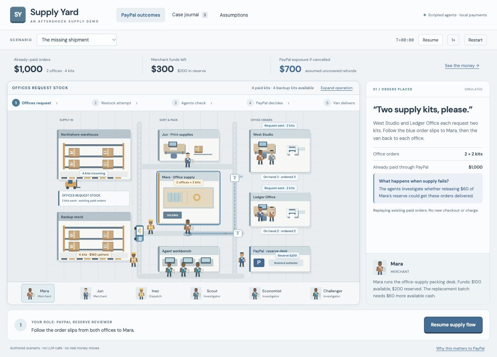

# Supply Yard

This document describes the preserved single-merchant walkthrough at `/case.html`. The default application now runs the [network economy](network-economy.md), with multiple merchant wallets, conflicting policy roles and three persistent shifts.

Supply Yard keeps the simple playfield-and-inspector layout and replaces the village with a small office-supply operation. It has two supplier areas, two supply merchants, two office buyers, a packing bench, a delivery van, and small agent and PayPal work areas. There is no city-scale market, company directory, price simulator, or additional dashboard.

The scenery and people are newly drawn Canvas artwork in `demo/game/yard-art.mjs`. They use warehouse racks, boxed kits, printers, packing tools, loading lanes, safety clothing and a van. The active renderer no longer imports Mint Town's scenery or resident sprites.

## One order flow

West Studio and Ledger Office each begin with two existing kits and have each ordered two replacement kits. There are four paid replacement orders totaling $1,000. The opening scene waits for **Play supply flow**. Then blue request slips travel from both offices to Mara, and Mara sends a combined four-kit restock request to Northshore. This replays existing orders; it never charges the buyers again. Existing office stock decreases by one every eight simulation seconds after play begins, stopping when the reviewer executes a branch.

The original supplier fails after the restock request. Its route turns amber and the scene explicitly asks for agent intervention. The backup warehouse has a four-kit batch costing $160 upfront. Mara has $100 available and a $200 reserve. **Scout** visits backup stock, **Economist** checks the reserve desk, and **Challenger** checks the batch terms at the packing desk. Highlighted work areas and evidence tags show each check completing. The user makes one PayPal reserve decision: keep the reserve or approve a $60 release under the existing authored constraints. Agents propose; the simulated reviewer authorizes. Approval does not move money until the approved plan executes and passes a fresh state check.

The original financial comparison is preserved: $700 uncovered refunds under cancellation; $129 expected uncovered refunds under the authored 85% successful-recovery assumption; $860 uncovered in the failed-recovery branch. These remain illustrative scenario outputs, not real PayPal policy, prices, measured savings or a model-estimated probability.

The selected success branch has physical simulation stops: **backup pickup → merchant restock → pack two orders → West Studio → Ledger Office**. Purchasing allocates the batch but leaves it at the warehouse awaiting pickup. The van carries four kits to Mara; the packing bench holds them for two simulation seconds; the van then delivers two to each office. Inventory and delivery receipts update at the matching arrival, not at purchase time. The screen stays in “delivery in progress” until both offices receive stock. The reserve visibly changes from $200 to $140 after execution, while modeled benefit stays labeled with its 85% success assumption. Only the completed selected success branch shows $0 provider coverage.

The five-step strip and a single in-scene caption explain the flow without adding a dashboard. Pause freezes requests, checks, packing and driving; restart clears them. Reduced-motion mode suppresses moving request slips and cosmetic animation while preserving the same simulation results. Routes and actors remain visible. The visual clock compresses time for the demo: seconds spent driving do not estimate the two-day delivery promise or a real logistics schedule.

## Scope and verification

- Scripted agents only; no LLM or native PayPal requests.
- The existing reviewer authority, stale-approval check, pending-refund reconciliation, monetary invariants and adverse cases remain.
- Office stock obeys `opening stock + received = on hand + consumed`.
- Purchased replacement stock obeys `awaiting pickup + van cargo + packing stock + office receipts = 4`. Each office's delivery receipts match its received stock. Refund and failure branches never dispatch this delivery sequence or add office inventory.
- Warehouse and office selection works through the playfield; participant buttons remain available for keyboard use. The canvas has a changing accessible description of office stock and the reserve.
- New loading routes stay outside warehouse, packing and office footprints.

Run with `npm run dev`; run the checks with `npm test`. The earlier Harbor Town checkpoint is preserved under `docs/archive/harbor-town-before-supply-yard/`. The removed metropolis draft remains outside the active application under `docs/archive/metropolis-draft-2026-10-19/`.

The broader novelty and financial hypothesis remain documented in the original research and [case explanation](harbor-town.md). This update changes presentation and adds a small inventory-use illustration; it makes no new claim of validated business benefit.
