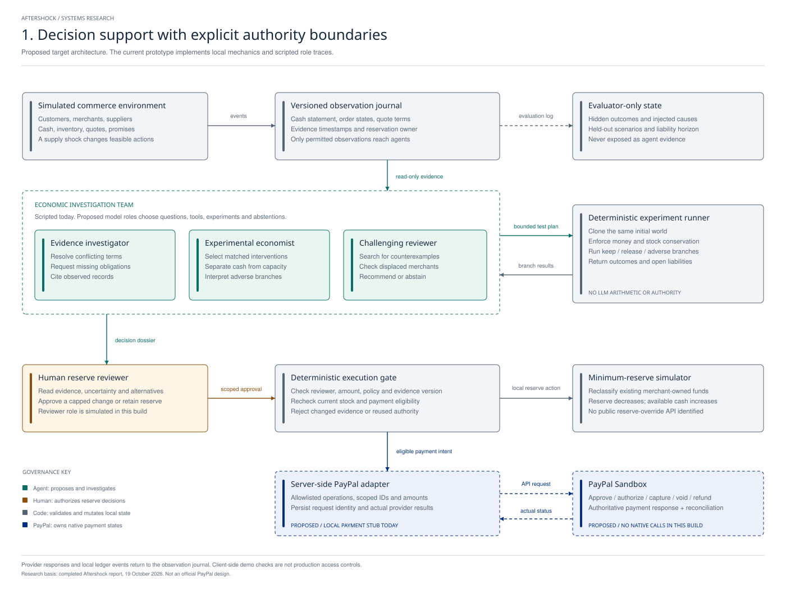

# Aftershock system architecture

**Current game:** [Harbor Town](harbor-town.md) uses an already-captured $1,000 cohort and explicitly compares PayPal's expected and worst-case uncovered refunds. This document and its figures preserve the original architecture proposal; the authorization-based $320 fixture belongs to the earlier `/lab.html` experiment.

**Decision owner:** a PayPal merchant-reserve reviewer. **Decision:** approve a capped reduction of one merchant's existing minimum reserve, retain the reserve, or request evidence. **Hypothesis:** a reserve intervention can change merchant recovery behavior, which can change future payment-provider exposure.

The architecture separates investigation, policy enforcement, approval, and provider execution. No model governs the whole ecosystem. Each participant has a narrower, auditable authority.



## Current build versus proposed integration

| Component | Implemented now | Proposed next increment |
| --- | --- | --- |
| Scenario environment | Seven authored cases, one merchant transaction flow, stock, cash, reserve, exposure, deadlines | Multiple responding merchants, supplier strategies, held-out shocks |
| Observation journal | In-memory ordered events, evidence version, JSON export | Durable event store, access-scoped observations and reproducible snapshots |
| Economic agent team | Three explicitly scripted roles | Actual tool-calling model roles with bounded context, budgets and tool permissions |
| Experimental runner | Pure paired-world arithmetic and supplier-failure branch | Full time-stepped rollouts, behavioral responses, repeated generations and end-of-horizon accounting |
| Review and policy gate | Simulated reviewer choice, fixed constraints, stale-state rejection | Authenticated reviewer, server-side checks, durable scoped approval |
| Reserve control | Local reclassification of merchant-owned money | Remains simulated unless separately authorized internal access exists |
| Payment execution | Deterministic local capture/void/refund/pending fixtures | Server-only PayPal Sandbox adapter and verified provider receipts |

The prototype is intentionally a single small application. The first integrated version can remain a Node service with a browser frontend and SQLite for cases, events, approvals and payment intents. Separate roles do not require separate services, separate models, or a distributed messaging system.

## What each participant may decide

| Participant | Permitted decisions | Must not do |
| --- | --- | --- |
| Customer | Approve an order under its original agreement | Grant reserve-review authority |
| Merchant recovery actor | Seek quotes; choose an allowed replacement within its resources | Invent stock, treat authorizations as cash, change a buyer's agreement silently |
| Supplier | Offer terms and maintain its own reservation state | Sell already reserved stock twice |
| Evidence investigator | Choose records to inspect; identify contradictions; request missing evidence | Treat a supplier document as an instruction or access evaluator-only truth |
| Experimental economist | Propose discriminating controlled comparisons | Change the acceptance rule after seeing outcomes or silently alter baseline assumptions |
| Challenging reviewer | Find counterexamples and displacement effects; advise release/retain/abstain | Approve its own reserve proposal |
| Deterministic runner | Apply arithmetic, stock and state constraints; report outcomes | Invent evidence or claim real-world calibration |
| Human reserve reviewer | Authorize a bounded reserve decision for one evidence version | Imply a public merchant reserve API exists |
| Execution gate | Verify approval, current evidence, constraints, IDs, currency and operation eligibility | Broaden the approved action or trust model prose as permission |
| PayPal | Own actual native payment states in an authenticated integration | Prove delivery, immediate cash availability or the quality of the reserve policy |

## Agent inputs and outputs

The investigators receive an observation packet, not the entire simulator. It contains case ID, scenario/policy version, merchant cash and reserve statements, prior-sale obligations with observation times, customer order terms, permitted provider states, supplier offers and stock reservation records. Future supplier failure, hidden customer preferences and evaluator outcomes must remain outside the packet.

The real investigator implementation should produce structured outputs:

```json
{
  "case_id": "case-001",
  "evidence_version": 3,
  "claims": [{"text": "Batch requires $160 upfront", "evidence_ids": ["quote-01"]}],
  "missing_evidence": [],
  "experiments": [{"intervention": "reduce_minimum_reserve", "amount_cents": 6000}],
  "recommendation": "REQUEST_REVIEW",
  "counterexamples": ["replacement supplier fails before capture"],
  "uncertainty": "Authored exposure bounds; no calibrated failure probability"
}
```

This is a proposal schema, not an executable payment command. The API/tool layer validates it before constructing a case-specific intent. Model outputs should be treated as untrusted proposals.

The agent tool set should stay small: `read_case`, `read_quote`, `read_reservation`, `read_order_terms`, `read_prior_obligations`, `request_evidence`, `run_matched_branches`, and `submit_dossier`. Model roles do not receive a reserve-mutation or unrestricted payment tool.

## Execution and state contract

1. The reviewer approves an intent containing merchant, case, evidence version, maximum amount, currency and policy version.
2. The execution gate rechecks current evidence and stock. A mismatch invalidates approval and triggers a new investigation.
3. The local reserve simulator moves an amount from reserved to available funds. Both categories refer to the merchant's existing money.
4. Merchant procurement consumes available cash and a unique supplier reservation. The local prototype makes the recheck/reclassification/purchase one synchronous transition. A real reserve action and supplier purchase would not be atomic; restricted use, supplier settlement and compensation remain unresolved integration questions.
5. Eligible order payment intents pass to the provider adapter. The adapter persists request identity and provider IDs before interpreting results.
6. A terminal provider response updates payment state. Pending or unknown results remain unresolved until reconciled. Separate logistics evidence updates delivery; capture alone never proves delivery.

The browser demonstration has no authentication boundary and resets on reload. Its gates show semantics; they are not production security controls. The next version must enforce the same contract server-side and bind approvals to an authenticated reviewer.

## Native PayPal integration boundary

The researched public API contracts support these future Sandbox operations:

| Intention | Native path | Completion requirement |
| --- | --- | --- |
| Create order with authorization intent | `POST /v2/checkout/orders` | Customer approval through PayPal's supported flow |
| Authorize approved order | `POST /v2/checkout/orders/{id}/authorize` | Persist the resulting authorization ID and state |
| Capture eligible authorization | `POST /v2/payments/authorizations/{id}/capture` | Treat the returned capture status as authoritative; reconcile pending/unknown |
| Void eligible uncaptured authorization | `POST /v2/payments/authorizations/{id}/void` | Follow endpoint semantics and reconcile actual authorization state |
| Refund a captured payment | `POST /v2/payments/captures/{id}/refund` | Persist the refund ID; pending is not completed |
| Reconcile | Appropriate GET for order/authorization/capture/refund | Apply observed status without duplicate accounting |

The native adapter must use only the Sandbox host and owned test accounts during development, keep credentials server-side, validate amount/currency/merchant/order scope, and use endpoint-supported idempotency. Not every endpoint shares the same idempotency contract. Requests with unknown outcomes must not be replaced with unrelated new payment intents.

The inspected public API schemas were pinned at PayPal REST specification commit `90e8041ffe02d80c452d2b476bedd59a8d219bdc`. The current application implements a smaller local state machine, not a complete PayPal API emulator. Reauthorization, partial capture/refund, production settlement, payment fees, and failed-refund retries are outside this first demonstration.

Sources: [PayPal Payments API](https://developer.paypal.com/api/payments/v2/), [idempotency guidance](https://developer.paypal.com/api/rest/reference/idempotency/), [public API specifications](https://github.com/paypal/paypal-rest-api-specifications).

**No public merchant reserve override was identified.** A delayed-disbursement feature is a separate platform capability and must not be used as a substitute explanation. The current reserve behavior remains explicitly simulated. [PayPal delayed disbursement](https://developer.paypal.com/platforms/checkout/delayed-disbursement/)

## Financial and economic invariants

- Integer USD cents only; no negative balances or stock.
- Available + reserve + supplier-paid + unsettled receipts + completed refunds equals opening merchant funds plus completed gross captures in this simplified ledger.
- Authorization adds no cash. Capture adds unsettled receipts, not immediately spendable cash.
- One stock batch has one authoritative reservation owner.
- No valid current approval means no reserve release.
- Changed evidence invalidates the prior approval before execution.
- Duplicate local request identities do not duplicate money movement.
- A captured order cannot use the void path; cancellation requires a refund.
- Pending captures/refunds do not count as completed transfers.
- Spent reserve funds cannot be recreated by a later review or a timer.
- Open obligations remain in the exported terminal assessment.

The reserve-only coverage calculation is an illustration of a constraint. It does not include all recoverable merchant assets, model insolvency, or estimate net PayPal loss.

## Accessible data and evaluation

Use synthetic merchant ledgers, supplier quotes, customer promises, reservation records and exposure ranges; public PayPal reserve guidance; public API contracts; and, in the next phase, actual receipts from owned Sandbox accounts. Do not claim access to PayPal's internal transaction graph, Cosmos models, proprietary reserve policy, or production customers.

The evaluator should compare the same observations, tool access, budgets and world seeds for: unchanged reserve; transparent fixed review rule; structured optimizer; single investigator; proposed team. Include cash-sufficient, capacity-limited, stale-information and high-exposure controls. Measure policy constraint violations separately from performance.

Potential business endpoints are unrecovered loss, incremental payment contribution margin, and reviewer time. Model-level endpoints include evidence accuracy, appropriate abstention, experiment selection, tool use, runtime and cost. Economic endpoints include recovered orders, merchant margin, customer waiting time, reservation waste and effects on other merchants. Observations and currently computed conditional outputs must not be described as validated counterfactual causal effects.

The intended novelty is this particular investigation of reserve-to-recovery feedback, not the existence of multiple agents, financial simulation or execution guards. Public research did not establish that PayPal lacks an internal equivalent. [NEMO-4-PAYPAL](https://arxiv.org/abs/2512.21578) and [PACE](https://arxiv.org/abs/2608.17220) already cover adjacent agent and policy capabilities.

## Build order

1. **Completed:** local flow, financial state mechanics, adverse cases, diagrams and invariant checks.
2. **Next:** actual evidence-seeking agent loop and a server-side case store; keep the same tool contract for a single-agent baseline.
3. **Then:** one end-to-end owned Sandbox order with real approval, authorization, capture or void, and recorded status reconciliation.
4. **Then:** complete delayed outcomes and held-out comparisons. Expand the economy only if it answers a decision the small environment cannot.

See [the completed research](../research/notes/final_report_paypal-aftershock-decision-3e42e5.md) for the prior-art audit, source limitations and reasons to reject an overstated novelty claim.
